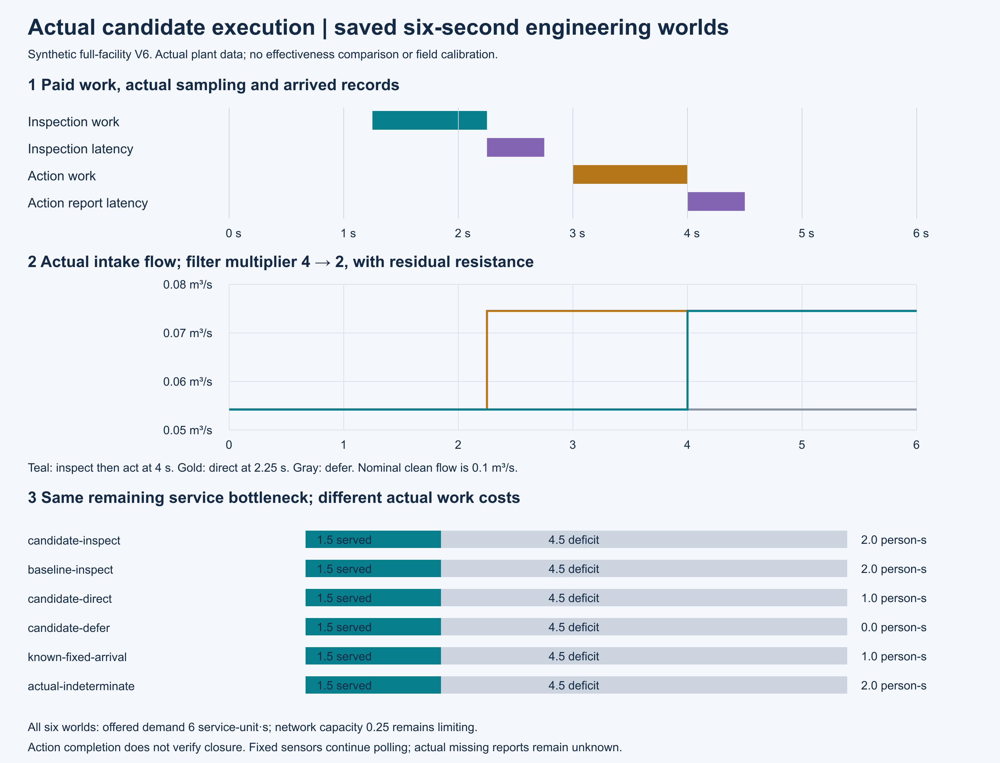
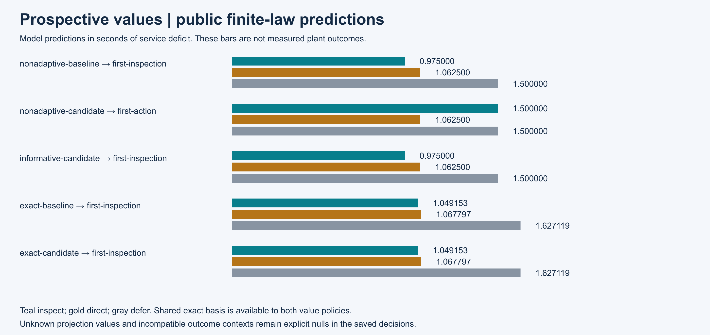
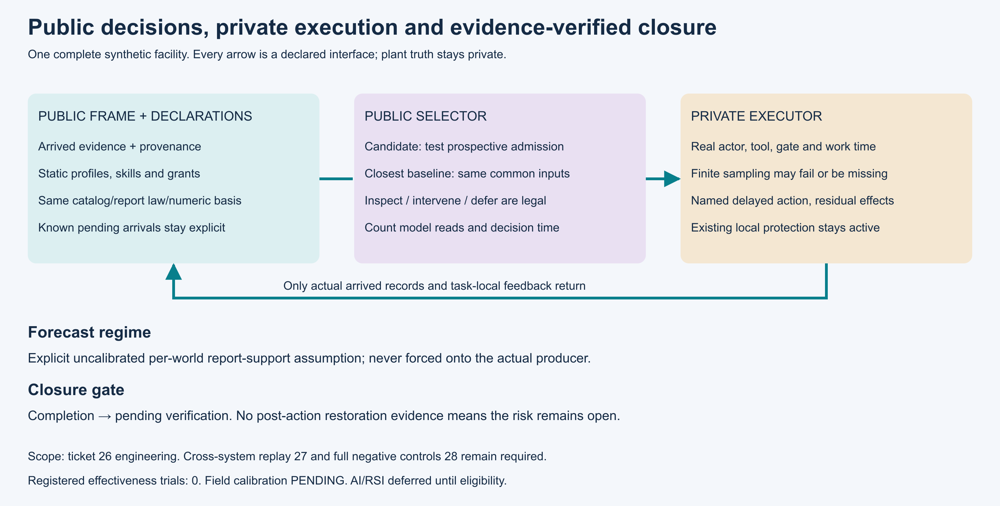

# 第26项根证据包：检查、直接处置与暂缓

实际集成源 `443747aea866d35376dad51a186994bb963eb7f5` 完成 564 项回归，零失败、零错误、零跳过；20份历史原件及278份Python/JSON源码身份核对通过。此包接受还待干净Git交付复核；当前不是完整研究目标完成。

候选在同一个八域合成设施中运行。10次独立公开选择及6次各6秒的实际设施运行全部保存，另有21个预定在线决策。检查在2.25秒采样、2.75秒到达，后续处置4秒完成、4.5秒反馈到达；滤阻4降至2，流量平方由1/340升至1/180。网络0.25仍是服务瓶颈：六个工况需求均6、交付1.5、缺额4.5。人员实际工作分别为0、1或2人秒；这些结果不构成方法优越性。

模型价值与实际结果分别展示。同一输入仅更换策略名称；两种价值策略共享概率、损失、人员工具及精确数值口径。当前候选检验预期报告是否会进入现有证据更新，允许检查、直接处置和暂缓。迟到或无法建模的报告保持未知，实际不适用测量保持缺失；错误认识造成的暂缓仍保留真实服务缺额。

实际状态和误差实现留在设施执行器。调度只读到时证据及静态声明；固定测点持续轮询，处置完成保持待复检。原V1协议未执行，审阅发现的两处验证工具缺陷和一个占用资源预期错误已通过显式V2修订处理；原V1源码、发现和协议保留。

开发的30个原调用目录另封存：16次确定完成、12次错误终态、1次覆盖拒绝、1次结果未知，26项历史输入/工具缺口明列。根完整回归共两次尝试：首次工具中断，没有终态与完整报告，已产生的18个在线夹具目录保留；第二次在同一源码新目录完成本页所述完整回归。两次根夹具原件及中断观察分别记账，不并入10/6/36冻结工程预算。所有失败与未知状态保持。

正式原件：`evidence/mainline/engineering/26-candidate/capture-20261107-02`；执行源 `35193647091f90d17c339976ae47ef69385e9a43`。本包含全部两轴审阅、源码守卫、实际运行日志、三张实际渲染并观看的图以及保存交付验证器。运行 `verify_packet.py --delivery-commit <commit> --output <new-json>` 只读保存字节和Git，不重跑设施或选择。

第27项跨系统闭环和第28项完整负例仍待执行，M4尚未完成。第30项前不运行效果研究，第38项前不启动AI/RSI；现场标定PENDING，完整研究目标持续active。
