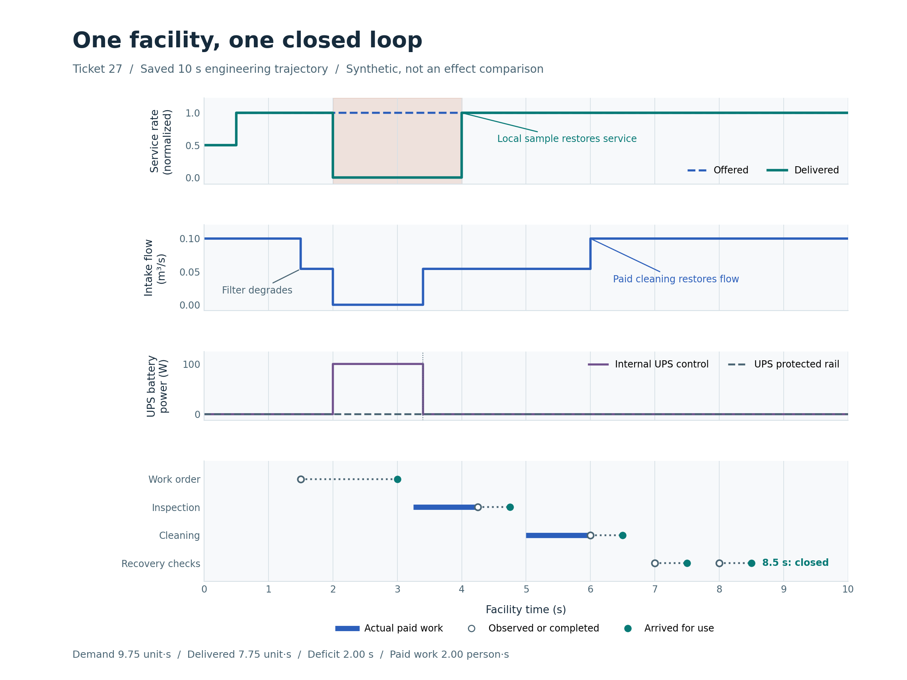
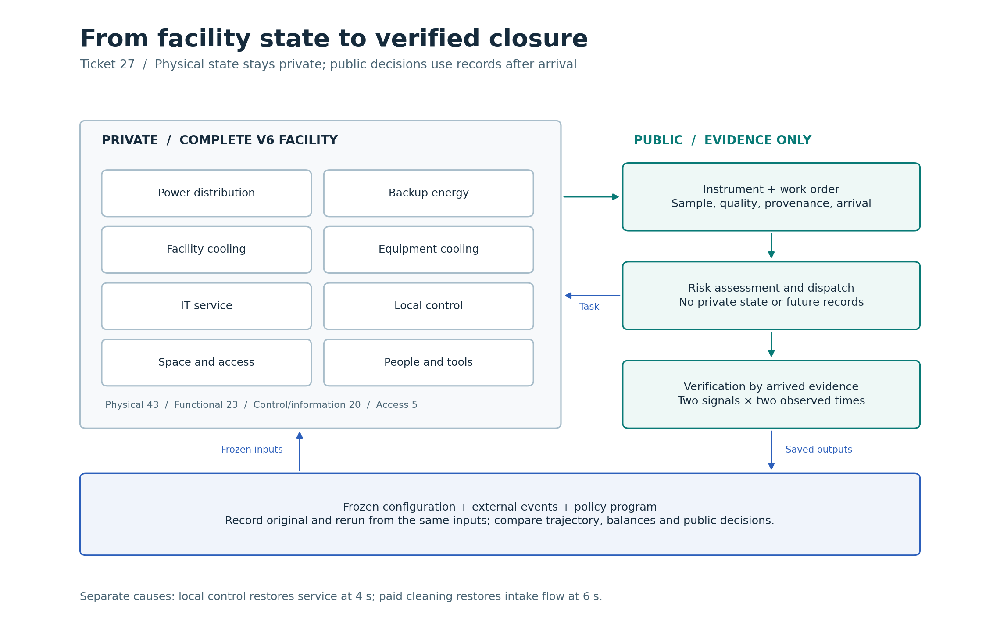

# 第 27 项：一套完整设施的跨系统闭环

在同一座郑州核心节点／曙光 8000 启发的**合成设施**里，设施在第 4 秒按当地控制规则恢复服务。人员到第 6 秒才完成滤网清理；风险到第 8.5 秒才由四条到达的实测记录核验关闭。三个时间点分别回答服务是否恢复、设备是否得到处置，以及证据是否足以关闭风险。

图 1。原运行保存的全场轨迹，1,016 个状态点、1,015 个积分区间。第 0.5 秒，外生服务需求从 0.5 升至 1；第 1 秒 UPS 进入维护，第 1.5 秒滤阻升高，第 2 秒电网失电。保护端在停供期间输出 0 W；UPS 自有控制电池仍供 100 W。第 3 秒工单才到达调度器，第 3.25–4.25 秒完成检查，第 4.75 秒读数到达。第 5–6 秒进行清滤，进水体积流量由约 0.0542 恢复至 0.100 m³/s。第 7、8 秒的流量和已交付服务读数，在第 7.5、8.5 秒分别到达。[矢量图](figures/27-actual-loop.svg)

| 从保存数据复算 | 原运行与重放 |
| --- | ---: |
| 外生需求积分 | 9.75 服务单位·秒 |
| 实际交付积分 | 7.75 服务单位·秒 |
| 归一化服务缺额 | 2 秒 |
| 实际检查和处置工作 | 2 人·秒 |
| 门禁检查 | 0.5 人·秒 |
| 整场能量残差 | 约 6.82 × 10⁻⁶ J |
| 最大质量残差 | 约 4.55 × 10⁻¹³ kg |

图 2。物理、功能、控制与信息、人员访问四类关系共用设施实体身份。当地保护使用本地状态；调度只接收已到达记录和声明的静态知识。稀疏固定传感器与历史、人工、工单、手持测量互补；本例派单依据是到达工单及随后取得的专业检查记录。私有轨迹留给设施和评估器。[矢量图](figures/27-evidence-architecture.svg)

首次 10 秒原运行完成，外层检查误把 UPS 内部控制耗电当成了保护端供电，记录为失败并保留。第三版协议先核对原件，再做唯一一次此前未执行的 10 秒同输入重放。未重做原运行。场景、私有轨迹和平衡账逐字节一致；完整运行记录各自核实 Git 标签后，只排除该标签和调度诊断耗时。两次合计 20 秒工程运行。[协议修订](../../../../docs/mainline/27-reserve-oracle-correction.md) · [首次失败账](../27-full-loop/capture-20261107-02/receipt.json) · [重放核对](../27-full-loop/capture-20261107-03/checks.json)

整合源 `a97d09eb19b7d64b38f2042075221627f9255fa7` 执行 567 项回归，零失败、零错误、零跳过；复核 20 份历史原件。两轴对保存数据的最终复核分别通过 402 和 373 项，未发现待处理问题。[整合日志](raw/tests.log) · [交付清单](declaration.json) · [独立审查原件](reviews.zip) · [验收记录](../../../../docs/mainline/evidence/27-root.json)

从干净检出运行 `python -B evidence/mainline/engineering/27-root-acceptance/verify_packet.py --delivery-commit <交付提交> --output <新文件>` 可核对保存字节、Git 身份、图表和冻结原件；该步骤不重跑设施或调度。此证据支持单一合成工况的有限工程闭环。第 28 项验证正常、误报、自动保护及来不及人工救援的情景；效果对照须等第 30 项冻结协议，现场标定仍待完成。
