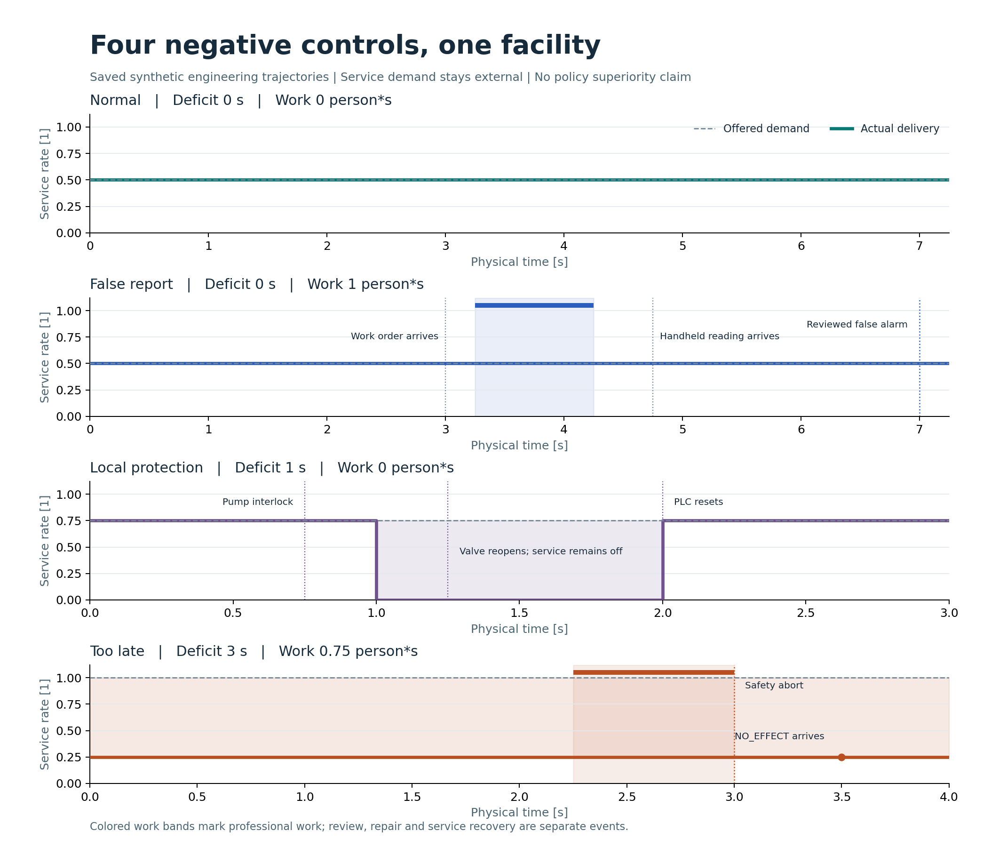
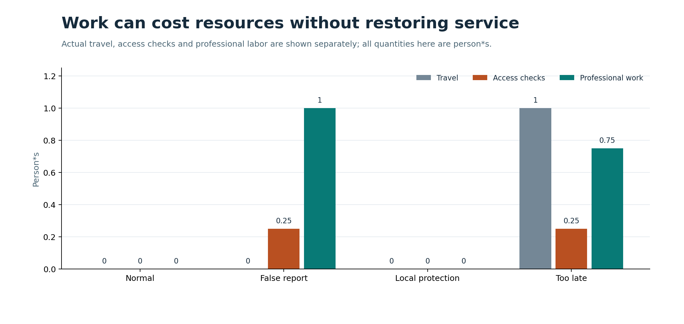

# 第 28 项：正常、误报、自动保护和来不及干预

四个工程案例在同一座郑州核心节点／曙光 8000 启发的**完整合成设施**运行。正常和误报共享全部物理条件：实际服务相同，只有误报消耗人工资源。自动保护案例的恢复由设施本地规则决定；太晚案例的中止保留已经付出的工时和未交付服务。

| 工况 | 需求积分 | 交付积分 | 归一化缺额（秒） | 行走／门禁／专业工作（人·秒） |
| --- | ---: | ---: | ---: | ---: |
| 正常 | 3.625 | 3.625 | 0 | 0 / 0 / 0 |
| 误报 | 3.625 | 3.625 | 0 | 0 / 0.25 / 1 |
| 自动保护 | 2.25 | 1.50 | 1 | 0 / 0 / 0 |
| 太晚中止 | 4.00 | 1.00 | 3 | 1 / 0.25 / 0.75 |

需求与交付积分的单位是服务单位·秒。归一化缺额为各时刻未满足需求比例的时间积分；例如太晚例四秒一直交付 0.25、需求 1，得到三秒缺额。[服务轨迹 SVG](figures/28-negative-service.svg)

**误报。** 工单第 3 秒才到达。人员在第 3.25–4.25 秒实际工作，手持读数第 4.75 秒到达。第 7 秒的授权审查用此前已到达的两条实际流量和两条实际服务记录，将疑点标记为误报已审查。设备没有被处置，这也不构成物理恢复。

**自动保护。** 第 0.75 秒阀门关闭，硬接线联锁停止内环泵。第 1 秒 PLC 采样锁止计算。第 1.25 秒阀门重开恢复流量，服务仍为零；第 2 秒本地采样满足原门槛后才复位。全程没有人工任务。

**太晚中止。** 工单第 1 秒到达。工人携工具走到门禁并检查，第 2.25 秒开始工作。最早完工应为第 3.25 秒；门禁在第 3 秒关闭并使工作中止。第 3.5 秒才收到 `NO_EFFECT`；第 3.25 秒的未确认状态和第 4 秒的处置失败状态都保留。网络瓶颈从未被移除。

[成本 SVG](figures/28-negative-work.svg) · [同一设施的八域架构与公开证据边界](../27-root-acceptance/figures/27-evidence-architecture.svg) · [四例保存核对](capture-20261107-04/checks.json) · [成功批次的终态](capture-20261107-04/receipt.json)

累计账包含最初失败的一次（7.25 秒计费上限，没有完整返回轨迹）和随后四次实际完成的运行（21.5 秒）。两张图来自保存轨迹和作业账。有限合成案例用于检查系统边界；效果比较和现场标定仍待后续独立证据。
