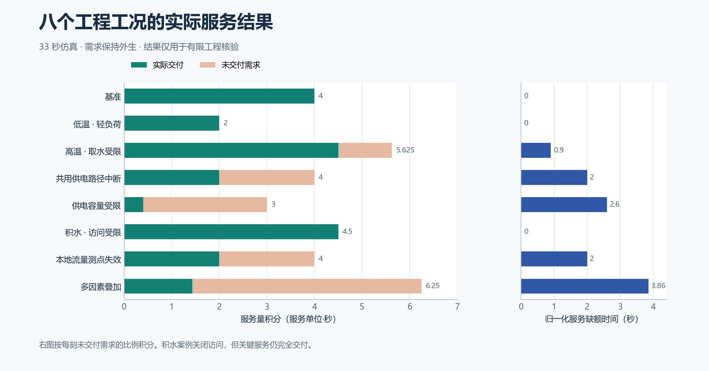
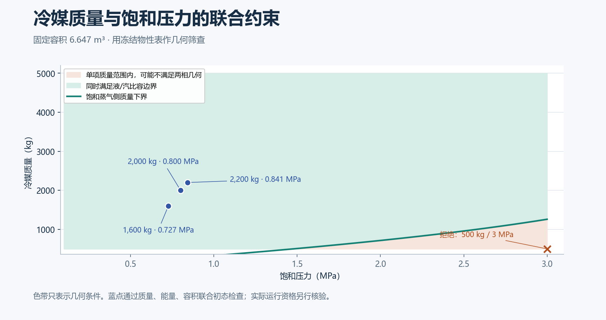
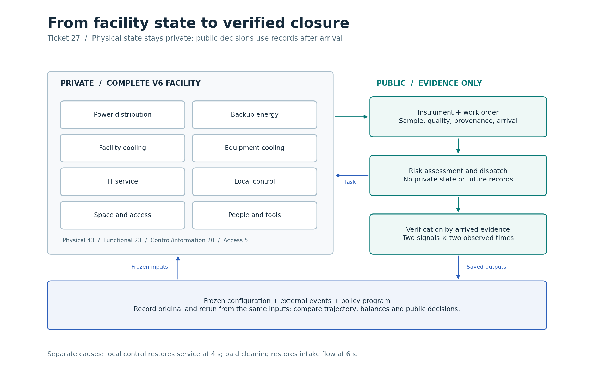

# 同一座合成液冷设施：八种工况的联合可行性

同一座八域设施在八种命名工况下各运行一次，共 33 秒仿真。工况在运行前固定；轨迹通过服务、守恒、热物性和事件边界检查。这里给第 30 项提供可复用的工程输入。现场标定仍待取证，当前没有策略效果试验。

[矢量数据图](figures/29-service-by-case.svg) · [可复算数据](capture-01/checks.json) · [冻结输入](prepared-01/cases) · [原始轨迹与守恒账](capture-01)

| 工况 | 窗口（秒） | 需求积分 | 交付积分 | 归一化缺额（秒） |
| --- | ---: | ---: | ---: | ---: |
| 基准 | 4 | 4 | 4 | 0 |
| 低温、轻负荷 | 4 | 2 | 2 | 0 |
| 高温、取水受限 | 4.5 | 5.625 | 4.5 | 0.9 |
| 共用供电路径中断 | 4 | 4 | 2 | 2 |
| 供电容量受限 | 3 | 3 | 0.401 | 2.599 |
| 积水、访问受限 | 4.5 | 4.5 | 4.5 | 0 |
| 本地流量测点失效 | 4 | 4 | 2 | 2 |
| 多因素叠加 | 5 | 6.25 | 1.429 | 3.857 |

需求和交付积分的单位为服务单位·秒。归一化缺额是逐时未交付需求比例的积分。共用供电路径在 1–2.5 秒中断，关键服务到 3 秒才恢复；独立的控制电池不算 UPS 向受保护负载供电。本地流量信号在 1 秒触发失效保护，2.25 秒恢复有效，3 秒在下一次本地采样时恢复计算许可。积水在约 2.5 秒关闭 IT 区访问，4.5 秒时达到 10.2 kg，关键服务仍完全交付。高温取水案例三段仿真记录的流量约为 0.1000、0.05423、0.05303 m³/s。

[矢量边界图](figures/29-phase-geometry.svg) · [来源与局限](../../../../docs/mainline/29-public-evidence-scope.md) · [联合初态契约](../../../../docs/mainline/29-uncertainty-domain-contract.md)

固定容积下，冷媒质量、能量和压力要使用同一组饱和物性。图中 500 kg、3 MPa 两个数分别合法，合用时没有该容积下的两相解；三枚蓝点是通过联合初态检查的输入。色带仅表示两相比容的几何约束。这次验收的对象是八条离散轨迹，现场冷媒、馈线、水力及人员数据仍列为缺口。

[八域架构矢量图](../27-root-acceptance/figures/27-evidence-architecture.svg) · [检查到核验关闭的完整轨迹](../27-root-acceptance/README.md)

物理、功能、控制与信息、人员访问四类关系共用设施实体身份。调度端只能取得声明的静态资料和已到达的记录。八组工况声明了不同固定测点覆盖；未覆盖位置保持未知。本轮不调度人员，也不生成观测记录，因此人员耗时和观测效用须另行比较。

[工程协议](../../../../docs/mainline/29-domain-engineering-protocol.json) · [执行账](capture-01/attempts.jsonl) · [原始失败及开发记录](development) · [独立复核和干净检出](review)
