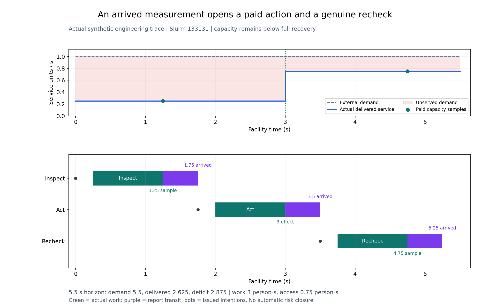
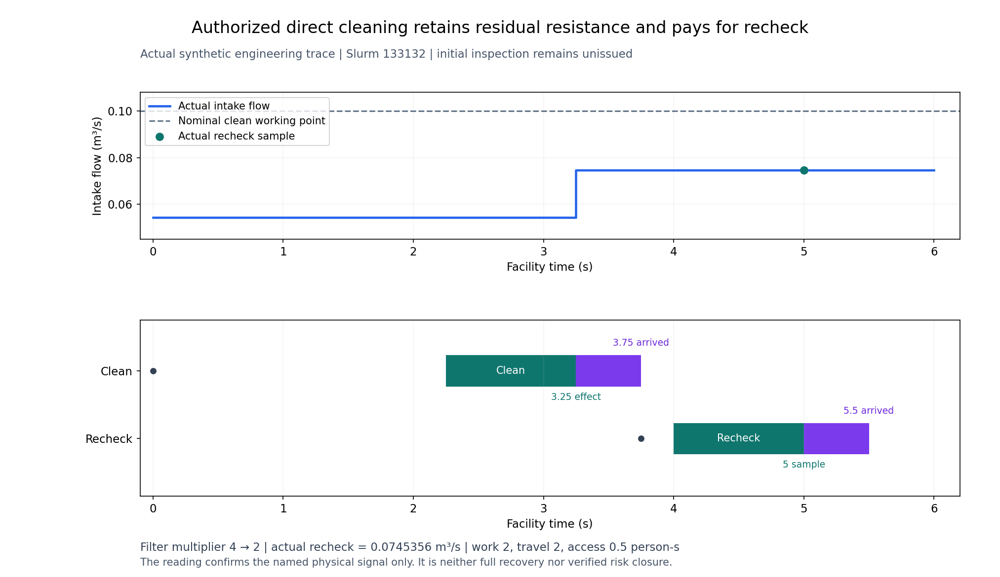
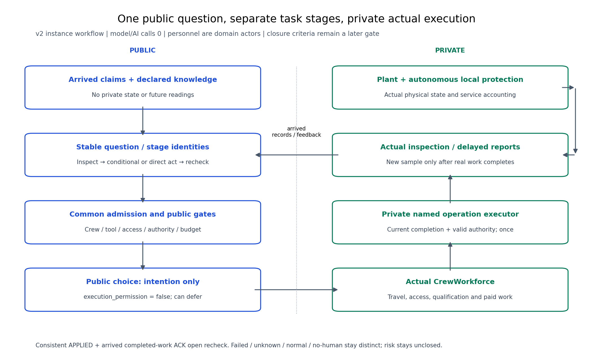

# 多系统问题如何变成实际检查、处置和复查

2026年11月9日开发检查点。按用户审阅建议，先完成[1–38跨阶段复核](../../../../docs/mainline/audits/20261109-integrated/review-report.md)，再补齐问题与任务覆盖，随后做业务端点和时间尺度；AI比较尚未开始。**本页是39b有限工程进展，整票仍待最终回归与新Git交付。**

|已经接上的行为|实际证据|
|---|---|
|工单触发专业检查|到时记录打开稳定问题实例；没有后台故障标签或固定全场巡回|
|供电与IT检查|不同专业/工具实际重叠工作，取得网络容量0.25及整流器输入212500000/97W；关联同一服务的路径仅为静态知识|
|副本、新工单与工具竞争|同源副本不增加问题；迟到工单有新槽位；共享表计未释放时不能派第二人检查|
|检查→条件处置→复查|网络先测0.25，3秒授权处置到0.75，4.75秒重新采样；费用、工时和未服务需求分别记账|
|直接处置及暂缓|直接清滤后再付费复查；正常/未知读数不处置；不派人工保留|
|处置失败与异步回执|完成时授权过期不生效；行动回执先到时等人员完成ACK，再派复查；过期初查不抹掉历史费用|

网络容量仍有残余缺额：5.5秒需求5.5服务单位秒，实际交付2.625、缺额2.875；工作3人秒、门禁0.75人秒。它证明这条工程链能执行，尚不是相对其他方法的效果收益。

清滤把阻力倍率4降到2，复查流量0.0745356m³/s，仍低于该工作点的名义0.1。初次检查没有发出；移动2、工作2、门禁0.5人秒照实计入。

人员是专业作业者。选择器只拿到时记录和声明知识，实际移动、资质、工具、访问、授权及本地保护仍由执行器检查；处置成功和复查报告均不自动关闭风险。新增问题的风险概率保持未知，不因八域已运行而宣称八域全部量化。

两个独立复核发现已分别修正，原件均在[复核包](reviews-01/README.md)：公开选择器原先未拒绝矛盾APPLIED回执；文档原“未实现”状态也滞后。保留[07红/绿](slice-07/README.md)及[08原失败与保存核对](slice-08/README.md)，没有把失败改成成功。

本阶段累计17次设施接口调用，13次完成原生时间窗（含08测试断言失败的完整原件）；直接公开选择调用6次，设施内部选择调用未单独插桩，返回决策43次。它们是不同记账分母，不是独立研究样本。详细轨迹留私有服务器，本地/GitHub只返回必要摘要、图和校验记录。原180次、主要NO_PRACTICAL_GAIN与现场标定pending保持。

接下来先完成39b最终回归和交付，再接39c业务端点/核验关闭、39d时间尺度和数值资格，之后才冻结原39的AI比较。当前已接受主线仍到38及39a；[清理报告](../../../../docs/maintenance/20261109-storage/README.md)保留删除类别、释放空间和远端存档核验。
