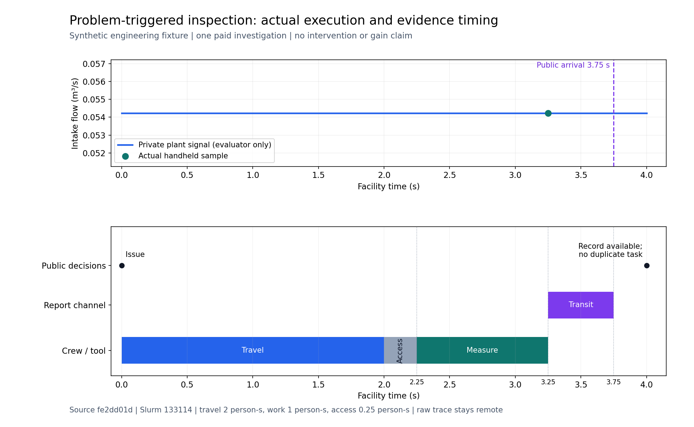
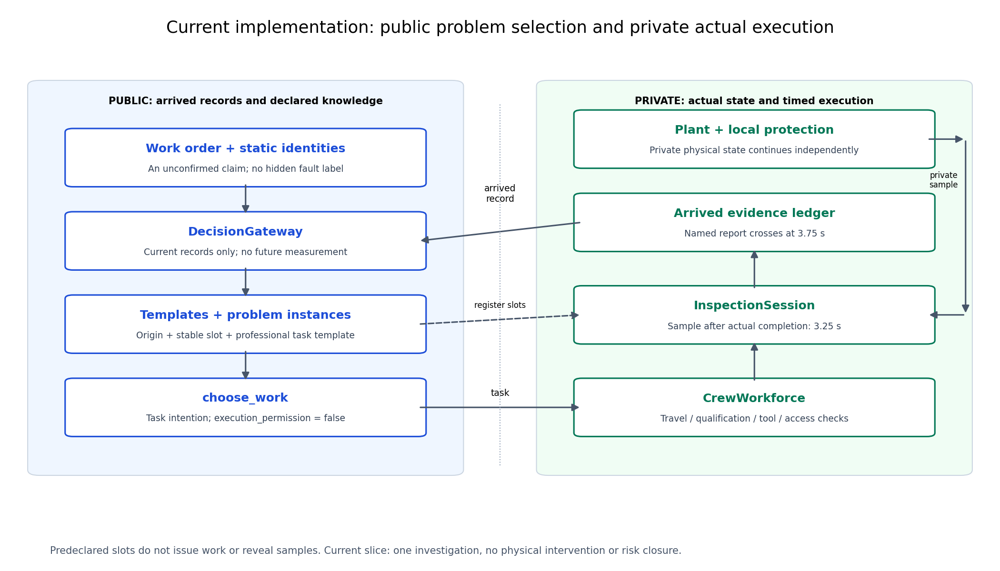

# 39b第二片：工单触发实际检查与证据到达

**真实人员和手持测量已经接通；39b仍在开发，尚未接受整票。**

|记录|Slurm作业|终态与范围|
|---|---|---|
|[03原失败](03-red-execution/terminal.json)|133111|FAILED1:0；输入漏登记既有访问限制通道，未触达预期的任务目录缺口|
|[04修订红片](04-red-execution-v2/terminal.json)|133112|预期的候选目录缺口得到确认；1项测试报错原件保留，工具正确记EXPECTED_RED|
|[05修订绿片](05-green-execution-v2/terminal.json)|133114|相同修订输入与独立预期下1项测试通过；实际设施演化4秒，作业COMPLETED0:0|

[原协议](../../../../../docs/mainline/39b-development-slice-02.json)与[显式v2修订](../../../../../docs/mainline/39b-development-slice-02-v2.json)分别保留。v2累计预算3次设施入口，包含原失败，不是额外3次；原04-green没有提交，被修订取代。唯一输入修正是补齐已在公开名义模型声明的source/observable，物理模型、测量程序、时序和独立预期不变。另有一次只读回传脚本错误，与实验失败分开记录；没有因此重启作业。

绿片执行源`fe2dd01dc84f79d39c9049331b9d437b7604b95e`，远端实际Git HEAD和所有源码/输入/工具前后守卫一致。1CPU/1GiB、Slurm整秒时长3秒；单元测试墙钟2.829秒，与设施内4秒时间分开。

|实际事件|设施时间/结果|
|---|---:|
|工单到达并派出冷却专业人员|0秒|
|移动/门禁核查后开始作业|2.25秒|
|完成1秒测量并采样|3.25秒|
|报告到达公开证据端|3.75秒|
|下一决策可见测量，同实例不重复派工|4秒|
|实测流量|0.05423261445466404m³/s，与独立sqrt(1/340)见证一致|
|移动、作业、门禁核查|分别2、1、0.25人秒|

[必要运行摘要](05-green-execution-v2/actual-run-summary.json)和[私有原件哈希索引](05-green-execution-v2/private-raw-index.json)已回传；约4.7MB的原生场景、逐步状态、守恒账和运行包保存在服务器，未复制回本机。公开首帧没有未来测量，4秒帧才有；检查没有清滤或改变设施能力，也没有关闭风险。

本片三次设施入口不计作新效果试验；原180次研究原件和结论保持。内部选择调用未单独插桩，返回的2个决策与调用前上限分别报告，不将返回帧数冒充新的独立统计单位。复发/复制/迟到、多系统竞争、处置及复检仍待后续行为验证。

实际数据图与架构图（服务器保存数据绘图作业133117/133119，未重跑设施）：

蓝线为评价器私有的实际流量，绿点是3.25秒完成作业后取得的测量；3.75秒以后才进入公开证据。下图分开标出意向、实际人员执行、物理采样与到时发布。

[SVG与PNG、绘图CSV和源清单](figures-02/plot-summary.json)保留可复算关系。首版左轴标签边缘问题及原图保留，第二版两张PNG已实际查看通过，CSV字节相同；原生SVG的路径属性空格按四个确切文件单列分类，原字节和哈希不变。
