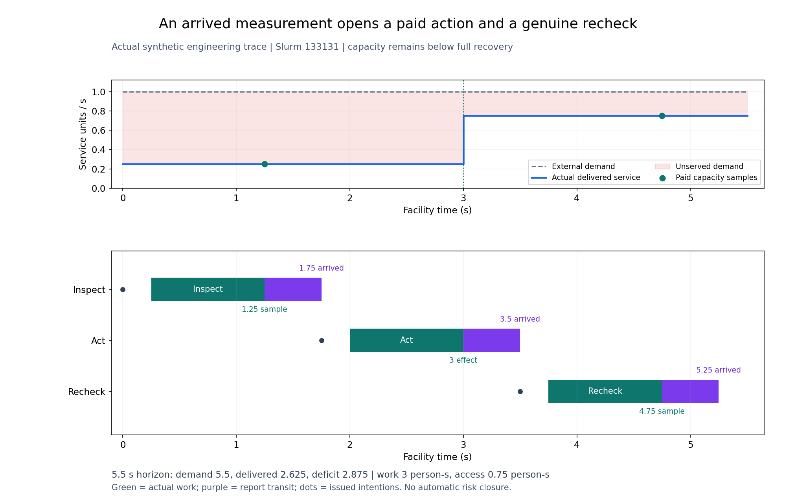

# 多系统动态任务：根回归与交付数据

实际源`4f80bb35480bf633a777ab34d30a8573ea0734f0`，Slurm133145：**609/609全部执行、零失败/错误/跳过**，20份历史原件与源码前后守卫通过。完整工程回归5分47秒，在服务器隔离环境执行；本数据包还须完成独立新Git交付核验，最终接受记录另列。

|现在能实际执行|验证结果|
|---|---|
|多系统专业核查|冷却、供电、IT测量使用实际资质、工具、行走和工作；静态共同服务路径不冒充容量或风险概率|
|工单到任务实例|同源副本不重复；迟到新工单保留稳定身份；共享工具实际占用会限制第二个任务|
|检查、条件/直接处置、复查|网络读数0.25→授权残余0.75→实际复查；直接清滤保留剩余阻力，不执行未派初查|
|负例和时序|正常/未知读数暂缓、no-human合法、完成时授权过期不生效；行动回执先到时等待工作完成ACK|
|公开边界|矛盾APPLIED被拒绝；后台真值不进选单，检查、处置生效与核验关闭分开|

[三张实际数据/架构图与开发对照](../39b-development/README.md)包含清滤残余流量与公开/私有执行架构。移动、工作、门禁、研究费用及保守准入包络分别记账；任何阶段均不自动关闭风险。

首次根回归133143有609项、1项失败，完整保存在[attempt-01](attempt-01/terminal.json)。旧稳健性公开CLI曾被当前源码调用，正确触发原封存守卫；测试现到真实冻结源检查原契约，全部断言和守卫不变，[09定向资格](../39b-development/slice-09/README.md)通过后才执行新根协议02。08的错误枚举断言原失败及其单独保存核对同样保留。

原180次研究、主要NO_PRACTICAL_GAIN和已接受报告保持。这里接受的是有限合成工程链路；39c业务端点/核验关闭、39d尺度与数值资格及后续AI/RSI增量仍待完成，现场标定pending。完整源码、依赖和详细输出留在私有服务器；本包只交付必要摘要、原日志、数据图及身份核对记录。
