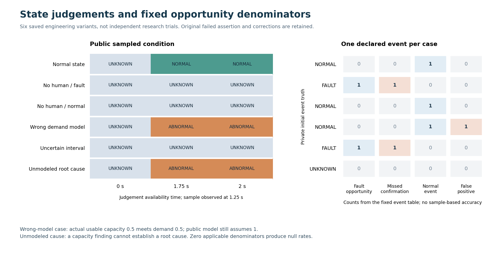
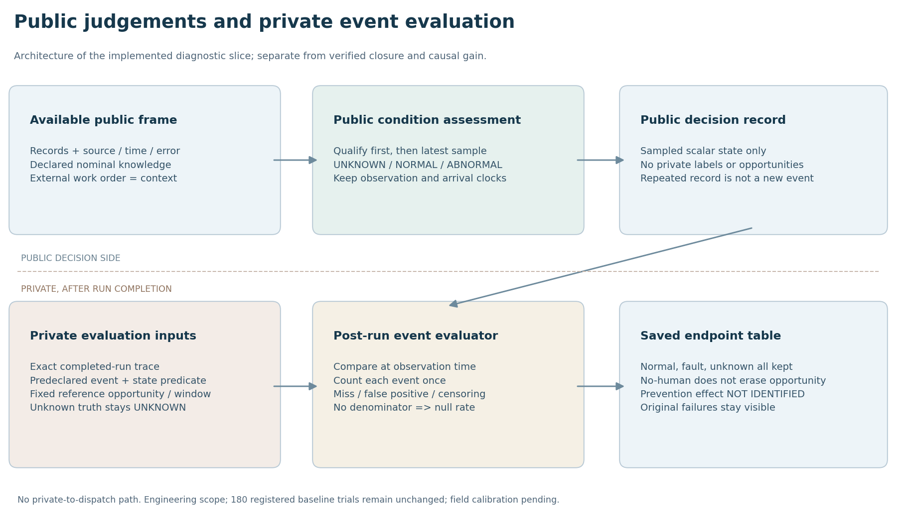
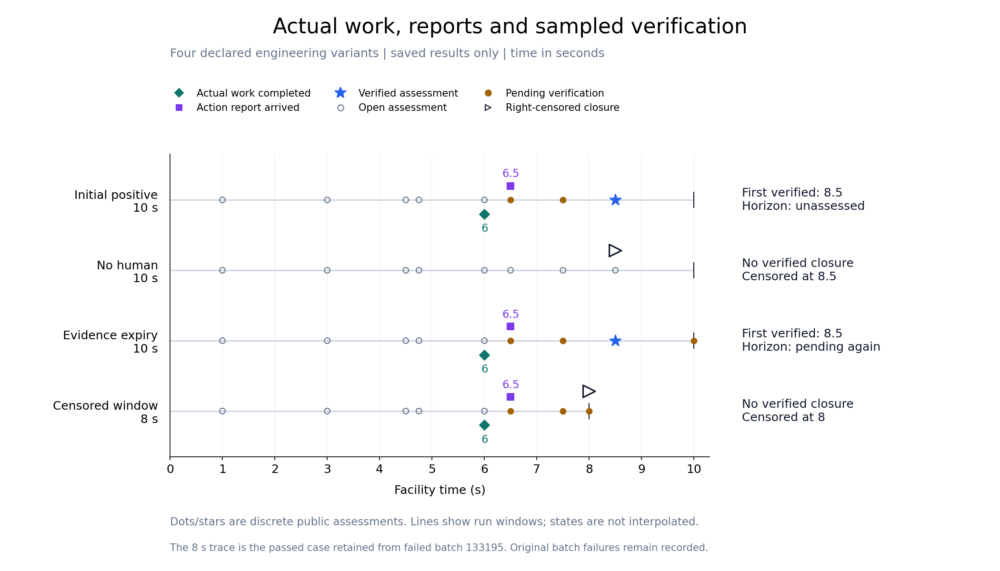
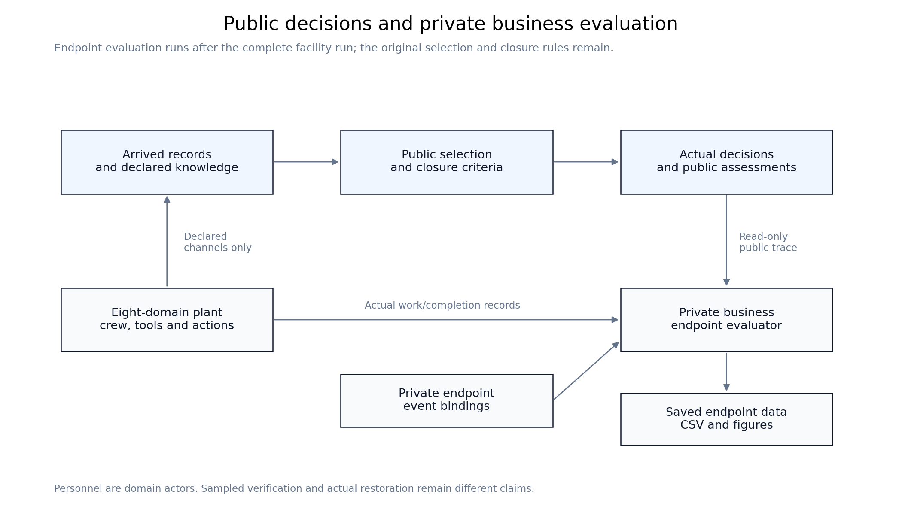

# 业务评价开发：从状态确认到证据关闭

**39c已接通实际关闭时刻、公开状态判定和固定事件分母，整票仍在开发。** 新增六个实际工程场景；无人工和不确定读数不会消除预先固定的故障取证机会，未建模根因保持未知。原180次研究、NO_PRACTICAL_GAIN与所有失败保持，未新增AI或效果研究。

左侧只依据已到达证据，右侧在运行后用私有真值核对。六例各声明一个事件，不能当成六个独立确认样本。工单本身不等于故障；未建模根因不能由容量异常读数推断。适用分母为零时，率为null；图中零仅表示明确的事件计数。

|实际工程场景|到达证据下的结果|完整事件表|
|---|---|---|
|正常|专业测量到达后判正常|正常事件1，误判0|
|无人工／故障|三个决策时刻均未知|本例冻结的故障取证机会1，未按时确认1|
|无人工／正常|公开帧与上一故障世界完全相同|正常事件1，误判0；私有真值不回流|
|需求模型故意设错|实际容量0.5满足需求0.5，公开模型仍假设1而判异常|正常事件1，误判1；重复判断不重复计事件|
|误差区间跨阈值|点值0.25但误差界1，保持未知|故障机会1，未按时确认1|
|未建模根因|可判断容量状态，不能确认故障原因|根因真值未知1，两种适用率均null|

公开侧先筛质量、来源和同刻冲突，再选最新合格观察，保留观察与到达时刻。较新但无误差界的数值记录不会抹掉仍有效的旧样本，也不会让旧样本变新。私有事件、真实轨迹及共同参考机会仅用于运行后评价。

状态首片[133254／133264](slice-03/README.md)及[六例原运行133274](slice-04/README.md)均保留；后者5项测试4通过、1项预期值断言失败，原状态仍FAILED，六条轨迹未重跑。实际受供电／需求限制的容量是0.5，原断言误写铭牌0.75；[保存纠正](slice-06/README.md)单列。

独立复核发现并纠正了[公开样本资格顺序](slice-05/README.md)与[保存核验工具优化模式门禁](slice-07/README.md)，均有冻结红绿及原始失败。原133280模式未记录的边界保留；新133282正常子进程明确记录模式0并核对44件原输出。图形133292原间距问题留档，133293只修数据图，CSV字节相同，当前两张新图均已实际查看。

点和星号表示各次实际公开评估，灰线只标运行窗口，不代表两次评估之间状态持续不变。无人工和8秒窗口没有观察到关闭，首次关闭/延迟保持null；过期例保存8.5秒首次关闭，也保存10秒当前待核验。四个工程变体共用合成设施基础，不作为四个统计独立研究样本。

人员是设施域中的作业者，评价器在设施运行结束后读取实际工作和已生成的公开评估。上述关闭程序适配稳定风险问题；新增状态程序另有固定的正常／故障／未知事件表及确认分母。39b动态实例关闭、迟到／过期／复制／冲突、不可检测和来不及、提前量及完整成本仍须后续切片。预防因果效应保持未识别，不填零。

|记录|实际结果|
|---|---|
|[首个红/绿](slice-01/README.md)|133147保留接口TypeError；133150完成10秒、8次返回决策，观察6/6.5/8.5秒端点|
|[边界资格及原失败](slice-02/README.md)|133194零测试失败；133195两输入错误、8秒例通过；133223只执行修正两例并通过，17次返回决策|
|Spec复核|首片55ef及纠正24f分别静态PASS，范围各自固定；[原件](reviews-01/slice01-spec/report.md)、[纠正](reviews-01/qualification-correction-spec/report.md)|
|Standards复核|首片及纠正分别静态PASS，保留原pin，不接受整票；[原件](reviews-01/slice01-standards/report.md)、[纠正](reviews-01/qualification-correction-standards/report.md)|

39c开发累计15次设施接口进入、11个完成时间窗／52秒、54个返回决策；另有2次直接公开状态判定、保存工具和绘图作业，分别记账。失败未返回部分不当作完成时长。LLM、训练与新增注册研究均0，内部预测／选择调用未插桩。运行和绘图使用远端Slurm；本地只编辑、传输、核对和看图，完整轨迹及实际输入留在既有私有服务器。

独立复核按固定版本保存：[最初发现](reviews-02/spec-report.md)、[样本纠正](reviews-03/spec-report.md)、[工具原发现](reviews-03/standards-report.md)、[工具关闭包](reviews-04/standards-report.md)，不覆盖旧发现。新诊断检查点4f2977bb实际CI42548898914成功：621项中执行619项，零失败／错误，2项既有可选神经检查跳过。实际回执、192件固定版本交付清单和完整日志见[检查点记录](../../../../docs/mainline/evidence/39c-diagnostic-checkpoint.json)。这是最小云端回归，不替代整票零跳过根验收。

[六例审计CSV](slice-07/10-saved-verifier-mode-green/outputs/normal-child/original-six-endpoints.csv) · [新绘图数据](figures-03/12-saved-diagnostic-matrix-layout/diagnostic-plot-data.csv)。下一步仍是39c剩余业务语义与动态关闭，之后整票独立复核、远端根回归及fresh交付；39d和新的AI比较保持依赖。

[数据表](figures-01/endpoints.csv) · [逐时评估](figures-01/assessments.csv) · [冻结契约](../../../../docs/mainline/39c-closure-endpoint-contract-01.md) · [完整39c任务](../../../../.scratch/full-facility-mainline/issues/39c-business-endpoints-and-closure.md)。本页为开发检查点，主线及M7保持active，39d和新的AI比较尚未开始。
