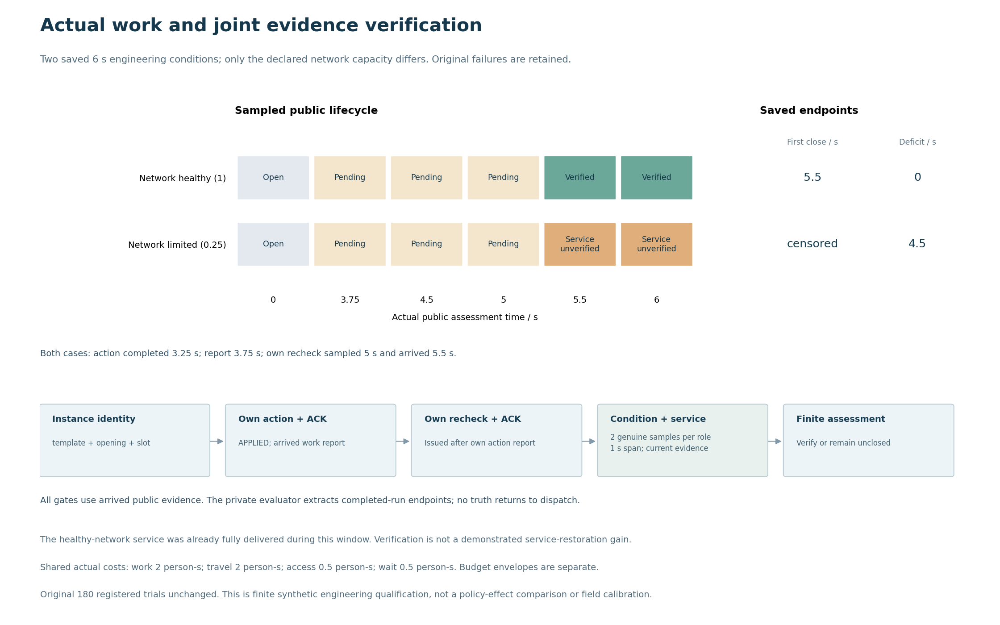

# 实例关闭：设备与服务证据共同核验

**同样完成清滤和本实例复检，健康网络例在5.5秒关闭；网络容量仍受限例保持待核验。** 两个6秒工程工况仅改变network_service_capacity：1与0.25。它们检验联合证据门槛，不是方法效果对照或独立研究样本。

[端点CSV](../figures-05/22-saved-instance-closure-figure/instance-endpoints.csv)与[12个实际评估CSV](../figures-05/22-saved-instance-closure-figure/instance-assessments.csv)由只读保存结果的Slurm133379生成，原输入/输出身份前后核对，PNG已实际查看。方格是各时刻实际评估，不表示两点之间连续状态。

|实际端点|网络健康1|网络受限0.25|
|---|---|---|
|清滤实际完成|3.25秒|3.25秒|
|行动报告到达|3.75秒|3.75秒|
|自己的复检取样／到达|5／5.5秒|5／5.5秒|
|两条条件样本／两条服务样本|4、5秒取样，4.5、5.5秒到达|相同时标|
|最早满足有限关闭|5.5秒|null，6秒观察窗右删失|
|6秒当前评估|VERIFIED_CLOSED|SYMPTOM_RETREATED_PENDING_VERIFICATION|
|标准化服务缺额时间|0秒|4.5秒|

健康网络例在本窗口内原本已交付服务；5.5秒是核验关闭端点，不能归为清滤创造的服务收益。受限网络例的冷却读数与自己的复检合格，但服务读数不合格，关闭不会借用冷却修复结果越过服务门槛。两类支持仍要求至少两条真实样本、1秒跨度、当前有效、合格来源/误差和无阻断反证；问题概率仍为null，不编造跨图因果路径。

两例实际各付出作业2人秒、移动2人秒、等待0.5人秒；门禁核对0.5人秒是全部等待的子项，不能另行相加。图和CSV逐项列出原字段，未对重叠量求和。准入账中的16.25 person_s／16.25 tool_s／2合成费用单位是预留或发出量，另行保存，不冒充这些实际工时或人民币费用。

唯一资格作业133378，执行源码`8eeef6b724a130dad12fb21cfe8bf68c46ec47f5`：2项测试、2次设施进入、2个完成原生窗口共12秒、12次返回决策，零失败／错误／跳过。所有运行源在前后守卫中一致，两例各45个实际运行文件身份与manifest匹配。原件在[唯一目录](21-instance-service-qualification/)。[完整实际输入身份](21-instance-service-qualification/case-input-identity.json)是取回时的独立身份说明，确认只差一个网络参数；受限例242997字节／d959880e…与原133377生成输入一致，原轨迹与完整输入仍留私服。

[Spec](../reviews-07/spec-report.md)与[Standards](../reviews-07/standards-report.md)按固定8eeef分别保存事前静态复核；随后[Spec结果交接](../reviews-07/spec-result-handoff.md)与[Standards实际原件复核](../reviews-07/standards-actual133378-report.md)另存，不把事后结果回填到事前记录。16原失败、17未提交、18新预算均保留。

跨实例借用、证据失效/来源、无人工与授权处置、风险接受/升级、提前量、完整成本和联合版本重放仍待资格。整39c未验收，零跳过根验收和fresh交付尚未执行；原180次及主要负结果不变。
