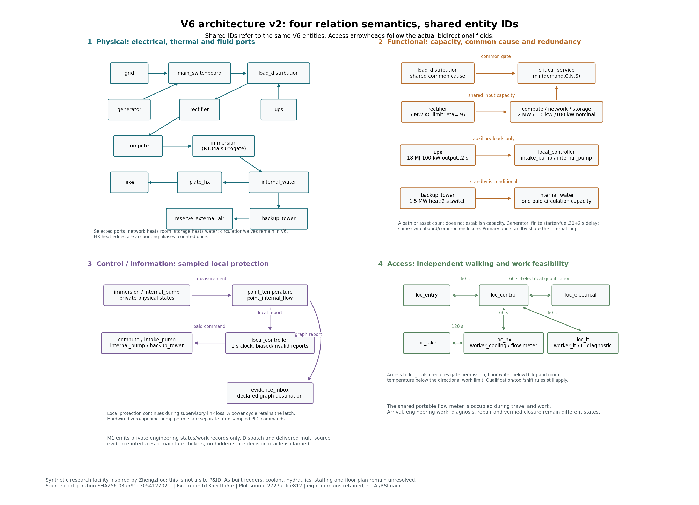
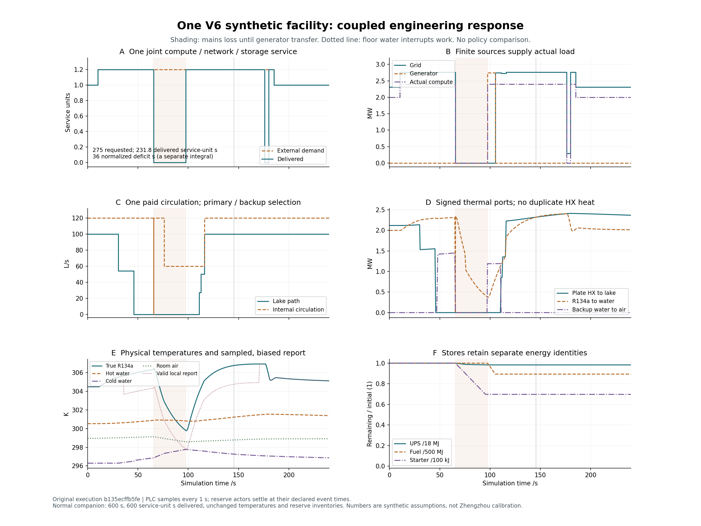
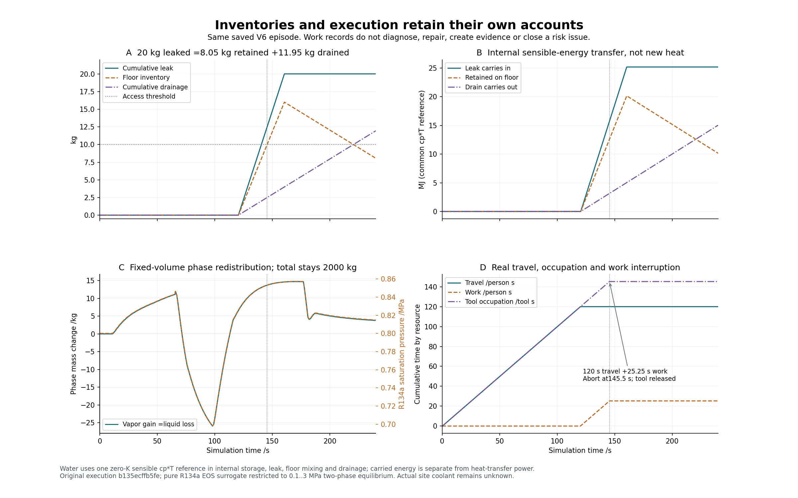

# M1：同一完整设施的八域可运行工程基线

M1 已由根接受。同一 V6 配置保留八个行为域、共享实体和四类关系；600 秒正常工况、17 个工程场景、129 条独立预期及3个拒绝输入均通过复核。根完整验收 **306项全部执行，零失败、零错误、零跳过**，20份历史原件有效。

这是郑州参照的合成研究设施。M1交付可运行的工程基线与有限算例验证；现场标定、数值/步长资格、证据驱动检查处置和独立方法比较继续在后续阶段进行。

## 当前联合架构



物理、电热/流体接口，功能/容量依赖，控制/信息关系，以及通行/作业条件分别绘制，共用相同实体身份。图中展示选择的声明边，37条关系的ID由[图收据](../11-coupled/architecture-v2-01/facility-architecture-v2.json)展开。访问边按原数据画双向；容量、共因、切换和实际供电共同决定备用能力。

[可编辑SVG](../11-coupled/architecture-v2-01/facility-architecture-v2.svg) · [八域反例与公式](../../../../docs/mainline/11-coupled-acceptance.md)

## 同一配置的组合响应



240秒场景同时包含负荷、滤阻、冷源切换、市电中断、自主发电机接管、传感偏差/无效、失联恢复及工程作业。累计需求275服务单位·秒、交付231.8，归一缺额时间36秒。市电中断后的32秒和通道无效后的4秒分别按当时需求归一；未服务工作43.2服务单位·秒与缺额时间使用不同账。

600秒正常配套案例交付600服务单位·秒，热状态及UPS、启动电池和燃料库存保持该研究工作点。17个成功案例从同一V6派生，实体和四图不变；SI参数覆盖、事件及其来源说明全部保留在[冻结runbook](../../../../docs/mainline/11-coupled-runbook.json)。

## 库存、携能与人员成本



20 kg热水泄漏对应11.95 kg排水和8.05 kg剩余积水。水的储能、漏入和排出使用同一数学 `cp*T` 参考；携能MJ与传热功率MW分开。纯R134a数值替代工质保持固定体积和2000 kg总质量，相间重新分配不创造质量或额外潜热。

积水在145.5秒达到10 kg研究访问阈值，停止已到场的作业。账中保留120人秒行走、25.25人秒工作和145.25工具秒占用。当前是有限工程作业记录；专业检查结果、维修效果与恢复核验由后续闭环实现。

## 根审查与可复核身份

[根收据](receipt.json) · [原始306项验收](acceptance-145cd8c1/summary.json) · [根实际交付读回](root-delivery/command-receipt.json) · [M1逐项接受表](../../../../docs/mainline/evidence/M1.json)

|记录|实际身份|
|---|---|
|工程运行与原绘图工具|`b135ecff`|
|原数据交付|`1625764d`|
|架构修订作者|`2727adfc`|
|修订图交付|`eb5df8e8`|
|根代码/完整验收|`145cd8c1`|

原包125份声明原件、1272状态点和1255区间，以及修订图3件产物、37关系、5条双向访问边，都在根按Git与实际字节核对；不依赖运行缓存。作者原306收集/304执行/2个可选Torch跳过的记录保留，根随后独立执行了全部306项。

[Standards源审查](../../../../docs/mainline/reviews/11-standards.md)、[最终交付审查](../../../../docs/mainline/reviews/11-delivery-standards.md)和[Spec审查](../../../../docs/mainline/reviews/11-spec.md)记录了纠正过程：双向访问边的图语义问题已用独立版本关闭，旧图、工具和交付不改；原生CRLF的属性分类也已关闭。作者手算草稿和读回器字段解释的失败另行保留，未追认为运行器修复。

作者交付时的candidate和初始pending-delivery状态是历史记录；当前接受状态以根M1收据和[progress](../../../../docs/mainline/progress.json)为准。方法效果试验、训练、LLM研究调用均为0，AI/RSI增量未建立。

当前联合配置的公开运行入口（使用新的输出目录）：

```bash
python -m aegis_dc simulate --model configs/full-facility-mainline-reserve-v6.json --duration 600 --output runs/a-new-v6-engineering-run
```

后续主线进入12数值资格与13外生/行动来源重放，再推进证据、风险、异质检查处置、独立比较和条件式增量审计。总目标保持进行中。
