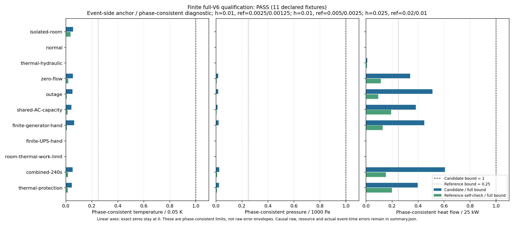
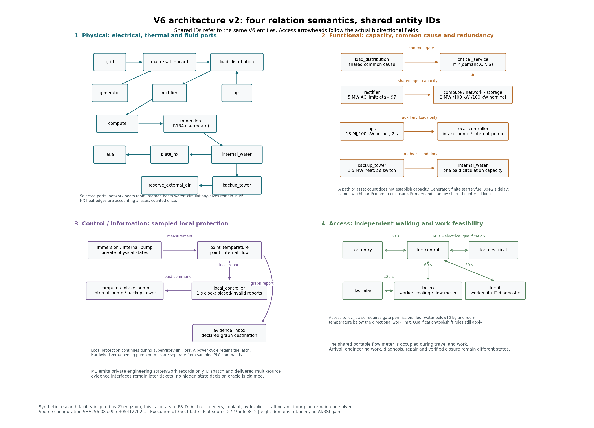

# M2 根接受：有限数值资格与可追溯重放

M2 已按同一 V6 合成设施接受。实际统一回归源为 `bcacbf78e4f071acd0a130c8dec85f5c95e4cc73`：359 项全执行，失败、错误、跳过均为 0；20 份历史原件通过，156 份 Python 源码和 HEAD 前后守卫一致。两项原可选 Torch 单元检查实际执行。原作者的 317/315、cf9 的 345/343 保留其原执行身份。

## 数据图与架构



图来自数值作者的最终原件。指标是事件侧锚点／相位一致对齐，并保留闭区间振幅；同钟因果 raw 差异和实际事件时差另列。它不是未保存真轨迹的误差包络，也不是连续参数域保证。



架构图保留原物理执行 b135、绘图源 2727 和 visual delivery eb5 的身份。物理、功能／容量、控制／信息及访问关系共用实体 ID；它不是现场 P&ID。

## 本次接受的内容

- [12 根权威](../../../../docs/mainline/evidence/12-root.json)：11 个声明工况、102 个原 ZIP／408 成员／306705 状态和 5 个实际执行身份。原 NO-GO、失败、表示边界与拒绝保持公开。
- 下一阶段显式选择最大步长 `.01 s`。五个旧工况仍采用 `.025` 对 `.02/.01` 的原阶梯；四个细化工况采用 `.01` 对 `.005/.0025`；两个进一步分辨工况采用 `.01` 对 `.0025/.00125`。五个旧工况没有新增更细的 `.01` 参考；各见证按其冻结阶梯解释。
- [13 根权威](../../../../docs/mainline/evidence/13-root.json)：外生需求／天气／故障与工程命令分开；版本、生命周期、请求实际时长／步长、区间时间轴和解释器身份受检。新 capture-05 有 4 个完成请求和 3 个真实 CLI 拒绝，26 项局部目标通过，作者本修订未运行全套。旧 01/02/04 和 pending receipts 不改写。
- 四轴最终评审分别保存在惰性 ZIP：[12 Standards](reviews/12-standards.zip)、[12 Spec](reviews/12-spec.zip)、[13 Standards](reviews/13-standards.zip)、[13 Spec](reviews/13-spec.zip)。[成员清单](reviews/preservation.json)记录每件字节数、SHA 和来源；ZIP 中的脚本、属性或探针不被解压为活动代码。
- [根原始日志](raw/tests.log)、[结果](raw/summary.json)、[源码守卫](raw/source-guard.json)、[初始收据](receipt.json)及[声明集合](declaration.json)保存实际证据。

## 有限源桥接

数值运行时身份为 16 项，重放运行时为 18 项，两者完整身份不同。8e→cf9 的六个旧定义（含整个 `_Plant`）相同，公共运行入口的命令来源、日志和输入 manifest 有变。旧 5bc 的 combined-240s/h1 与 cf9 同工况的参数赋值并集、作业、时长和步长一致；scenario、state、balance 三件逐字节相同，summary／work records 一致。[AST 桥接](bridges/physical-kernel.json)与[保存字节桥接](bridges/combined-raw.json)只支持这一有限对应，不扩为整个运行时相等或绝对误差界。

## 只读复核与下一入口

在封装提交的新 checkout 中运行以下定点校验，输出另用新路径；它只读 SHA／Git blobs、ZIP 成员、状态和有限桥接，不调用模型或全套测试：

```powershell
python -B evidence/mainline/engineering/M2-root-acceptance/verify_packet.py --delivery-commit PACKET_COMMIT --output NEW_PROOF.json
```

需要新工程轨迹时显式选择受述范围内的 V6／步长，并使用新输出目录；本封装没有执行该命令：

```powershell
$env:PYTHONPATH = 'src'
python -m aegis_dc simulate --model configs/full-facility-mainline-reserve-v6.json --step .01 --duration 10 --output NEW_OUTPUT_DIRECTORY
```

兼容 CLI 的 v2／h=1 s 默认保留原适用域；M2 数值入口显式使用上述 V6／.01 参数。原 05 verifier 在其历史 8ac checkout 验冻结属性；当前根 union 单独见证，不能冒充旧输入或任意跳过哈希。

[M2 权威与范围](../../../../docs/mainline/evidence/M2.json)接受的是声明的有限工况和方法。现场标定 pending；注册效果研究、LLM／训练、AI／RSI 增量均未启动。下一主票 14 为多源证据账，尚未分配；主场景存在稀疏固定传感器，允许历史／人工／工单／手持资料，后台真值不自动交给调度。M2 不是整个研究目标完成。
