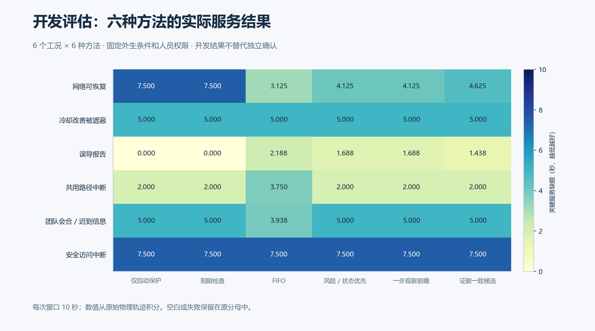
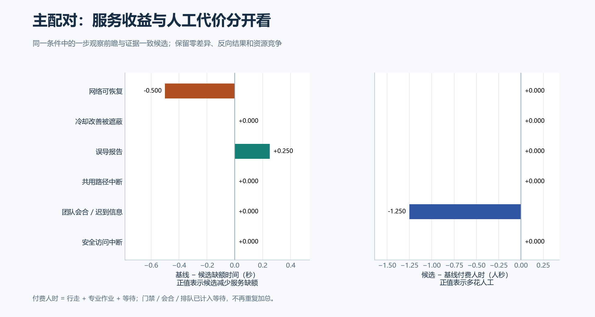
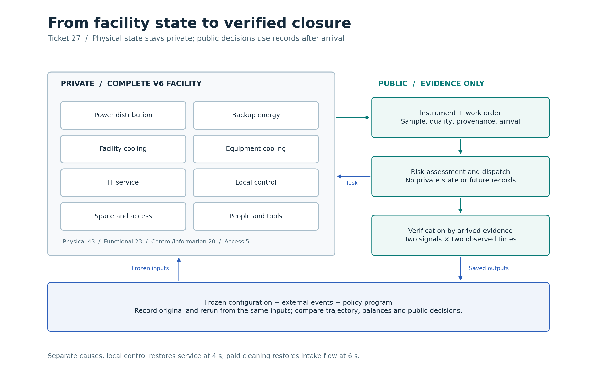

# 第 31 项开发评估：检查信息何时有用、何时拖慢处置

六个公开开发工况、六种方法共运行 36 次，360 秒仿真；全部返回，无重试。主配对是一步观察前瞻与证据一致候选。同一工况共用物理、人员工具、需求、到达记录和行动设置，只改变策略名。

这轮没有显示候选的平均服务优势：主配对平均改善为 **−0.0417 秒**，即候选多损失约 0.042 秒。这个平均值只描述六个开发条件，独立确认尚未运行。候选少花人工的结果与服务结果分开记录。

[原始数值](results.json) · [矢量图](figures/31-service-by-method.svg) · [完整尝试账](capture-01/attempts.jsonl)

| 开发工况 | 基线 − 候选缺额（秒） | 候选 − 基线付费人时（人秒） | 观察到的边界 |
| --- | ---: | ---: | --- |
| 网络可恢复 | −0.500 | 0 | 候选最初暂缓，后续恢复比基线迟。FIFO 直接处置的缺额更低。 |
| 冷却改善被遮蔽 | 0 | 0 | 网络容量继续限制服务，清滤或检查不能消除该瓶颈。 |
| 误导报告 | +0.250 | 0 | 候选减少了部分错误处置损失；无人工对照的缺额为零。 |
| 共用路径中断 | 0 | 0 | 当地保护和外生恢复决定主要服务窗口。 |
| 团队会合、迟到信息 | 0 | −1.250 | 没有服务增益，但省去了一次检查成本。 |
| 安全访问中断 | 0 | 0 | 中途门禁阻止处置完成，服务缺额保留。 |

[矢量图](figures/31-paired-service-and-cost.svg)。付费人时为行走、专业工作和等待之和；门禁、会合和排队是等待的分项。没有把不同量纲拼成奖励分数，也没有把停机后的未执行需求从缺额中删去。

五个工况在相同公共信息和既往历史下出现首次不同选择，覆盖三个工况族；当时两种方法都至少有两个共同可行的付费候选。这批开发条件能区分选择，动作不同仍不保证服务更好。实际轨迹中的拒绝、取消、未确认和成功效果均按原状态保留。

## 设施、信息与研究边界

八个行为域一直运行。检查产生有限覆盖、延迟到达的记录；处置仍须通过人员资格、工具占用、访问和授权门槛。后台轨迹只供设施和评估器使用。这里的“私有”是决策权限边界；公开的是合成研究原件。

内层设施接口沿用工程轨迹格式；本包外层 [batch.json](capture-01/batch.json)、逐次账和 [receipt.json](capture-01/receipt.json)将这 36 次明确登记为开发试验。它们不是现场试验、AI／RSI 增量或正式确认结果。处置完成没有被当成复检关闭，未安排的关闭评价保持未评价。

CI 原失败源于验收状态相关的测试前提，修正后两条主线检查已通过，[原失败及修正](../../../../docs/mainline/evidence/30-publication.json)保留。记账问题在实际开发启动前修复：持久化 STARTED 才计费；模糊写入停止并另留记录，不能伪装为未运行。[静态检查和原件预检](support/manifest.json)包含早期失败和独立审查原件。

下一步为第 32 项锁定独立确认输入和执行身份，再按第 33、34 项得到配对结论。方法和判据没有按这轮数据调整。按本轮交付约定，在第 35 项后集中展示成果和适用范围，供用户核对是否符合最初目标。
