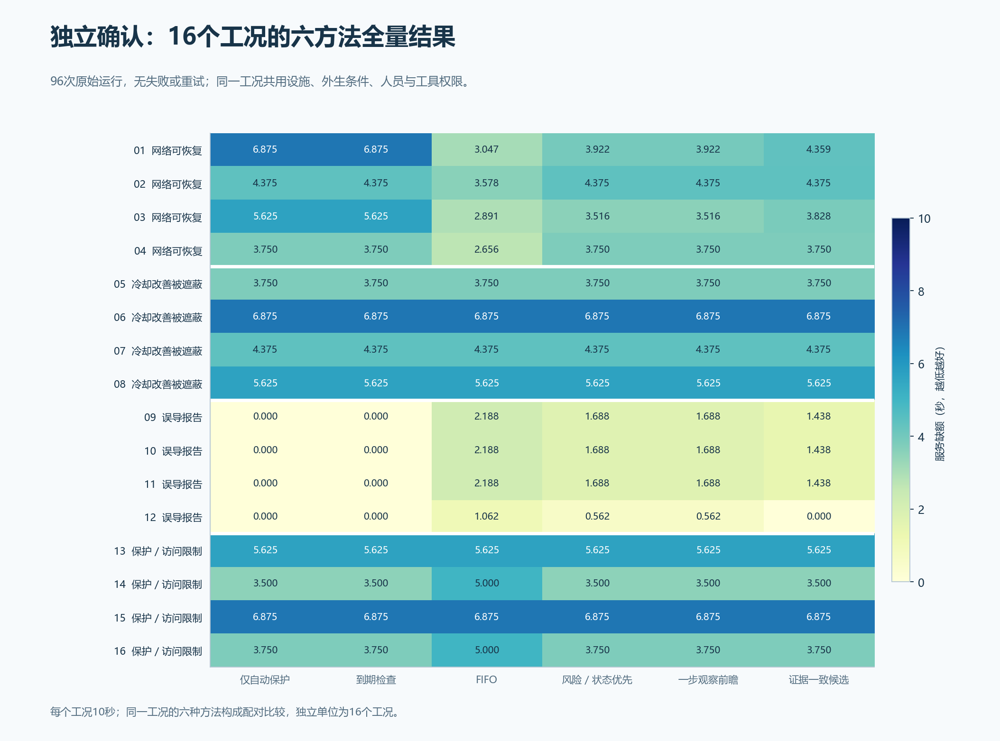
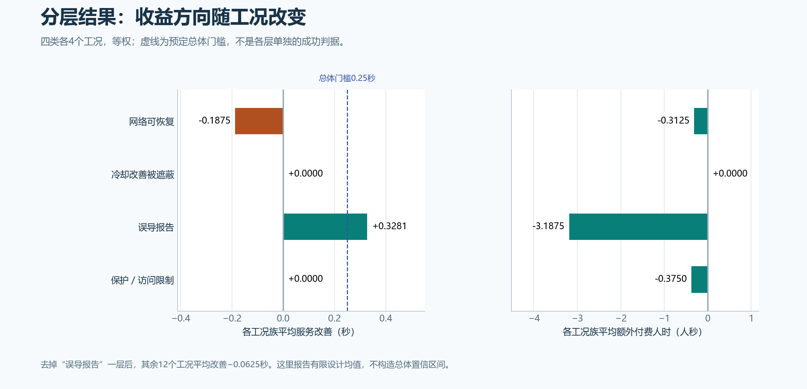

# 第34项：省下人工，平均服务改善未达到门槛

16个封存工况的96次运行全部完成。按事先固定的主配对，证据一致候选相对一步观察前瞻平均减少服务缺额 **0.03515625秒**，低于预定的 **0.25秒**最低收益门槛，注册结论为 **NO_PRACTICAL_GAIN**。候选平均节约0.96875人秒，成本结果单独报告。

[逐工况CSV](paired-worlds.csv) · [矢量图](figures/34-confirmation-paired-service-cost.svg) · [全部复算结果](results.json) · [冻结算术输入](verified-facts.json)

| 预定判据 | 实际结果 | 判断 |
|---|---:|---|
| 平均服务缺额减少至少0.25秒 | +0.03515625秒 | 未达到 |
| 额外付费人时不超过0.5人秒 | −0.96875人秒 | 未超限 |
| 额外行走不超过0.25人秒 | −0.25人秒 | 未超限 |
| 额外工具占用不超过0.5工具秒 | −0.609375工具秒 | 未超限 |
| 至少4个共享历史首次不同选择、覆盖2个工况族 | 12个、3族 | 满足可区分要求 |
| 实际硬约束违规为0 | 0 | 本批次未观察到违规 |

付费人时是行走、专业工作和等待之和。门禁、排队和会合属于等待分项，未重复计费。安全、资格、授权和当地保护分别核对；零违规不等于方法有效。

[六方法CSV](method-summary.csv) · [矢量图](figures/34-confirmation-all-methods.svg)。每行同一工况的六种方法共用初始实际设施、外生事件、测量生成机制及种子、人员和工具权限；动作与检查时刻不同会改变后续状态和实际到达的测量记录。独立比较单位是16个工况，不能把96条方法轨迹或96,985个状态点当成独立物理样本。

| 方法 | 平均服务缺额（秒） | 平均付费人时（人秒） |
|---|---:|---:|
| 仅自动保护 | 3.812500 | 0 |
| 到期检查 | 3.812500 | 1.250000 |
| FIFO | 3.932617 | 3.718750 |
| 风险／状态优先改编 | 3.847656 | 2.687500 |
| 一步观察前瞻（固定主基线） | 3.847656 | 2.375000 |
| 证据一致候选 | 3.812500 | 1.406250 |

候选的平均服务缺额与“仅自动保护”相同，额外使用1.40625人秒。逐工况并不相同：相对无人工对照，候选在网络族平均少损失1.078125秒，在误导报告族平均多损失1.078125秒，其余两族差异为零；这批等权设计的平均值因此相抵。该描述不改变已冻结的主配对。

主配对在网络族平均改善−0.1875秒、误导报告族+0.328125秒，其余两族为零。去掉误导报告族后，剩余12个工况平均改善−0.0625秒。[矢量图](figures/34-confirmation-family-effects.svg)

本批16个主配对全部返回，所以预定缺失值边界收缩为同一个有限设计均值[0.03515625, 0.03515625]秒。这不是总体置信区间；没有从10秒合成机制工况推断现场长期收益。现场校准、参数域和结构稳健性仍待后续工作。

## 原件与复核

执行源`fc747fb1a579e678c5e88753d110d4875b4899b2`，原始数据提交`bcc3c42cdd6842a1d7ff3fdbc4e89e756f29ffdc`。[第33项96次原件](../33-confirmation/README.md)经两路独立核对和新检出证明。本项只复算保存数据，没有追加设施、策略、模型或训练调用。

第一次保存分析入口因缺少PYTHONPATH失败；原错误另存，补全环境后复算原件。96次确认运行没有重试，注册试验仍累计132次。[分析和作图原件](support/manifest.json)保留入口记录、工具源和图表来源。

第35项将按原定独立条件和32次预算，分别屏蔽非固定证据、依赖知识和联合人员规划，检验这些机制的作用。候选规则不会按本轮确认结果调整。
