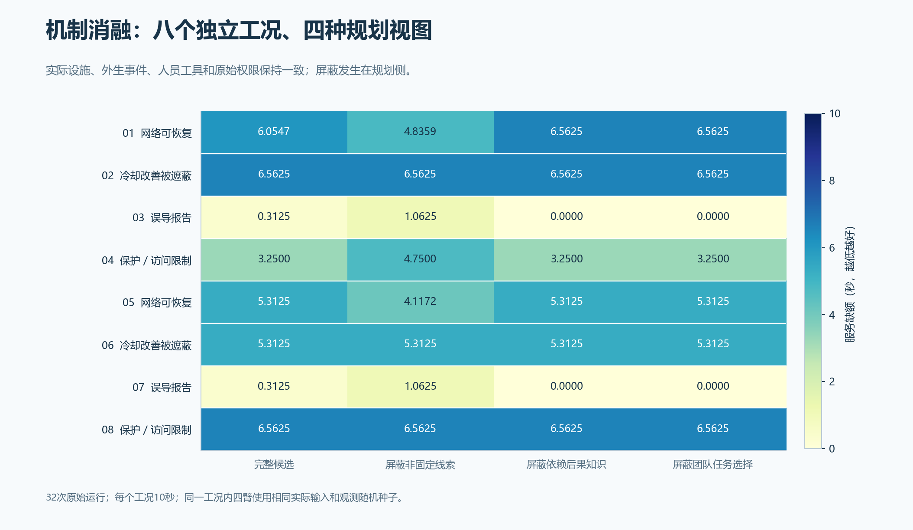
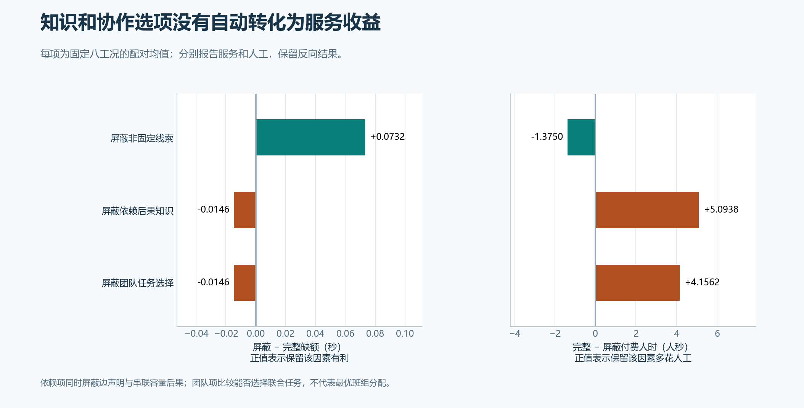

# 第35项：线索有作用，知识和团队选项的当前用法仍有限

8个独立封存工况、4个规划视图，共32次运行全部完成，320秒模拟预算、320次决策，无失败或自动重试。保留非固定线索在本批平均减少0.07324秒缺额并节约1.375人秒；保留依赖后果知识或团队任务选项的当前实现，没有显示平均服务收益，且多花人工。

主要确认结论仍为 **NO_PRACTICAL_GAIN**。本项按预定8工况解释机制，没有改变第34项的主配对、最低收益门槛或16工况结论。

[矢量图](figures/35-ablation-all-methods.svg) · [全部结果](results.json) · [四臂数值汇总](arm-summary.csv) · [24个逐工况对比](paired-mask-effects.csv)

| 屏蔽因素 | 屏蔽−完整缺额（秒） | 完整−屏蔽人工（人秒） | 本批观察 |
|---|---:|---:|---|
| 非固定线索 | +0.073242 | −1.37500 | 保留线索的完整候选平均服务更好、人工更少 |
| 依赖后果知识 | −0.014648 | +5.09375 | 当前知识用法没有转化为平均改善，人工投入更高 |
| 团队任务选择 | −0.014648 | +4.15625 | 当前团队任务用法没有转化为平均改善，人工投入更高 |

左列正值表示屏蔽后更差，即保留该因素有利；人工列正值表示完整候选多付人工。付费人时仍为行走、作业和等待之和。工具和行走分别保留在CSV，没有合成一个分数。

[矢量图](figures/35-ablation-service-cost.svg)。这些是8个固定条件的配对有限均值，不能把32条方法轨迹或32,344个状态点当成独立现场样本。

| 规划视图 | 平均服务缺额（秒） | 平均付费人时（人秒） |
|---|---:|---:|
| 完整候选 | 4.209961 | 5.40625 |
| 屏蔽非固定线索 | 4.283203 | 6.78125 |
| 屏蔽依赖后果知识 | 4.195312 | 0.31250 |
| 屏蔽团队任务选择 | 4.195312 | 1.25000 |

## 实际保留了什么，规划侧改变了什么

四臂的实际设施、外生事件、实际人员资质、工具、路径、原处置权限、测量生成机制与随机种子逐字相同，只有输入中的消融标签不同。动作和检查时刻会使后续状态及实测记录不同，这是被评价的闭环行为。

- 非固定线索：仅从规划证据账删除operator-report及其传递复制记录，保留来源注册表、固定测点和实际观测生产能力。
- 依赖后果知识：规划侧删除f12、f13、f14及问题引用，并把每段服务容量和每个动作后果向量改成compute-only。它同时屏蔽边声明和串联容量后果，是一个组合知识因素；实际管网、供电和功能关系不变。
- 团队任务选择：规划侧删除多人候选，移除相应价值映射和报告支持；风险保留UNMODELED、原有后果界和证据缺口。实际执行器仍保留团队、资格、工具、授权及原任务。这里比较团队任务能否被选择，未评价最优班组分配算法。

双视图适配器先建立完整实际执行器，再向原选择器提供被屏蔽的规划视图。私有派工只恢复完整静态身份绑定，当前时刻、证据和任务保持一致，公共决策记录仍保留被屏蔽的视图。28次实际意向对应56条双通道映射，均经独立核对。

## 数据、计算与原件

[arm-summary.csv](arm-summary.csv)另列实际到达的不同记录数、接口报告的模型评估次数、目录身份校验次数和选择阶段墙钟诊断。四臂均报告每工况20次action_value接口评估；依赖屏蔽另有每工况20次组件身份校验。记录数量会随检查行为变化，同源关系仍按原规则处理。

选择阶段墙钟仅作诊断，模型计算没有推进物理时钟；它不是现场响应延迟，也不与人秒、工具秒混算。现场标定仍待完成。

实际执行源`d102173f2a8c31402f70dbf4522371aa18070ed9`，274项执行文件冻结源`6c98bee2404c8a4694ce334204ca6e2d996f6bae`，32次原件交付`ab0efed85621947875469674f2dfcab26bd158bf`。原269项代码和配置未改动。

[完整尝试账](capture-01/attempts.jsonl) · [批次与执行源](capture-01/batch.json) · [终态收据](capture-01/receipt.json) · [输入冻结](prepared-01/receipt.json) · [执行前审查原件](execution-freeze/manifest.json)

开发检查的原失败、静态审查发现及修正均保留。唯一3秒工程见证按原628版本封存，未升级为后续映射版本的动态证据；本批32次运行中的实际提交另外核对。[工程原件](../../engineering/35-ablation-adapter/development/manifest.json)

本轮共164次注册运行：36次开发、96次主确认、32次机制消融。第36项稳健性和第37–42项仍待完成；按用户要求，在本项后集中展示阶段成果并进入方向复核。
