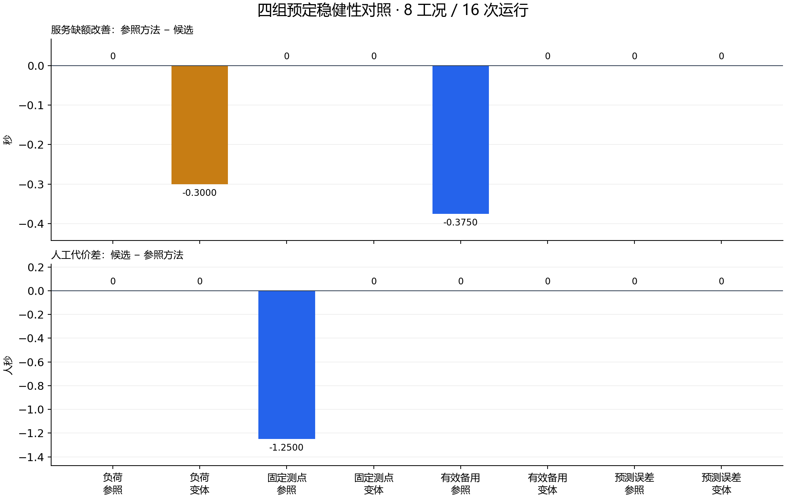

# 四组稳健性比较：方法差异受工况与预测模型限制

原协议的最后 **16 次运行全部完成**：8 个工况、2 种冻结方法、4 个成对区组，160 秒仿真、160 次决策，零失败、中断或重试。累计注册运行为 **180 次 / 1800 秒**。这是有限合成条件比较，不是现场估计。

本组没有正的服务改善差值：两个工况候选较差，其余六个相同。8 个预定工况的描述性平均改善为 **−0.084375 秒**；它不替代原16工况的主要确认结果。主要结论仍为 `NO_PRACTICAL_GAIN`，原平均改善0.03515625秒未达到0.25秒门槛。

图中服务差为“参照缺额−候选缺额”，正值较好；人工差为“候选−参照”，负值表示少用人工。蓝色为参照条件，橙色为预定变体。原图及两次图形排版修订均保留，未改数据或重跑模型。

|预定变化|参照条件：两法缺额（参照/候选，秒）|变体：两法缺额（秒）|可支持的结论|
|---|---|---|---|
|R1 外生需求0.75→1.25|0.625 / 0.625|4.975 / 5.275|高负荷点候选多损失0.30秒，人工代价相同；未显示跨负荷优势|
|R2 固定整流表计启用→停用|6.25 / 6.25|6.25 / 6.25|启用时候选少用1.25人秒及1.25工具秒；停用后这项节省消失；不能推广为一般传感覆盖结论|
|R3 同样断电下UPS在役→下线|4.5625 / 4.9375|7.375 / 7.375|备用下线使两法绝对损失都增加；方法差消失不表示下线有益|
|R4 预测处置后容量0.75→1|6.25 / 6.25|2.96875 / 2.96875|两法都从先检查改为直接处置；实际处置仍为0.75。更乐观的预测在此真值下碰巧改善结果，不能据此说预测更准确或候选独有获益|

R4 的首次实际选择见原件13–16的 `policy_public_decisions`；其余输入、实际处置和配对观测实现均保持冻结。R3改变的是有效备用可用性，四图/实体仍为完整设施；它与35的决策知识屏蔽不同。

## 数据与范围

- [全部8个配对差及四组变化](analysis-01/results.json)、[配对CSV](analysis-01/paired.csv)、[16次分别读出](analysis-01/run-readout.csv)、[实际巡检时序/来源](analysis-01/inspection-timing.json)。
- [完整原件及收费账](capture-01/receipt.json)、[16份冻结输入](prepared-01/receipt.json)、[执行前独立审查](execution-review/)、[实际执行锁](../../../../docs/mainline/evidence/30-robustness-execution-lock.json)。
- [进入36前的01–35审计](../../../../docs/mainline/audits/20261108-pre36/audit-report.md)保留两处修正、原失败及全部18项指标状态。

每组参照/变体共享观测实现，独立设计单位为4个区组，不能把16条方法轨迹当16个独立样本。这里只报告预定有限差异，不生成总体置信区间或重分主要结论类别。两方法信息、真实动作与资源接口相同；R4只改变公共预测。

固定测点覆盖、模型参数、先验/似然、工时和行走时间均是合成设定。正式比较采用10秒压缩窗、1秒专业工时及1/2秒路径；默认V6的30秒工时和60/120秒路径是另一套基线设定，均未现场标定。

实际处置效果、来源绑定阈值读数、历史有效性与终点当前性分别保留。`closure_program=None`，正式比较没有测量证据验证关闭；通用故障确认、误报/漏报率和提前预防仍未操作化或未测，不能当作零。注册运行没有LLM/训练调用。

实际物理执行源：`18679d7620385c553041e58065d6c7841faebb15`；冻结可执行源码：`f834ea4de71a175fc4fa341cc29ed1694280ae0e`，286项源码/配置与解释器逐项绑定。新时标修正显式桥接旧源，原协议、原164次数据和失败未覆盖。准备、正式运行、保存分析、作图和审查分别记账。
