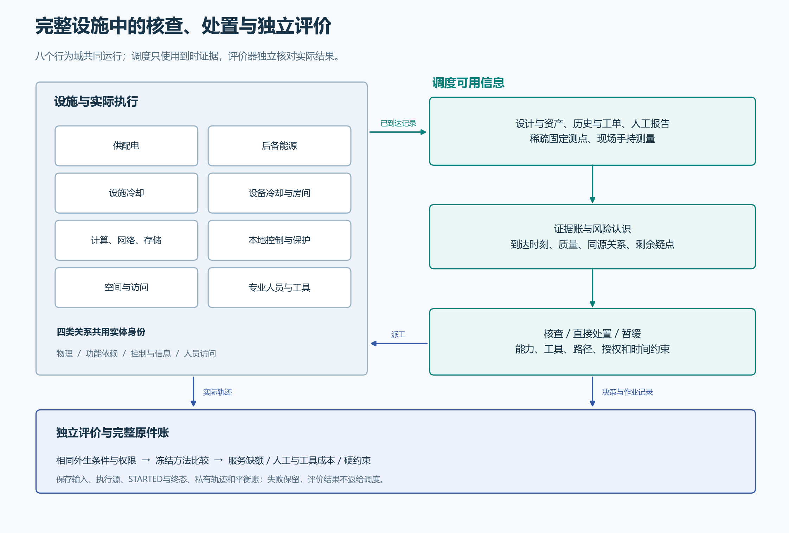

# 受授权与截止约束的检查决策：相对合法动作的收益边界

中文论文结构稿，供审阅。以同一八域合成设施为对象，把注册比较、有限条件算例和解析边界作为不同层次的证据。稿件的主结果安排在正文；投稿对象及相关工作定位另待确定。

## 一、问题：获得信息之后，哪项动作会改变？

固定测点覆盖有限时，工单、人工报障和现场测量可以更新设备状态认识。检查后的行动仍受资质、工具、授权与截止约束。本文以同一初始证据和资源上限为起点，问查后策略相对于哪种合法动作、在什么条件下有严格收益。准确率影响报告分支，行动权与时序决定分支能否产生处置效果。

## 二、框架：四类动作与分列的后果

把实际状态保留在设施和评估器中，决策只使用到时证据。列出暂缓、升级、直接授权处置和检查后处置四类候选，按授权、时限和资源筛选；记录未解决、误报、失败和错过截止的分支。以原协议的服务缺额为主指标，辅助断供、人秒与资源成本分别报告。图1使用已有架构图，图注写明谁能读取状态、谁有权限改变状态。

## 三、正文证据：预设比较、冷却算例和 UPS 解析边界

**预设派工的注册对照。** 两种主策略与四个参照臂共180次，主确认的平均服务改善为0.03515625秒，未达预注册0.25秒实际收益门槛。结论 **〔验证关闭未入环；仅2个预设实例；无现场标定〕NO_PRACTICAL_GAIN**。正文保留它，以呈现在明确参照和门槛下的负结果。它不验证 UPS 定理，也不回答全场按问题触发的效果；没有单独操纵参照、授权或验证关闭来识别排序反转或未达门槛的原因。确认配对分布及故障族方向按原口径报告。[范围与原图出处](preset-dispatch-scope-review-20261110/report.md)

**冷却条件算例。** 在声明点值下，先检查比直接处置多0.455143秒服务缺额、多0.216505人秒，少0.133981模型成本单位。保留这个负结果，注明服务缺额的声明假设包络重叠，且不是置信区间。此处说明比较基线会改变解释；它不证明直接处置在所有假设下均占优，其秒数也不作为 UPS 的成本。[点值与包络](../docs/reviews/20261110-direction-correction/risk-baseline.md)

**UPS 辅助连续性。** B1 的匹配探针在30秒窗口内两组主服务缺额相同，受保护负载存在断供差异，交流恢复初态右删失。该窗内三个负载的两叶相同；一组归一化边界映射到三个分别报告的负载。无扰动且及时成功率不低的合法直接恢复使严格胜区消失；在有扰动的冻结参考行（条件成功率0.75，同口径代价为叶子差的0.02），相对全部合法不查动作的全胜区为 `58/483 < p < 142/467`。相对直接恢复的单项胜区更宽，为 `[0,142/467)`。表3列出不同假设下的区域，不作现场阈值解读。[B1 原件说明](../docs/mainline/39r-backup-support-consequence.md) · [四动作边界表及完整条件](../docs/mainline/39r-ups-a1-stage2-breakeven.md)

## 四、定理、充要边界与现场证据

**定理与反向刻画。** 若两方案均可行，直接恢复无额外断供、及时成功概率不低于查后有效恢复概率，且检查的同口径代价非负，则检查无严格胜区。一般地，在可行性与条件参数固定的先验全区间，存在胜过直接恢复的严格胜点，当且仅当 `max(d_R−d_I, r_I−q_R)>k`。归一化优势是两端点优势的凸组合；要胜过最佳合法不查动作，还需取各对照胜区的交。授权失败使动作退出比较集。断供边界中的观测组合为 `(a,b·d_FP)`，期望人时仍依赖 `b`。[定理、反例与等价输入](../docs/mainline/39r-ups-a1-stage3-theorem.md)

三类证据承担不同任务，不作同一机制的三次独立实验。合成设施尚无现场标定，八域中六域的风险、七域的检查价值仍未建模。检验定理能否用于现场，需对齐独立授权、工单与报告的时戳、截止前成功记录和逐负载扰动；人秒、工具秒与同负载断供代价分开。[现场证据清单](../docs/mainline/39r-ups-a1-stage3-theorem.md#现场证据清单)列出每条前提的记录和失效条件。工程接口、CI和复现账放方法附录，注册比较与冷却负结果留在正文。
