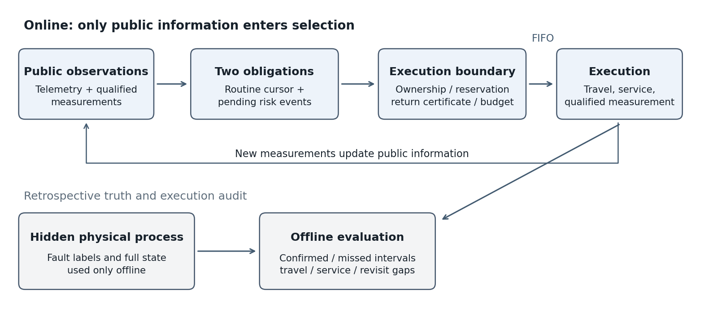
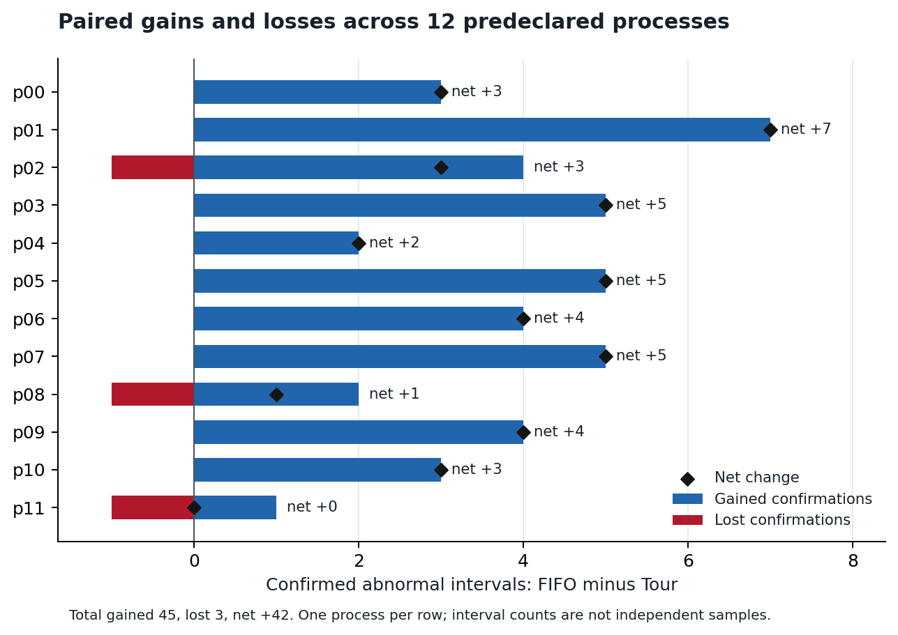
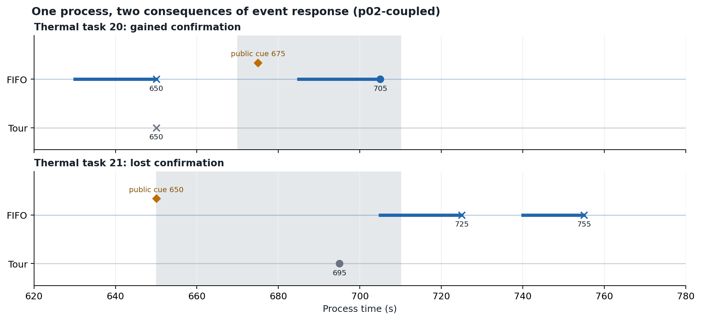

# 面向耦合设施持续巡检的受约束事件确认

**Constrained Event Confirmation for Persistent Inspection of Coupled Facilities**

机制稿 · 导师讨论版 · 2026-11-02。主文围绕RQ1—RQ2组织问题、方法与结果，并保留已结束的同权限规则搜索负结果。后果反馈设计另存为[研究备忘](feedback-design.md)，不作为本稿的已完成贡献。主张与证据对应见[研究问题与贡献表](research-map.md)。

## 摘要

持续巡检需要同时满足例行重访与新风险的及时确认。固定巡回即使满足重访上限，也可能错过持续时间较短的异常；公开遥测提示又不能代替具有专业资格的现场测量。本文构建一种受约束事件确认机制，将新公开风险表达为独立确认义务，在每次检查完成后重规划，并通过插入后的返回证书保护例行巡回。额外访问更新最近测量时间，保留后续例行义务；固定访问预算限制响应成本。在128机柜、18名执行者的合成热—冷耦合场景中，采用12个预定过程进行配对评价。FIFO事件响应将有效确认由固定巡回的28/89段提高到70/89段，平均每个过程净增3.50段，探索性95%自举区间为[2.42,4.50]；平均移动距离增加0.50%，完成检查量减少0.33%，全部检查中的重访、资格及预约违规为零。同专业风险目标置乱确认25/89段，支持风险位置在该在线机制中的任务价值。结果中的新增45段与丢失3段揭示了确认收益和巡回时序之间的取舍。在已见开发过程上，9条同权限响应规则确认28—60段，未超过FIFO。上述结果刻画了独立确认义务在规定条件下的任务价值、响应成本和时序取舍。

**关键词：** 持续巡检；专业确认；事件响应；重访约束；风险位置干预。

## 1 引言

耦合设施中的设备状态随负载、供电、冷却和控制行为共同变化。移动巡检需要在有限专业能力与工时内持续取得可靠测量。数据中心环境监测已有移动机器人系统和真实部署基础[R1]，近期工作也将大语言模型与场景图用于语义任务解析和运维执行[R8]。本文关注持续巡检中的一个执行问题：已有例行覆盖如何与新出现的风险确认共同安排。

重访合格并不意味着所有短时异常都能被确认。例如，某检查点的允许重访间隔为300秒，而异常可能在两次例行访问之间出现并恢复。此时，完成全部例行任务与及时取得异常期间的专业测量是不同目标。公开遥测能够提供线索，但一个报警提示只有被转化为可执行的专业确认义务，才能直接影响现场确认时机。

另一项困难来自行动接口。若策略只允许调整当前少量例行任务的顺序，窗口外对象即使出现风险，也无法直接取得新的访问机会。确认任务因而需要同时明确响应权限与后续例行义务，而不能只给窗口内任务增加风险分数。本文将例行重访与事件确认分别记账，并用返回证书约束新增访问。

本文围绕两个研究问题组织论证：**RQ1**，独立风险确认义务能否在保持专业资格和持续重访的条件下提高有效确认？**RQ2**，收益是否依赖风险目标位置正确？在回答这两问之外，第5章定义同权限响应规则的诊断工具，第6.7节报告其开发负结果，用于分析立即响应与保留事件之间的取舍。

现有工作形成三项可讨论的贡献。第一，给出区分例行重访与风险确认的任务表达，使额外专业访问能够与既有巡回共同执行。第二，建立候选插入、首轮返回与周期延续的可行性检查，并给出其在确定耗时和固定所属条件下的保持命题。第三，以过程级配对评价机制收益、风险位置干预及其成本，保留新增和丢失确认，公开完整原件与失败修订记录。同权限搜索的未获改进结果与成功案例一并报告，避免仅由动作权限扩展推断策略优化已经成立。

## 2 相关工作

### 2.1 持续监测与重访要求

持续监测研究关注多次访问随时间变化的目标。Asghar等将节点的最大重访间隔作为latency约束，并研究满足这些约束所需的机器人数量[R2]。Yanes Luis等研究部分观测下非均匀水域的模型辅助多执行者巡检，是本项目的问题基础[R4]。本文固定人员配置与任务所属，将关注点放在已有巡回中可否插入及时的专业确认；本轮动作由名义估计与透明规则产生。

R4的原始目标是重要度加权idleness及采样回报，动作是8邻接网格移动；safe-consensus检查避障和车辆碰撞，`W_MAX`用于指标截断。本文改为具有服务时长的专业测量、完成级硬重访约束及返回巡回证书。因此，当前关系是任务契约的延伸；不同指标上的收益不作为超越原DDQL算法的证据。逐节观测、动作、目标、约束和模块对照见[来源核查表](research/closest-methods-20261102.md)。

### 2.2 事件驱动决策与专业确认义务

Welikala与Cassandras通过事件驱动的滚动时域控制优化网络目标的不确定度[R3]。事件驱动决策因而已有明确研究基础。本文进一步区分“引起重规划的事件”与“需要完成一次专业测量的风险确认义务”：前者规定何时决策，后者规定本次响应要完成什么以及怎样闭合。数据中心移动测量[R1]及LLM语义运维[R8]提供场景背景，本文在固定资源下评价例行覆盖与短时确认之间的取舍。

Zhang等已研究持续巡逻与紧急处置的协同双任务规划，以目标奖励和协作选车安排响应车辆与继续巡逻的车辆[R9]。本文的任务特征是专业确认服务、固定所属的测量重访要求，以及每次插入后的显式循环延续。双任务联合本身已有先例；与R9的完整约束差异仍以取得其全文后的核对为准。

### 2.3 执行时约束与后备可行性

Shielding通过在学习器外部限制或修正动作来执行安全规范[R5]。本文采用与此一致的职责分离：候选规则只在通过检查的动作之间选择，资格、预约和返回证书由执行边界管理。当前证书具体利用固定任务所属、确定通道和服务耗时，给出可直接复核的循环后备计划。

Wabersich与Zeilinger的预测安全过滤利用未来可行计划审核当前候选输入，并在必要时沿后备计划延续[R10]。本文在这一方法背景下，为离散专业巡检构造候选完成、首轮返回与闭合周期的检查。第4章命题说明该任务特定构造的充分条件，不把保留后备可行性的思想作为新的通用安全理论。

[文献比较表](related-work.md)记录原始来源、核验层级及任务差别。本文以专业确认契约、循环返回构造和可复核的任务取舍为定位，不将双任务联合或一般后备思想本身当作首次创新。

## 3 问题定义

### 3.1 设施、任务与执行者

将静态通道表示为图 $G=(V,E)$，沿合法通道的最短移动距离记为 $d(x,y)$。专业任务集合为 $\mathcal J$。每项任务 $j$具有位置 $x_j$、所需专业 $q_j$、服务时间 $s_j$及最大重访间隔 $D_j$。位于同一设备附近的不同专业任务分别记账。

执行者集合为 $\mathcal A$。执行者 $a$具有专业 $q_a$及固定所属任务集 $\mathcal J_a$，各所属集合互不相交并覆盖全部任务。一个执行者一次执行一项移动与服务，途中及服务均不可打断。任务只有在专业匹配、访问方式允许、所需服务完成并取得有效测量后，才构成一次专业检查。

每位执行者维护固定循环 $\pi_a$及其例行游标 $u_a$。游标所指任务为例行头 $h_a=\pi_a[u_a]$。本实验使用128项热任务和各16项电气、制冷、自控任务，共176项；18名执行者按12、2、2、2配置。热任务服务10秒、电气与制冷任务各20秒、自控任务15秒。热重访上限300秒，其余专业600秒。

### 3.2 物理过程、公开风险与评价异常

物理状态 $z(t)$由供电—液冷—控制的合成过程产生；巡检决定观测和确认时机，物理状态独立于巡检动作演化。在线信息 $\mathcal I_t$包括公开遥测、历史专业测量、估计、位置、工时和任务账本。隐藏故障类型、未来异常起止及未公开状态用于过程生成和事后评价。

**物理故障注入**是过程参数的外生改变；**公开风险** $r_j(t)$是在线信息生成的严重度代理；**评价异常** $L_j(t)$由事后真实状态与任务阈值定义；**有效专业确认**要求在评价异常的有效采样时刻完成相应检查并得到异常测量。公开风险既不是校准故障概率，也不直接计作现场确认。

本实验热异常取设备温度代理高于65°C，制冷异常取pod流量低于33.6 kg/s；电气和自控分别使用接触温度与传感器误差阈值。阈值是合成任务约定，设备温度代理不等同于机房空气温度规范。评价在5秒网格上进行，保留至少连续3个正标签采样箱的区间，因而最短保留持续时间为15秒。

远程测温布置于编号为4的倍数的机柜，流量遥测布置于偶数pod。专业检查可为未直接遥测的对象取得测量。名义估计据当前公开包及历史测量更新；本轮没有CVAE、PPO或大语言模型推理。

具体风险代理保持固定。记 $[x]_+=\max(x,0)$，机柜热超阈量为 $a_r=[\hat T_r-65]_+/20$，公开供电缺口为 $g_r=1-P_r^{\mathrm{del}}/\max(P_r^{\mathrm{req}},10^{-12})$。pod内热量最大值与供电缺口均值分别记为 $m_p$和 $\bar g_p$。由最近允许测量构造接触温度超阈量 $b_p=[T_p^{\mathrm{contact}}-60]_+/30$、流量缺口 $f_p=[1-F_p/33.6]_+$及已经专业核验的传感器误差标志 $v_p$；未测量项使用冻结的名义初值。

|任务专业|公开风险 $r_j$（各项最终以上限4截断）|
|---|---|
|热，机柜 $r$|$a_r+0.25g_r$|
|电气，pod $p$|$b_p+\bar g_p+0.1m_p$|
|制冷，pod $p$|$f_p+0.25m_p$|
|自控，pod $p$|$v_p+0.25m_p$|

名义温度估计按公开送达功率、供液温度、允许取得的流量和固定热参数积分，并在远程或专业温度测量可用时同化。风险代理因此可以跨系统传递公开线索，而不读取隐藏故障类型。健康人工虚假提示条件额外施加协议声明的风险脉冲，保持物理过程与专业测量不变。

合成供电、流量与热状态的核心方程、单位、参数来源及故障作用见[附录A](model-appendix.md)。其数值检查验证实现一致性，当前参数不解释为现场标定。

### 3.3 两类义务及持续重访约束

**例行义务**要求任务持续获得专业测量。设任务 $j$在回合 $[0,H]$内的完成时刻为 $c_{j,1},\ldots,c_{j,n_j}$，加入虚拟评价边界 $c_{j,0}=0$与 $c_{j,n_j+1}=H$，约束为

$$
\max_{0\le k\le n_j}\left(c_{j,k+1}-c_{j,k}\right)\le D_j. \tag{1}
$$

两个边界用于审核首次检查前和末次检查后的最大空窗，不表示0或 $H$时刻实际发生专业测量。未完成任务的初始期限按0加重访上限计算。

**事件义务**由新公开风险上升沿创建，表示需要一次专业测量。每个事件 $e$记录目标 $j_e$、可见时刻 $v_e$及派单有效期 $v_e+T_e$。本轮 $T_e=120$秒。事件义务和例行游标分开维护：非头任务的额外访问更新最近测量时间，但不推进例行游标；例行访问也可以同时完成目标的事件确认。

回合额外访问预算为 $B=12$。仅当派单目标不同于当前例行头时消耗预算；完成的是例行头时，即使目标有事件，也不计为额外访问。预算由所有执行者共享，派单时按固定执行者顺序预留，以避免同一步超额。

### 3.4 评价指标及比较单位

设过程 $i$的评价异常区间集合为 $\mathcal S_i$。区间 $s$的起止为 $a_s,b_s$，若存在匹配专业、完成服务、测量报警且事后正标签有效的完成时刻，则记首次有效确认为 $f_s$，否则为空。确认量为

$$
C_i=\sum_{s\in\mathcal S_i}\mathbf 1\{f_s\ \mathrm{exists}\}. \tag{2}
$$

对漏检使用区间结束截尾，定义 $\delta_s=f_s-a_s$（确认）或 $\delta_s=b_s-a_s$（未确认）。过程内的严重度加权截尾等待为

$$
W_i=\frac{\sum_{s\in\mathcal S_i}w_s\delta_s}{\sum_{s\in\mathcal S_i}w_s},\qquad
w_s=\alpha_{j_s}(1+\bar e_s). \tag{3}
$$

其中 $\alpha_{j_s}$为合成资产权重，$\bar e_s$为该区间的平均归一化超阈量。该权重不表示经济损失。无评价异常的过程不定义 $W_i$，不以零替代。主表先在每个过程内计算式(3)，再平均12个过程。

成本使用全体执行者的实际移动距离 $M_i$、服务时间 $S_i$、完成检查量 $N_i$和额外访问次数。比较策略 $A$与 $B$时，分别报告新增确认集合与丢失确认集合：

$$
G_i=|\mathcal C_i^A\setminus\mathcal C_i^B|,\quad
L_i=|\mathcal C_i^B\setminus\mathcal C_i^A|,\quad
\Delta C_i=G_i-L_i. \tag{4}
$$

每个独立过程／种子为配对单位，同一过程内多个设备异常共享故障、路线和人员，不能作为独立样本。本文比较确认、等待和实际成本，并逐项检查式(1)、资格及预约。

## 4 受约束事件确认机制

### 4.1 事件账本与生命周期

每个任务保留上一步风险是否为正的标志。每次公开观测更新时，先清除严格超过有效期的待处理事件，再检测从零到正的上升沿。若目标尚无待处理事件，则创建新事件；待处理期间的风险变化合并到同一确认义务中。风险回落本身不关闭待处理事件。

完成专业测量后，目标的待处理事件闭合，并记录正常或异常测量。连续正风险期间，一次正常闭合或到期不会自动反复创建事件；新的上升沿才提供下一次创建机会。有效期内已经派出的任务允许过期后完成，记为晚测。由同刻专业测量揭示并闭合的事件另行统计，不计为提前线索带来的额外响应成功。

该语义将一次风险片段对应到一次确认请求，限制无意义重复。它也意味着“先查正常、之后风险继续升高”不会在没有新上升沿时自动触发下一次确认，这一设计取舍在第7章讨论。

### 4.2 合法候选与FIFO规则

当执行者空闲时，候选为当前例行头和其所属任务中的待处理事件。候选首先接受资格、任务所属、预约、回合剩余时间及返回可行性检查。非头任务还需要剩余额外访问预算。执行者在途时保持原任务，完成后重新决策。

在通过检查的事件候选中，FIFO按可见时刻最早优先；同刻事件按当前公开风险较高、任务编号较小打破平局。若存在合法事件，则执行该事件；否则执行合法例行头。待处理事件即使当前风险已回落，仍按事件账本语义等待测量或过期。该规则使风险线索可以改变实际访问，而非仅改变一个显示分数。



**图1.** 公开观测进入事件账本和名义估计；例行游标与事件请求共同形成候选，约束检查确定可执行集合，固定FIFO选择事件或例行头。隐藏状态只用于过程和事后评价。第5章的策略诊断沿用相同执行边界。

### 4.3 插入与返回证书

设移动速度为 $v$，本实验固定 $v=1\,\mathrm{m/s}$，决策网格 $\Delta=5$秒。由位置 $x$到任务 $j$并完成服务的量化时长为

$$
\tau(x,j)=\Delta\left\lceil\frac{d(x,x_j)/v+s_j}{\Delta}\right\rceil. \tag{5}
$$

最近完成时刻记为 $\ell_j$，尚未检查的任务在初始检查中取0。若在时刻 $t$选择目标 $j$，预计完成时刻为 $\hat c_j=t+\tau(x,j)$。证书先要求 $\hat c_j\le H$且

$$
\hat c_j\le \ell_j+D_j. \tag{6}
$$

随后将目标的虚拟最近测量时间更新为 $\hat c_j$。若 $j=h_a$，虚拟游标前移；否则保持游标。按新游标展开所属循环，逐项计算首轮返回完成时刻，并对每项检查同样的完成期限。某目标在插入和返回轮中再次出现时，以最新的虚拟测量时间计算其下一期限。

令循环的闭合量化时长为

$$
P_a=\sum_{(j,k)\in\mathrm{cycle}(\pi_a)}\tau(x_j,k). \tag{7}
$$

初始化要求 $P_a\le D_j$对该执行者全部所属任务成立。首轮返回通过后，后续沿同一循环运行，每项任务的相邻访问间隔均为 $P_a$。若所属任务数为 $n_a$，距离和两任务间耗时已缓存时，单个候选证书需要 $O(n_a)$次期限检查；扫描 $k_a$个候选的证书成本为 $O(k_an_a)$，FIFO最小项可在线性扫描中得到。该复杂度不包含首次图距离预计算，也不表示所有执行者的一整次选择都只检查一个候选。

### 4.4 条件性可行性保持命题

**假设。** 任务位置、通道和服务时间固定，移动速度为已知常数；每项量化执行耗时为正且与实际执行一致；任务所属互不重叠；检查不被中断；执行者之间不存在未建模的通道占用或排队延迟。初始例行积压及各闭合循环可行。完成后，只要存在能在回合内完成的合法候选或例行头，立即派出下一项，不加入证书未计入的等待；不继续插入时沿例行头执行后备巡回。

**命题1（插入后备计划的可行性保持）。** 在上述假设下，每次通过证书的插入都保留一条满足所属任务重访上限的循环后备计划。若每次重新规划继续遵守证书，实际完成的检查之间保持该重访约束；有限回合首尾边界按式(1)另行检验。

**证明。** 对一次被接受的候选，式(6)保证目标距上次测量的间隔合格。首轮返回逐项检查所有其他所属任务的下一次完成期限，因此从当前状态执行候选并返回一轮时，不会在某任务首次被重新访问前超过其期限。返回轮对重复访问的目标使用更新后的虚拟测量时间，故插入目标在该轮再次被访问时也满足要求。轮末继续固定循环，其每个相邻完成间隔为式(7)的 $P_a$；初始化条件保证这些间隔均不大于对应 $D_j$。因此构造出一条可行的无限后备延续。

实际执行的候选完成时刻与证书一致，完成后记录的最近测量和游标即成为下一次检查的真实起点。若选择继续例行巡回，立即执行已存在的可行延续；若选择另一次插入，新证书再次构造可行延续。正执行耗时避免有限时间内发生无限次重规划，立即派单条件排除证书未覆盖的额外等待。由初始可行性和逐次替换可行延续的归纳，重访约束在这些实际完成之间保持。所属任务互不重叠且无共享耗时干扰，使其他执行者的派单不破坏该构造。有限回合结束时尚未完成的下一次访问以边界 $H$截断，首尾间隔由式(1)直接审核。证毕。

命题说明约束如何保持；它不要求FIFO得到全局最优路径。固定循环的返回检查是一项充分条件，可能拒绝其他重新规划方式能够完成的访问。

### 4.5 执行流程

初始化时刻为5秒：接收首个公开包、更新名义估计，检查初始例行积压和闭合循环，再建立事件账本并观察初始风险。随后每轮按下列顺序执行：

```text
1. 在当前时刻，为空闲执行者形成“例行头＋所属待确认事件”候选。
   依次检查资格、预约、剩余回合、返回证书与补查预算；按FIFO派单。
2. 核验全体派单后，为每位执行者推进5秒：先消耗移动时间，再消耗服务时间。
   真实过程和公开包预先在同一5秒网格生成，巡检动作不改变物理过程。
3. 到新时刻，为服务完成者生成专业测量及报警，更新最近检查、位置和空闲状态；
   将新公开包和本步专业测量同化进名义估计。
4. 检查实际完成时刻等于派单证书时刻；若完成的是当时例行头，推进游标。
5. 计算更新后的公开风险：先使严格过期的未决事件到期，再接收新上升沿。
6. 用本步专业测量关闭目标当前的待处理事件；正常测量也闭合。
   若该测量对应的原派单事件已到期，再将其记为measured_late。
7. 返回步骤1；在途执行者保持原任务，不重新派单。
```

步骤5先于步骤6，使专业测量可能在同一步揭示新风险并立即闭合该事件；这种记录归为同刻揭示。新时刻严格超过TTL后才到达的已派事件可转为晚测，TTL端点本身仍有效。结束时以实际专业测量评价异常确认，审核式(1)覆盖的首段、中间和末段空窗。每次派单证书与实际完成记录均保留。

## 5 同权限响应规则诊断

### 5.1 受限二选一接口

为比较相同事件权限下的响应策略，在固定FIFO候选外增加受限选择器。若非例行头的FIFO事件候选 $e_a$及例行头 $h_a$均有合法证书，则规则输出 $g_\theta(\mathcal I_t,e_a,h_a)\in\{\mathrm{respond},\mathrm{defer}\}$。响应执行 $e_a$；暂缓执行 $h_a$并保留事件，完成后重新决策。只有一种动作合法时执行合法项，事件目标与例行头相同时直接执行同一任务，不引入空等。事件期限、任务所属、资格、服务、补查预算和返回证书均保持。

现有12个主过程的FIFO轨迹中，89次非头事件派单同时具有合法例行头。这个回溯计数说明二选一接口有实际选择机会；它不是89个独立过程，也不预先证明暂缓能够改善任务。

### 5.2 固定数值规则空间

规则为四特征线性阈值。输入为公开风险除以4、事件年龄除以120秒、事件与头任务预计完成时刻之差除以300秒，以及两项证书最小余量之差除以600秒。四个系数各在[-4,4]，截距在[-2,2]。分数大于等于0响应，分数小于0则执行合法例行头。零系数零截距与FIFO逐项派单和测量一致。

实现只接受声明字段与有限数字，不接受代码或任意表达式。选择器只读取认证候选的公开标量，无法改写资格、TTL或重访检查。规则族包含风险阈值、事件年龄阈值、风险—耗时组合及返回余量组合，用于直接检验不同响应取舍。

|规则族|本包登记的不同设定|主要作用|
|---|---|---|
|风险阈值|3条：原始公开风险阈值0.10、0.75、1.00|比较不同风险强度下的响应|
|事件年龄阈值|2条：15秒、90秒|比较保留事件、先执行例行头的策略|
|风险—耗时组合|2条线性组合|同时考虑风险、年龄和插入耗时差|
|风险—余量组合|2条线性组合|同时考虑风险、年龄和返回余量差|

完整系数在冻结协议中逐项保留。这9条规则是允许线性空间中的有限子集，不能代表整个空间的最优解。

### 5.3 预登记开发搜索与停止条件

搜索在3条预登记链中各分配4次候选机会，所有候选在同一组12个已见复合故障过程上评价。相同规则和过程可缓存复用，候选机会仍计费；因此12次机会对应9条不同规则和108次实际开发评价。12份旧FIFO原件按字节复用，单独标明，不记为新执行。

开发保留条件为相对FIFO总净增至少1段确认、平均移动增加不超过5%、平均完成量损失不超过2%，且全部安全违规为零。符合条件的规则再按净增确认、平均截尾等待、移动距离的预定顺序选择；平局保留较早规则。若全部候选未通过保留条件，则按封存规则结束该包，不追加候选，也不进入原先预留的后续研究。

这些比较用于诊断同权限响应取舍，结果在第6.7节完整报告。搜索链、缓存标签和实际环境次数分别计数，已见过程内的多个候选不作为新的独立过程样本。

## 6 实验

### 6.1 已冻结协议及执行身份

使用12个新过程种子，每个安排一个180秒辅助馈线损失与CDU结垢复合故障、一个60秒冷板扰动，以及一个健康条件。健康条件中6个仅加入较高测量噪声，另外6个同时加入30秒人工虚假风险脉冲。故障定位与负载／过程种子分别配置，主故障覆盖12个pod，开始相位为150、335、520或705秒，每回合1800秒。

|设置|取值|
|---|---|
|机柜／pod／专业任务／执行者|128／16／176／18|
|过程步长／移动速度|5秒／1 m/s|
|主过程数量／评价异常段|12／89（热77、制冷12）|
|附加条件|轻微扰动12、健康高噪声6、健康人工虚假提示6|
|事件派单TTL／额外访问预算|120秒／每回合12次非头任务访问|
|方法|固定Tour、FIFO事件响应、同专业同所属目标置乱|
|估计与控制|名义估计、固定的过程反馈控制；巡检不模拟维修|
|不确定性|10000次过程级配对bootstrap，固定随机种子|

最终108份成功执行对应36个条件、三种方法，全部纳入分析。一次风险解释字段的工程失败被保留，并在明确修订预算后完成续跑；科学条件、方法和指标未按结果改变。源码封存、失败计费及九份成功记录的字节继承见[补充材料S1](supplement.md)。

### 6.2 方法与信息干预

Tour只执行固定例行循环。FIFO加入独立风险确认义务与受约束插入。置乱组使用相同事件机制与预算，在每位执行者的同专业所属任务内建立确定的随机单循环，将每个目标的风险流指向另一个目标；映射不读取隐藏故障信息，风险值集合与任务所属保持。

不同位置会改变路程、返回可行性和后续专业观测，因此置乱评价的是风险位置干预下的在线机制，而不是固定相同事件流与实际访问次数的信息分量。三个方法在每个条件中具有相同物理过程身份和评价异常区间。

### 6.3 RQ1：有效确认与成本

<!-- GENERATED_TABLE_MAIN_START -->
|方法|确认/异常段|漏检|平均加权截尾等待/秒|平均移动/米|平均服务/人秒|平均完成量|额外访问合计|
|---|---|---|---|---|---|---|---|
|固定Tour|28/89|61|78.16|11793.40|16670.00|1426.00|0|
|FIFO事件响应|70/89|19|49.69|11852.32|16592.92|1421.33|89|
|同专业位置置乱|25/89|64|81.06|11867.47|16592.92|1421.17|81|
<!-- GENERATED_TABLE_MAIN_END -->

FIFO将确认量从28段提高到70段，汇总确认比例由31.5%增至78.7%，增加47.2个百分点。式(4)的过程级平均净增为3.50段，探索性95%自举区间为[2.42,4.50]。12个过程有11个为正、1个为零；总体净增42段由新增45段和丢失3段构成。



**图2.** 每行对应一个预定复合故障过程。正向条表示FIFO相对Tour新增确认，负向条表示丢失，黑点表示净增。区间推断以12个过程为单位，而非以89段异常为单位。

移动平均增加58.92米，即0.50%；平均完成量减少4.67次，即0.33%。平均严重度加权截尾等待由78.16秒降至49.69秒。所有实际执行的资格、预约及完整重访间隔检查均为零违规。服务时间减少伴随完成量下降，论文将两者共同报告。

预先规定的判定要求平均净增至少1段且探索性区间下界大于零，平均移动增加不超过5%、平均完成量损失不超过2%、安全检查零违规，且至少8个主过程形成评价异常。12个主过程均有评价异常，全部判定条件通过，因而冻结FIFO为规定适用域内的研究基线。

### 6.4 RQ2：风险位置的作用

同专业目标置乱确认25/89段。FIFO相对置乱平均每个过程净增3.75段，探索性区间为[3.00,4.58]，12个过程均为正。热异常77段中，Tour、FIFO和置乱分别确认23、59和21段；制冷异常12段中分别确认5、11和4段。

FIFO与置乱实际额外访问合计为89与81次，后者平均路程略长。正确位置使机制在本包中取得更好的确认结果，因此“只要允许额外访问就有相同收益”不能完整解释这些结果。该比较同时包含目标位置变化对后续路线和测量的影响，其结论对应整套在线机制。

### 6.5 健康、轻微变化与生命周期成本

<!-- GENERATED_TABLE_COST_START -->
访问列为全部过程累加；移动与完成量列为每过程差值的平均。各行范围由过程数给出。

|条件|方法|过程数|访问合计/次|移动差均值/米|完成量差均值/次|
|---|---|---|---|---|---|
|健康高噪声|FIFO事件响应|6|0|0.00|0.00|
|健康高噪声|同专业位置置乱|6|0|0.00|0.00|
|健康＋人工虚假提示|FIFO事件响应|6|5|13.62|-0.33|
|健康＋人工虚假提示|同专业位置置乱|6|5|13.42|-0.67|
|60秒冷板扰动|FIFO事件响应|12|3|5.50|-0.33|
|60秒冷板扰动|同专业位置置乱|12|3|0.74|-0.42|
<!-- GENERATED_TABLE_COST_END -->

健康高噪声条件未产生事件访问。六个人工虚假提示条件中，FIFO完成六次正常事件闭合，其中五次为额外访问，平均增加13.62米、少完成0.33次检查。轻微冷板扰动没有形成评价异常区间，但FIFO出现三次额外访问，平均增加5.50米、少完成0.33次检查。这些条件用于衡量响应代价，人工脉冲不估计现场误报率。

<!-- GENERATED_TABLE_LIFECYCLE_START -->
范围为12个主过程内各方法的全部风险事件；下表状态互斥，可相加到事件总数。

|方法|事件总数|有效期内测量闭合|过期未测|晚测闭合|回合末待处理|
|---|---|---|---|---|---|
|FIFO事件响应|123|112|8|3|0|
|同专业位置置乱|122|109|11|2|0|

下表为交叉属性及决策统计，不能与上表或彼此相加：正常闭合的分母为有效期内测量；同刻／先有信号的分母为全部已测（含晚测）；竞争的分母为存在合法且预算允许事件的决策。

|方法|正常/有效期内测量|同刻/全部已测|先有信号/全部已测|多事件竞争/事件可选决策|
|---|---|---|---|---|
|FIFO事件响应|42/112|3/115|112/115|21/104|
|同专业位置置乱|99/109|2/111|109/111|14/100|
<!-- GENERATED_TABLE_LIFECYCLE_END -->

同刻揭示并完成测量的事件与先有信号后测量分别统计。正常闭合、过期和晚测是事件义务的结果；异常区间的有效确认由第3.4节独立评价。两类统计因而不直接互相替代。

### 6.6 同一主过程中的成功与退化

选择主过程 `p02-coupled`中同一执行者agent 1的两条完整策略轨迹。两组该执行者的已完成任务前缀一致，均在605秒完成任务11；这一局部一致性不要求其他执行者或全局观测在两条策略下完全相同。此后Tour立即执行例行任务9并在620秒完成，FIFO先插入任务23、635秒完成，再于665秒完成任务9。

机柜17的评价异常区间为680—705秒。Tour于645秒完成正常测量，FIFO于690秒确认异常，新增确认发生在例行头访问中。机柜21的评价异常区间为650—710秒，Tour于695秒确认，而FIFO在725秒取得正常测量，丢失该段确认。由同一负责人执行的插入与后续重规划改变了例行相位，使任务17落入异常窗口、任务21移出异常窗口。

这是两条完整策略轨迹的取舍分析，不把差异归因于单独一次插入的反事实效应。其他执行者的并列案例与完整来源记录见[补充材料S2](supplement.md)。



**图3.** 三个面板均为同一主过程的agent 1。上方面板给出共同任务11之后的完成链，标签为“任务@完成秒”；橙线标出FIFO的任务23插入。下方两面板分别呈现任务17的例行确认收益和任务21的确认损失。灰区为事后异常，实心点为异常测量，叉号为正常测量，菱形为FIFO轨迹中的公开风险，粗线为相关派单到完成。案例按已知结果回溯选择，不增加独立样本，也不构成单次插入消融。

### 6.7 同权限开发诊断：登记规则未超过FIFO

响应／暂缓搜索在执行前登记3条搜索链、每链4次候选机会，包含风险阈值、事件年龄阈值及风险—耗时—返回余量组合。所有规则使用第5.1节的同一线性空间和执行器。开发条件取已有12个复合故障过程，FIFO原件只读复用，不增加独立过程数。

12次候选机会中有3次跨链重复规则，缓存后为9条不同规则、108次新开发评价，均成功。候选确认28—60/89段，全部低于FIFO的70/89段；各候选在11或12个过程上改变了完整动作。最好的候选仍净少10段确认，因此这不是规则没有生效或不存在二选一机会的负结果。

<!-- GENERATED_TABLE_SEARCH_START -->
|链|规则|确认/89段|新增/丢失（相对FIFO）|净增|开发保留|
|---|---|---|---|---|---|
|S0|risk|28|3/45|-42|否|
|S0|age|33|3/40|-37|否|
|S0|risk_time|59|3/14|-11|否|
|S0|risk_slack|43|3/30|-27|否|
|S1|risk|30|3/43|-40|否|
|S1|age|60|2/12|-10|否|
|S1|risk_time|59|3/14|-11|否|
|S1|risk_slack|43|3/30|-27|否|
|S2|risk|47|2/25|-23|否|
|S2|age|60|2/12|-10|否|
|S2|risk_time|60|2/12|-10|否|
|S2|risk_slack|49|3/24|-21|否|
<!-- GENERATED_TABLE_SEARCH_END -->

开发保留要求相对FIFO总净增至少1段、平均移动增加不超过5%、完成量损失不超过2%且安全违规零。所有候选未通过该门槛，三个链均保留FIFO。按预定分支，本包在搜索结束后停止；实际研究模型调用0、训练0、新确认评价0，不追加规则或调整指标。完整候选和损益见[搜索交付](../evidence/response-defer/README.md)。

该诊断表明这些已登记规则在本开发条件中没有取得确认增量。有限规则子集及已见过程不能证明整个线性空间无解，也不能外推为成熟调度算法的总体排序。未执行的模型反馈和新过程设计保留在独立备忘中，不作为本稿结果。

## 7 分析与适用范围

### 7.1 确认收益及其执行来源

事件机制扩展了风险能够触发的访问权限，同时改变后续巡回相位。独立确认义务解决了“风险可见但当前排序窗口无法选择”的执行问题；返回证书则把额外访问限制在能够继续例行巡回的状态内。三段丢失确认说明，即使满足最大重访上限，局部时序改变仍会错过个别短时异常。任务收益应由新增、丢失与成本共同解释。

目标置乱使正确风险位置的作用获得干预支持，但实际访问次数、路径和后续观测一起变化。当前结果支持风险位置对机制整体效果的价值，精确等成本、固定观测流的分量效应需要不同实验设计。

### 7.2 事件语义的选择

一次连续正风险期间的单次确认响应能够去重，避免同一提示反复消耗专业工时。其相应边界是：事件被正常测量关闭后，持续正风险继续升高也不会自动再开；事件到期后没有新上升沿也不会再开。120秒规定的是派单有效期，已经派出的任务可晚完成。因此“确认义务完成”和“风险已经消除”是不同结论，巡检在本模型中不执行维修。

主过程中的多个合法事件竞争决策为FIFO的21次，但89次非头任务事件派单的例行头都同时合法。可选择并不等于能取得确认增量：第6.7节的登记规则确实改变了11或12个过程的完整动作，却均未超过FIFO。当前结果区分了行动接口存在、策略发生变化和任务效果改善三个层次。

### 7.3 适用域与外部有效性

主结果来自12个预定、结构化的合成热—冷耦合过程。异常段由77段热异常和12段制冷异常组成；电气与自控任务参与例行执行及约束检查，但没有对应的评价异常性能证据。每个故障pod都有两个远程测温点；单机柜定位锚点有无直接遥测不等于整个故障区域无遥测。

固定通道、确定服务时间和固定任务所属使返回证书可明确验证；实际拥堵、随机耗时、故障维修、动态权限和共享作业空间会改变可行性条件。合成严重度与资产权重并非校准的故障概率或经济损失。过程级bootstrap描述本包配对收益的探索性变化范围，不能直接作为任意真实机房总体的区间。

### 7.4 方法定位与可复核性

本稿的主实证回答机制是否有任务价值以及正确风险位置是否重要。开发搜索补充了同权限风险／年龄／耗时／余量规则的直接比较，范围为9条已登记规则和已见条件，不承担“优于成熟调度算法”的一般性主张。双任务联合和后备可行性已有近邻；本文给出专业确认任务中的具体执行契约、充分证书及其经验取舍，贡献定位应与这一范围保持一致。

完整原件包含108条成功轨迹、原失败账本、源文件封存、配置及继承关系。九份旧成功记录与原件逐字节一致；另有对153,879次专业测量和108份执行记录的只读复核。复核检查专业资格、实际完成时刻、执行区间、移动和服务总量及首尾完整重访间隔；物理过程未在该复核中重新生成。公开材料与统计生成脚本使结果能够按来源审查。

### 7.5 展望：执行后果驱动的规则改进

真实运行后果如何帮助系统形成更好的响应规则，保留为后续研究。Reflexion和GEPA已提供语言反馈与轨迹反思的相关思想[R6—R7]；在本任务中，需要用同规则空间的搜索、无后果反馈模型和真实后果反馈模型区分提案能力与执行经验，并先封存规则再评价新过程。当前搜索负结果没有运行这些模型组，因而不评价反馈有效性。具体设计与原停止分支保留于[后果反馈研究备忘](feedback-design.md)，后续若继续应另立新假设与协议。

## 8 结论

本文将持续巡检中的例行重访与风险确认分别表达，并用插入后的返回证书保护确定条件下的例行延续。在12个预定合成热—冷耦合过程中，FIFO事件响应将有效确认由28/89段提高至70/89段，平均移动增加0.50%、完成量减少0.33%，满足预定收益、成本和约束门槛。同专业目标置乱确认25/89段，支持正确风险位置对该在线机制的任务价值。新增45段与丢失3段共同描述了响应与巡回时序之间的取舍。

同权限开发搜索中的9条不同规则确认28—60段，均未超过FIFO；各规则已经实际改变动作，负结果与主机制收益共同限定了本稿结论。研究表明，保护持续重访与增加短时异常确认可以在该任务契约下共同实现，同时仍存在具体对象的确认损失和执行成本。

## 参考文献与数据

- **[R1]** Russo et al., 2016. [Data Center Environmental Monitoring](https://www.mdpi.com/1424-8220/16/8/1255).
- **[R2]** Asghar et al., 2019. [Persistent Monitoring with Latency Constraints](https://arxiv.org/abs/1903.06105).
- **[R3]** Welikala and Cassandras, 2021. [Event-Driven Receding Horizon Control](https://arxiv.org/html/2003.11713v5).
- **[R4]** Yanes Luis et al., 2025. [Variational model-based Deep Reinforcement Learning for Non-Homogeneous Patrolling](https://doi.org/10.1016/j.eswa.2025.126483).
- **[R5]** Alshiekh et al., 2018. [Safe Reinforcement Learning via Shielding](https://arxiv.org/abs/1708.08611).
- **[R6]** Shinn et al., 2023. [Reflexion](https://arxiv.org/abs/2303.11366).
- **[R7]** Agrawal et al., ICLR 2026. [GEPA正式论文](https://proceedings.iclr.cc/paper_files/paper/2026/hash/0e9e708b6f48e14fd0ac29e167413f76-Abstract-Conference.html).
- **[R8]** Cheng et al., 2026. [LLM-enhanced Robot for Data Center O&M](https://journals.sagepub.com/doi/10.1177/17298806261450661).
- **[R9]** Zhang et al., 2024. [Cooperative Dual-Task Path Planning](https://doi.org/10.1109/TITS.2024.3421894).
- **[R10]** Wabersich and Zeilinger, 2021. [A Predictive Safety Filter](https://arxiv.org/abs/1812.05506).
- **[D1]** [有限验证报告](../evidence/event-validation/final/README.md)、[配对统计](../evidence/event-validation/final/pairs.json)、[108条逐条件表](../evidence/event-validation/final/results.csv)。
- **[D2]** [完整原件Release](https://github.com/DonsonHH/Zhinengti-RSI/releases/tag/event-validation-20261102-v1)。
- **[M1]** [事件执行器](../src/patrol_rsi/risk_response.py)、[返回证书](../src/patrol_rsi/coverage_plan.py)、[评价定义](../src/patrol_rsi/inspection_metrics.py)。

完整书目信息见[references.bib](references.bib)；正文主张到数据、源码及核验状态的映射见[evidence-map.json](evidence-map.json)。
