# 大型液冷算力设施的多系统巡检研究报告

导师阅读版 · 证据截止2026年11月8日 · 使用已有成果，无新增试验。

## 0. 导读：导师要求的研究成果是什么

本研究围绕一个问题展开：**固定测点覆盖有限、设施相互依赖时，如何决定哪些风险值得派专业人员去查，并通过可执行处置改善算力服务？** 研究链条从完整设施开始，经过证据与风险判断、核查和处置，最终用服务结果与运维代价评价。 [S01][S02]

| 会后确认的要求 | 本报告展示什么 | 阅读位置 |
| --- | --- | --- |
| 从机柜扩大到完整设施 | 八域、45个实体、四类关系，以及供电与排热的具体连接 | 第1章 |
| 不依赖全覆盖实时遥测 | 稀疏固定测点、历史与资产、人工工单、现场检查及其时标 | 第2章 |
| 先模型，再科学量化风险 | 控制体、服务缺额、概率与后果、检查对后续行动的价值 | 第1、2章 |
| 依据问题安排动态核查 | 暂缓、直接处置、检查后行动与人员/工具约束 | 第3章 |
| 检验业务价值 | 服务保障、人工、行走、工具及硬约束分别计量 | 第4章 |
| 凝练可解释的方法 | 已有闭环、正/负例、机制消融和可追溯图表 | 第3—5章 |
| 再评价智能体与RSI | 进入条件、已有学习研究的定位及待验证增量 | 第5章 |

研究要求按用户会后确认口径转述；原AI纪要不作逐字发言记录。

现有成果包括：可运行的完整设施模型；以时点证据为输入的风险和检查价值接口；有资格、工具、时间与授权约束的实际作业闭环；以及已封存的独立比较。主要确认中，候选平均节约0.96875人秒，服务改善0.03515625秒，未达到预定0.25秒门槛。 [S02][S11][S16]

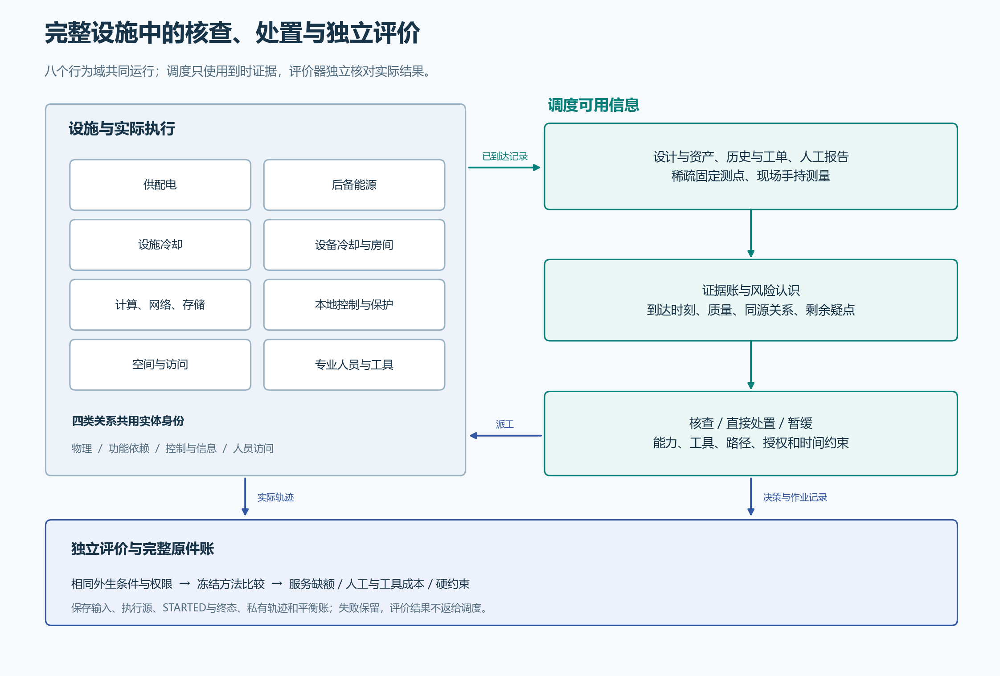

图1。结构说明图。八域实际设施与调度者可用信息分开，人员作为专业执行者进入闭环。

## 1. 设施物理层：供电、排热与算力服务怎样耦合

### 1.1 工程来源、研究设定与现场缺口

主研究对象采用郑州核心节点／曙光8000的工程组织作参照，运行对象是一座命名的合成研究设施。Frontier与El Capitan资料用于比较供电、机械冷却、换热和监控层级。工程资料提供模块及接口约束，具体实例、连接和工作点由版本化场景显式声明。 [S01][S20][S03]

| 证据类别 | 在本研究中的作用 | 展示方式 |
| --- | --- | --- |
| 公开工程来源 | 确定设施层级、系统类别和可查接口 | 三案例来源台账，按原来源区分设计与实际测量 |
| 研究模型与设定 | 把拓扑、容量、动态和作业组织成可运行系统 | V6配置、SI单位、适用范围及模型代码 |
| 已有工程与比较结果 | 检验守恒、执行闭环及方法效果 | 已有轨迹、封存原件、独立对照与数据图 |
| 待补现场资料 | 决定真实场景适用性和参数校准 | 实际工质、馈线/后备覆盖、水力曲线、人员与访问资料 |

### 1.2 八个行为域进入同一座设施

| 域 | 当前模型中的对象和实际规则 | 可能影响 |
| --- | --- | --- |
| 供配电 | 外部电源、主配电、整流、负载分配与容量/损耗 | IT及辅机实际供电与发热 |
| 后备能源/排热 | UPS储能、柴油机燃料与启动、后备排热及切换 | 受保负载连续性、恢复延迟与剩余保障 |
| 设施冷却 | 湖水边界、取水泵、滤网、阀组、板换、内部水与循环泵 | 流量、换热与蓄热 |
| 设备冷却/房间 | 设备固体热容、相变参考工质、房间热量与环境门槛 | 温度演化、保护与作业条件 |
| 计算/网络/存储 | 外生需求、实际执行能力及串联服务瓶颈 | 已交付服务与未服务需求 |
| 当地控制/监测 | 本地采样、控制滞回、保护、稀疏测点与证据入口 | 自动响应与调度可见记录 |
| 空间/访问 | 位置、积水/排水、门禁、访问资格与可达关系 | 人员能否及时到场并安全作业 |
| 人员/工具/作业 | 四类专业人员、专业工具、移动、占用、会合与实际完成 | 可执行检查、干预时刻与付费工时 |

场景含45个共享身份实体、113项参数。行为域表示当前声明规则的覆盖范围。

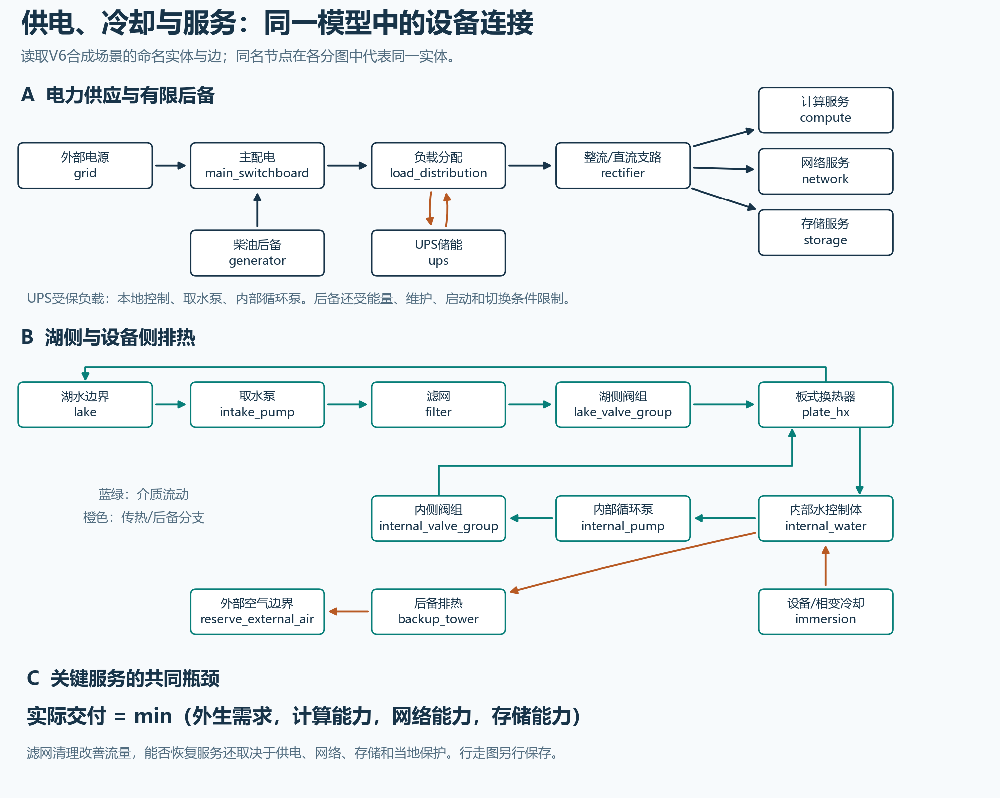

图2。按V6配置中的命名实体与边重新绘制主要连接。全部45个实体与91条关系可从本报告下载；各图中的同名节点为同一实体。

### 1.3 四种关系各自回答不同问题

| 关系 | 当前边数 | 解决的问题 |
| --- | --- | --- |
| 物理 | 43 | 电能、流体与热量从哪里进入和离开 |
| 功能/容量/冗余 | 23 | 哪些能力与共同瓶颈决定关键服务 |
| 控制与信息 | 20 | 谁测量、谁控制、什么记录能到达决策者 |
| 人员访问 | 5 | 人怎样移动，何时具备进入和作业条件 |

四图共用实体ID；人员行走边不会被当作供电或排热连接。

关键服务由共同能力约束。即使冷却流量已经恢复，网络容量仍可能限制服务；两台后备设备若共享受限馈线、泵或控制条件，也不能按台数直接认定为两条独立保障路径。 [S03][S19]

### 1.4 已实现模型的主干方程与量纲

$$
P_{out}=\eta P_{in},\quad P_{loss}=P_{in}-P_{out}
$$

供电和转换损耗分别记账，单位均为W。IT实际发热依据实际执行功率，不能在降载后删除外生需求。

$$
\Delta p=Kq^2,\quad P_{pump}=\Delta p\,q/\eta
$$

准稳态泵/阻力工作点：q为m³/s，Δp为Pa，K为Pa·s²/m⁶。串联阀组、滤阻和可用泵功率会改变流量；完全关闭按联锁分支处理。

$$
\dot Q_{HX}=\varepsilon C_{min}(T_{h,in}-T_{c,in})
$$

板换使用声明的ε/NTU关系。两侧热容率C的单位为W/K；一侧减去的热量进入另一侧，质量不穿壁，停流另走零流动换热分支。

$$
\frac{dU}{dt}=\sum_{in}\dot m h-\sum_{out}\dot m h+\dot Q+P_{diss}
$$

控制体保存质量与内能，固体、内部水、参考工质和房间分别分账。相变性质采用冻结的R134a纯流体平衡参考；实际工程工质仍待确认。

$$
s(t)=\min\{d(t),c_{compute}(t),c_{network}(t),c_{storage}(t)\}
$$

d是外生服务需求，s是实际交付。共同瓶颈用同一条服务时间线累计，避免供电与冷却同时受限时重复计算同一损失。

$$
D_H=\int_t^{t+H} [d(u)-s(u)]/d(u)\,du\quad(d(u)>0)
$$

D为归一化服务缺额时间，单位秒；零需求时该时刻贡献为零。它与未交付的服务单位·秒分开报告。

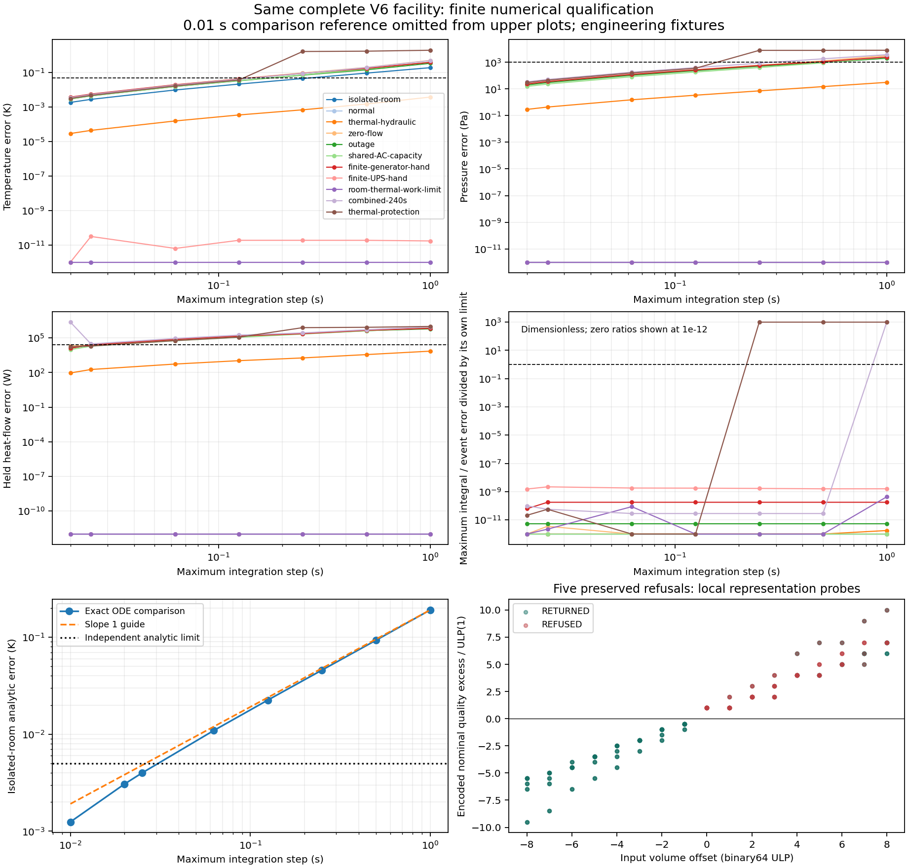

图3。工程验证图。不同见证按各自冻结阶梯解释，用于检查数值实现及平衡，不是巡检收益比较。

### 1.5 参数可查、可调，缺失资料单列

完整配置提供每项参数的数值、SI单位、有效范围、依据类别与来源。下表给出理解模型所需的主要工作点；这些数值是合成设定或参考物性推导，现场标定仍待完成。 [S03]

| 参数 | 数值 | 单位 | 依据 |
| --- | --- | --- | --- |
| 全设施电输入容量 | 10000000 | W | 合成设定 |
| 整流容量 | 5000000 | W | 合成设定 |
| UPS初始储能 | 18000000 | J | 合成设定 |
| UPS输出上限 | 100000 | W | 合成设定 |
| 柴油机输出容量 | 4000000 | W | 合成设定 |
| 柴油机初始燃料能量 | 500000000 | J | 合成设定 |
| 计算请求功率 | 2000000 | W | 合成设定 |
| 名义网络能力 | 1 | 1 | 合成设定 |
| 湖侧名义流量 | 0.1 | m3/s | 合成设定 |
| 内部名义流量 | 0.12 | m3/s | 合成设定 |
| 湖侧聚合阻力 | 12000000 | Pa*s2/m6 | 合成设定 |
| 滤阻倍数 | 1 | 1 | 合成设定 |
| 基础检查时间 | 30 | s | 合成设定 |

完整113项参数、范围、依据见同目录 [model-parameters.csv](model-parameters.csv)。

## 2. 证据与风险层：从已有记录形成待核查问题

### 2.1 问题从哪里来，什么信息当时能用

风险线索可以来自资产与维护记录、人工报告和工单、已有固定测点、现场专业检查及手持仪器。固定传感器现实存在，但覆盖与可用性有限；未覆盖位置保留为未知。调度只接收当时已经到达的记录，后台故障与未来标签留在设施/评估器。 [S01][S02]

| 输入 | 能回答什么 | 必须随记录保存什么 |
| --- | --- | --- |
| 资产、设计与历史 | 存在什么保障路径、维护下线和未关闭缺陷 | 版本、对象、工况及尚未核实的配置 |
| 人工报告与工单 | 有人发现了什么、需要核查哪个问题 | 报告者来源、观察时刻、到达时刻及可信度 |
| 稀疏固定测点 | 指定位置和采样时刻的局部状态 | 覆盖、缺测、采样/到达时间、观测模型 |
| 专业检查与手持测量 | 在实际条件下能否取得指定证据 | 人员/工具、工作区间、采样时刻、结果到达和适用条件 |
| 复制或传递记录 | 原始发现如何被转述 | 共同根源和复制关系，避免重复独立计数 |

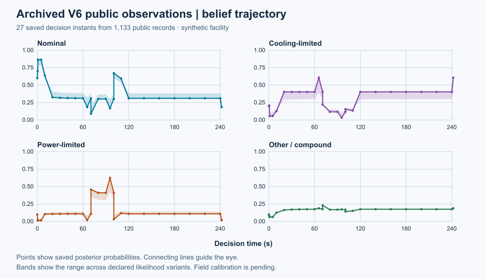

图4。27个保存时点读取既有公开快照。阴影为声明似然变体的范围，复制与同源记录没有被当作多份独立证据。

### 2.2 风险量化需要明确情景、时间窗和后果

FEMA在这里提供危险源、资产、情景、影响、脆弱性和能力复盘的过程参照；设施失效概率、服务损失和检查性能由本研究另行定义。一个问题应写成“诱因—设施状态/屏障—服务后果—可核查证据—可执行处置”，再在明确时窗内计算风险。 [S01][S15]

$$
R_H(\mathcal I_t)=\sum_s p_s(H\mid\mathcal I_t)\,\mathbb E[L\mid s,H,\mathcal I_t]
$$

I是当时可用信息，H是评价时间窗，s是互斥损失情景。概率与条件损失对应同一情景和时窗；服务、人员、工具与费用分别计量。

风险接口的已有有限见证量化了指定热/供电问题，并为其他六类问题保留影响路径、条件后果界、证据缺口和专业转介。尚未识别的概率与点风险保持缺失。设施被完整建模，并不自动意味着全设施故障概率已经完成现场校准。 [S06]

| 示例问题 | 已有依据与待核查点 | 可考虑的行动 |
| --- | --- | --- |
| 冷却保障是否不足 | 滤阻/阀组/泵与可用排热路径；查实际流量和配置 | 专业检查、授权清滤或申请后备冷却 |
| 供电后备是否可用 | 储能、维护、启动与切换记录；查受保负载和实际状态 | 检查、升级、受限工况下的授权处置 |
| IT服务为何仍受限 | 计算/网络/存储共同瓶颈；查服务与网络状态 | 专业IT检查、恢复网络容量或调整执行请求 |
| 能否安全进入作业 | 房间温度、积水、门禁、资格与当时访问证据 | 等待、改派、补证或升级；不以降低分数消除限制 |

问题模板来自当前模型与接口，具体作业权限由实际执行器重新核查。

## 3. 决策与执行层：检查怎样产生实际价值

### 3.1 暂缓、直接处置与检查后行动共同进入比较

风险描述可能损失多少，检查价值描述这次获得的信息能否改变后续可执行行动。比较对象同时包含暂缓、直接处置与检查后条件行动；报告延迟和行动生效之前仍继续承担服务损失。 [S18]

$$
\mathrm{NetVOI}_j=\min_a E[L(a)\mid I]-E_{Y_j}[\min_a E[L(a)\mid I,Y_j]]-K_j
$$

这是同一损失量纲内的检查净价值表达。现有接口分别报告服务、人时、工具时和研究费用的变化，不任意折算相加；每个正支持分支都须满足完整资源承诺。

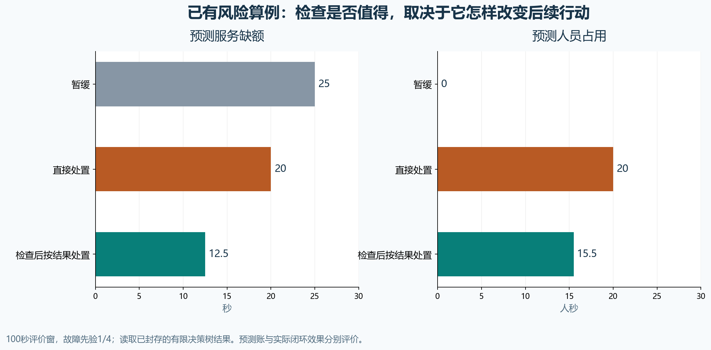

图5。重绘已封存的100秒有限决策树算例，先验1/4。服务缺额与人员占用分轴呈现；它们是该法则下的预测值。

| 故障先验 | 暂缓：缺额 / 人时 | 直接处置：缺额 / 人时 | 检查后按结果行动：缺额 / 人时 | 该法则下缺额最小的选择 |
| --- | --- | --- | --- | --- |
| 0 | 0秒 / 0人秒 | 20秒 / 20人秒 | 2秒 / 12人秒 | 暂缓 |
| 1/4 | 25秒 / 0人秒 | 20秒 / 20人秒 | 12.5秒 / 15.5人秒 | 检查后行动 |
| 9/10 | 90秒 / 0人秒 | 20秒 / 20人秒 | 39.8秒 / 24.6人秒 | 直接处置 |

三个先验均来自既有封存工程结果。有限决策树验证计算与边界，实际设施收益由第4章独立比较评价。

### 3.2 人员、工具与安全决定行动是否可执行

人员是电气、冷却、控制和IT专业的领域执行者。任务需满足目标绑定、专业资格、工具、路径、访问、会合、工作时间及授权；同一人或工具不能在重叠时段重复占用。实际执行到完成时再次核查安全与权限，未完成或被中止的任务不产生成功处置效果。 [S03][S08][S09]

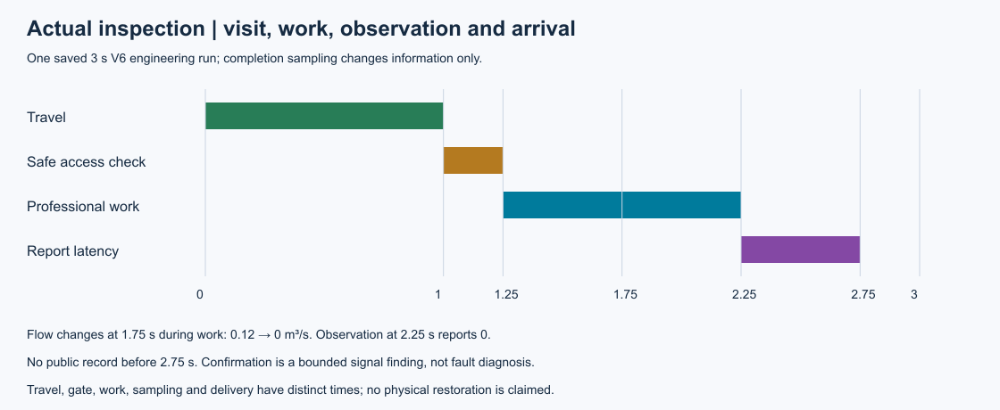

图6。已有工程检查记录。调度者只能在报告到达后使用测量，不能提前取得观察结果。

已有检查见证中，采样发生在实际作业期间；例如2.25秒取得的测量到2.75秒才可被调度使用。已有在线候选见证中，4秒处置完成、4.5秒反馈到达。移动、等待、检查、处置、报告延迟和验证关闭因此各有自己的时刻。 [S08][S19]

| 当前命名处置 | 实际改变什么 | 仍须保留什么 |
| --- | --- | --- |
| 清理滤网 | 指定目标的滤阻倍数 | 残余阻力、工作耗时与后续真实流量 |
| 恢复网络容量 | 指定网络服务能力 | 其他串联瓶颈、资质/授权与实际完成 |
| 调整计算执行请求 | 实际执行功率及发热 | 外生服务需求与未服务需求 |
| 申请后备冷却 | 后备命令 | PLC采样、切换延迟、风机能耗和当地保护 |

执行器只开放命名操作，不接受任意参数写入。

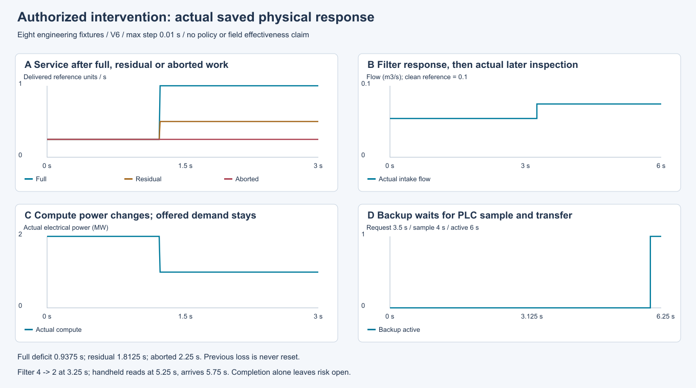

图7。已有命名处置工程数据。滤阻、计算请求、网络容量和后备冷却命令分别受实际完成、授权和当地控制规则约束。

### 3.3 用同场轨迹区分恢复、处置与关闭

同一工程轨迹同时包含负荷变化、后备维护、滤阻变化、失电、本地自动响应、工单、检查、清滤和复查。**服务在4秒恢复，清滤在6秒完成，风险在8.5秒由已到达恢复记录核验关闭。** 服务恢复有自动机制的作用，不能把全部恢复归给巡检策略。 [S07]

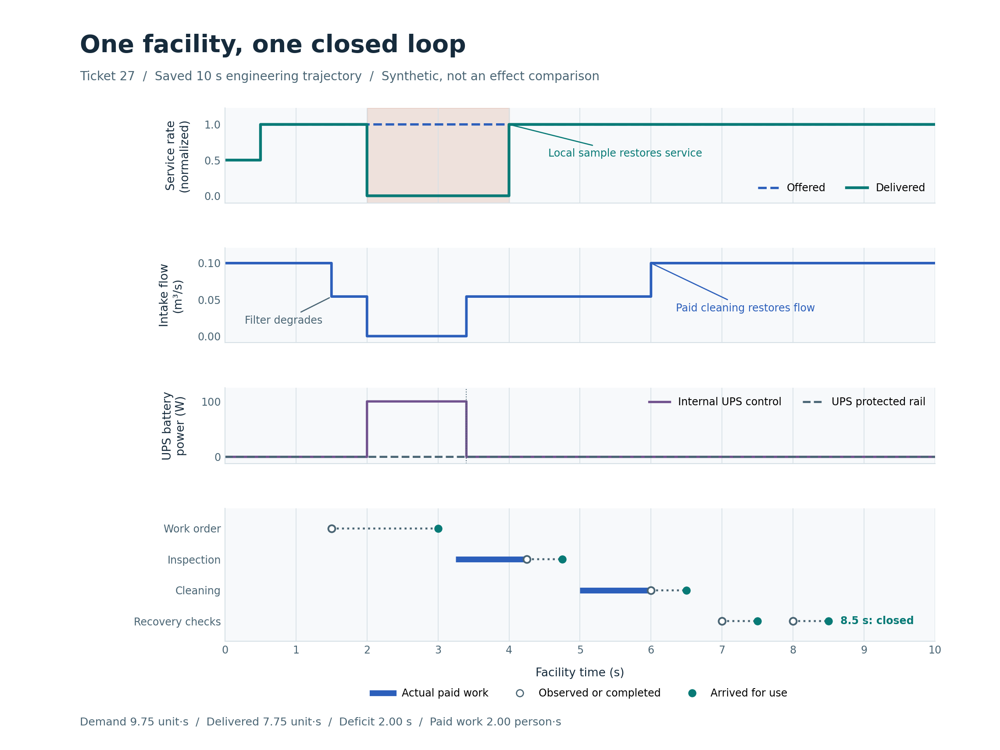

图8。同一10秒工程轨迹：4秒自动恢复服务，6秒人工清滤完成，8.5秒恢复记录到达后关闭风险。

| 从已有10秒工程轨迹复算 | 原运行与重放结果 |
| --- | --- |
| 外生需求积分 | 9.75 服务单位·秒 |
| 实际交付积分 | 7.75 服务单位·秒 |
| 归一化服务缺额 | 2 秒 |
| 检查与处置工作 | 2 人秒 |
| 门禁检查 | 0.5 人秒 |
| 整场能量残差 | 约6.82×10⁻⁶ J |
| 最大质量残差 | 约4.55×10⁻¹³ kg |

这是一项工程闭环见证，独立方法比较的注册样本另行统计。

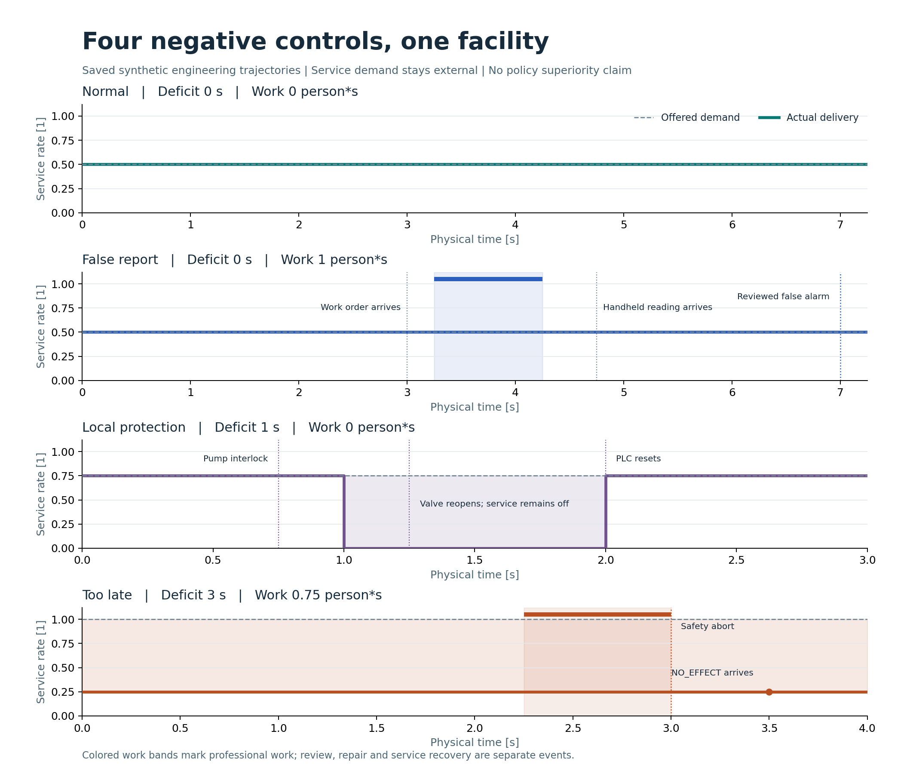

图9。保留无收益及不能挽回的工况，检查工程闭环是否错误制造恢复。它们与注册方法比较分别记账。

正常、误导提示、自动保护已经恢复以及人工来不及救援的完整轨迹也被保留。阴性检查可以更新认识；到访、处置完成、症状消退和证据核验关闭分别记录。 [S10]

## 4. 独立比较层：服务收益、资源代价与机制作用

### 4.1 先固定比较，再读取结果

| 阶段 | 独立工况 | 方法/视图 | 实际运行 | 本报告的用途 |
| --- | --- | --- | --- | --- |
| 开发 | 6 | 6种方法 | 36次 | 检查机制是否产生可区分选择，单列开发结果 |
| 主要独立确认 | 16 | 6种方法 | 96次 | 按冻结主配对、门槛和成本约束评价 |
| 机制消融 | 8 | 4种规划视图 | 32次 | 解释非固定线索、依赖后果和团队选项的作用 |

每次评价窗口10秒，共164次、1640秒模拟时间。独立单位是工况，方法轨迹和逐时状态点不增加独立样本数。

六种方法为仅自动保护、到期检查、FIFO、风险/状态优先改编、一步观察前瞻和证据一致候选。固定主配对为最后两者。不同方法共用初态、外生扰动、观测生成机制和资源权限，后续状态与检查记录允许因实际行动而改变。 [S11]

### 4.2 主确认：平均省下人工，服务改善未达门槛

| 预先规定的判据 | 16个确认工况的结果 | 解释 |
| --- | --- | --- |
| 平均服务缺额至少减少0.25秒 | +0.03515625秒 | 未达到最低收益门槛 |
| 额外付费人时≤0.5人秒 | −0.96875人秒 | 平均节约人工 |
| 额外行走≤0.25人秒 | −0.25人秒 | 未超限 |
| 额外工具占用≤0.5工具秒 | −0.609375工具秒 | 未超限 |
| 至少4个首次不同选择、覆盖2个工况族 | 12个、3族 | 存在可区分的真实选择 |
| 实际硬约束违规为0 | 本批未观察到违规 | 约束合规与方法收益分别评价 |

> **主要确认结论：NO_PRACTICAL_GAIN**：本批平均服务改善未达到注册门槛；人工成本下降是单独成立的有限设计结果。没有用节省工时替换预定的服务收益标准。

图10。原图保留全部正值、反向值与零差异。服务改善按主基线缺额减候选缺额计算；人工差额单独报告。

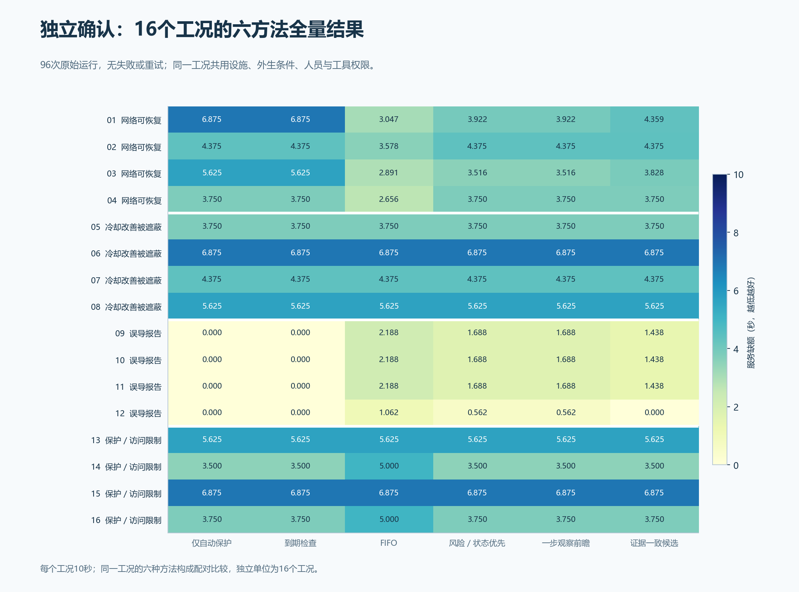

图11。每行是同一封存工况；六种方法共用初态、外生事件、测量生成机制与资源权限。动作不同会改变后续实测记录。

| 方法 | 平均服务缺额（秒） | 平均付费人时（人秒） |
| --- | --- | --- |
| 仅自动保护 | 3.812500 | 0 |
| 到期检查 | 3.812500 | 1.250000 |
| FIFO | 3.932617 | 3.718750 |
| 风险/状态优先改编 | 3.847656 | 2.687500 |
| 一步观察前瞻 | 3.847656 | 2.375000 |
| 证据一致候选 | 3.812500 | 1.406250 |

服务与人员分别展示，数值为16个固定工况的均值。

候选的平均服务缺额与仅自动保护相同，但额外使用1.40625人秒。逐工况并不相同：相对无人工对照，候选在网络族平均少损失1.078125秒，在误导报告族平均多损失1.078125秒，其余两族为零，等权平均因此相抵。 [S11]

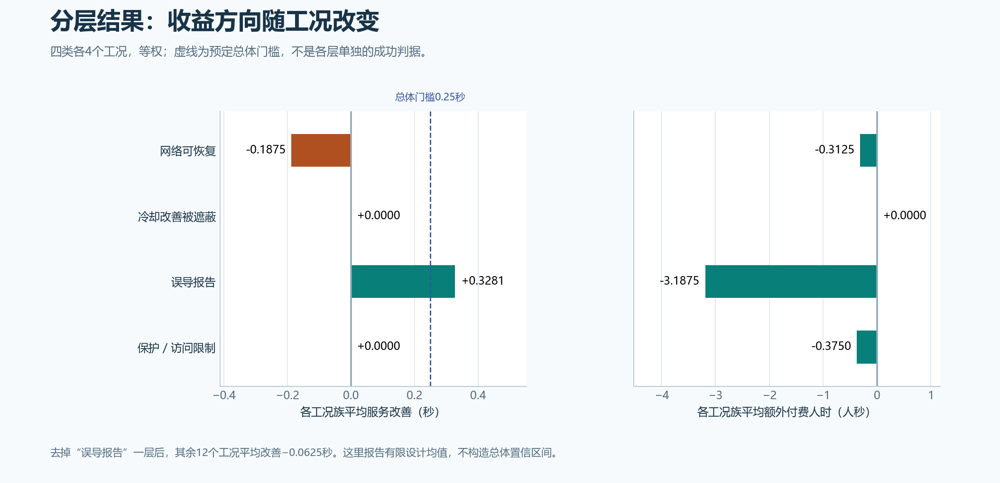

图12。主配对在网络族反向、误导报告族有利，另外两族为零。当前数据不足以支持普遍的平均服务优势。

固定主配对在网络族平均改善−0.1875秒，误导报告族+0.328125秒，其余两族为零。去掉误导报告族后，剩余12个工况平均改善−0.0625秒。全部16个配对返回，缺失值边界收缩到同一个有限均值；该边界不是总体置信区间。 [S11]

### 4.3 消融：哪些因素在当前用法中产生作用

| 被屏蔽的规划因素 | 屏蔽−完整服务缺额（秒） | 完整−屏蔽人工（人秒） | 本批观察 |
| --- | --- | --- | --- |
| 非固定线索 | +0.073242 | −1.37500 | 保留线索平均少损失、少用人工 |
| 依赖后果知识 | −0.014648 | +5.09375 | 当前用法没有平均服务改善，人工更多 |
| 团队任务选择 | −0.014648 | +4.15625 | 当前用法没有平均服务改善，人工更多 |

服务列正值表示保留因素有利；人工列正值表示完整候选付出更多。

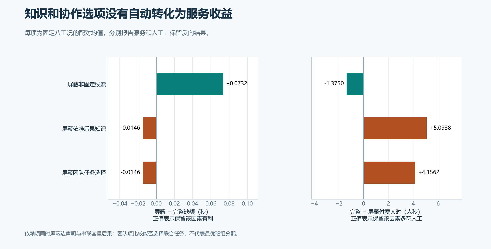

图13。8个固定工况的配对有限均值。服务列为屏蔽臂缺额减完整臂缺额；人工列为完整臂减屏蔽臂。

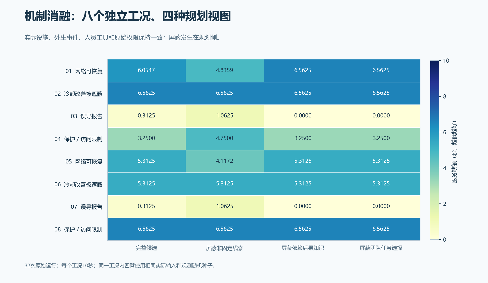

图14。四臂保留相同实际设施与执行规则，只按已注册定义屏蔽规划者获得的因素。

非固定线索消融只从规划账删除人工报告及其复制后代；依赖消融同时屏蔽边声明和串联容量后果，是组合知识因素；团队消融删除多人候选及相应价值绑定，评价团队任务能否被选择。实际设施和执行器能力保持。上述结果约束当前方法的机制解释，并不否定真实工程依赖或专业协作。 [S12]

### 4.4 开发结果单列，结论保持冻结口径

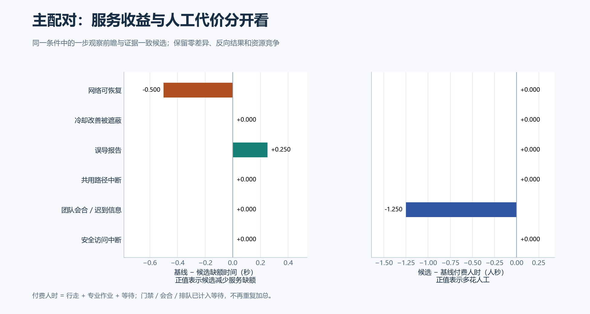

图15。36次开发运行按6个工况解释，平均改善−1/24秒；开发集与独立确认集分开呈现。

开发阶段6个工况的主配对平均改善−1/24秒。开发、确认与消融分别保留，未合并为更大的独立样本；候选没有根据确认结果重新调参。 [S13][S16]

## 5. 研究结论：已经形成什么，哪些主张仍待验证

现有工作的实质成果是：**完整设施的可计算工程对象、时点证据与风险问题接口、异质核查和授权处置闭环，以及对收益和机制的独立检验。** 这些成果把“哪里可能出问题、去查能改变什么、谁能执行、服务实际恢复多少”连到同一套可追溯记录中。 [S02][S07][S11][S12]

| 导师关切 | 现有成果支持的结论 | 当前尚缺的证据 |
| --- | --- | --- |
| 模型应覆盖完整设施 | 八域在同场景中通过电、热、服务与作业条件发生作用 | 竣工拓扑、真实设备曲线和现场工况校准 |
| 风险评估要有科学量化 | 给定时窗、概率对象、联合后果及观测法则时可复算 | 全设施现场故障率、检查性能与处置效果的标定 |
| 巡检要有实际价值 | 闭环能执行；主要确认节约人工，服务改善未达门槛 | 预定参数/结构稳健性和更广适用域验证 |
| 跨系统知识与协作应有解释 | 当前消融显示线索有作用，依赖/团队用法增加人工而无平均改善 | 新的、独立可检验的改进假设及其确认 |
| 智能体和RSI应落到方法上 | 已有透明基线和可测瓶颈；本轮未调用LLM、未训练 | 第38项资格审计及后续独立技术增量比较 |

会前RGB→IR、CVAE-U-Net、PPO及1080回合研究保留在原报告中，属于原固定巡回和观测条件下的证据。它们说明已有感知与学习基础；当前按需核查主线中的智能体/RSI增量仍须独立评价。 [S01][S02]

> **本次交付范围**：按用户本次确认，仅用现有成果完成导师阅读展示，不新增试验。研究执行仍停在第35项；第36—42项、现场校准及智能体/RSI资格与增量工作未完成。

## 附录A. 现有原件、失败记录与复算入口

注册研究共164次：开发36、确认96、消融32，全部返回，注册失败和自动重试均为0。工程调用、准备入口、分析入口、CI及审查中的原失败分别保留。它们与注册设施试验分账；本报告只读取保存结果并重新组织图文。 [S16]

完整参数、实体、关系、主要配对及消融CSV已嵌入HTML，可离线下载。

完整尝试账、输入冻结、实际执行源、失败与修订、图表数据和独立审查随各票原件保存。报告中的数字以冻结条件和执行记录为准，工程验证、独立方法比较和现场标定分别解释。 [S02][S16]

## 附录B. 来源与适用范围

- **S01 会后确认的研究要求**：`docs/meetings/2026-11-03-research-reset.md`，SHA-256 `caa3ff49b317f9545b9cffd4a2035def0f52c4f5ac6280772a643513aea86087`。
- **S02 完整设施研究目标与范围**：`docs/MAINLINE.md`，SHA-256 `45b2932842b96c931dde3d92d16f865a8daea45a78b55a670898caa7c8d1d0f1`。
- **S03 当前V6合成设施配置**：`configs/full-facility-mainline-reserve-v6.json`，SHA-256 `08a591d305412702906e360983342d383c5022e33a96771e78322c0a9fe89085`。
- **S04 风险与检查价值的封存工程结果**：`evidence/mainline/engineering/20-action-value/capture-01/check-results.json`，SHA-256 `36d547485833ffaa838ed550d355fdd1ce83109ed3ea3d8510351c1b38417ce3`。
- **S05 证据认识与有限法则校验**：`evidence/mainline/engineering/18-root-acceptance/README.md`，SHA-256 `5834fea0e209e38b510fe9b87b0f0fbf8455fb38a036b92976f013596599dddc`。
- **S06 风险情景及未识别项**：`evidence/mainline/engineering/19-root-acceptance/README.md`，SHA-256 `9adebf7438c2e7cbb366fe8ae1282400a26ee9ad35d95c79080e0a8fd0c39127`。
- **S07 完整设施闭环原件说明**：`evidence/mainline/engineering/27-root-acceptance/README.md`，SHA-256 `c355b7e9ec586648c3caa2be8d1acd342c8b72ec6ea50c99c59ef6eaa5491b2b`。
- **S08 实际检查时序**：`evidence/mainline/engineering/22-root-acceptance/README.md`，SHA-256 `0155c3485c379fa97970ed7f353d7149913535135bcea257c015821307cf7dbf`。
- **S09 处置作用与执行边界**：`evidence/mainline/engineering/23-root-acceptance/README.md`，SHA-256 `b00ecf38f1d6aafca6168f960d5962efd59f2ba342d0328cf86fec324e50b256`。
- **S10 正常和完整负例**：`evidence/mainline/engineering/28-negative-controls/README.md`，SHA-256 `7e8bba33750c8a5aee6da4e679b25cd87006e924fca8d34130341237a0895c45`。
- **S11 16工况独立确认结果**：`evidence/mainline/research/34-paired-analysis/results.json`，SHA-256 `7bbd16673c7e601bf5ab039eec3668154db8c80707150e656a5375f8b244b128`。
- **S12 8工况机制消融结果**：`evidence/mainline/research/35-ablation/results.json`，SHA-256 `b7aacf8853c15e0370bd7f462dbf45cc73cb2b5cf2f0f7d440da7380ab132968`。
- **S13 开发评价原件**：`evidence/mainline/research/31-development/results.json`，SHA-256 `e4967e07fda72d264d170efca73d269f4bea5f34875328a1993bd7c5c94f2373`。
- **S14 控制体及状态方程依据**：`docs/research/20261104/facility-cases/state-equations.md`，SHA-256 `b34892af57cb7a266a430b842250d0601254c4b90f13cc087c21009d6a773d43`。
- **S15 FEMA过程参照与设施改编**：`docs/research/20261103/fema-risk-framework.md`，SHA-256 `47161c620bf2af2ce4ee539ff45a68816263be6942008844489555dc7cae5d71`。
- **S16 当前进度与注册预算**：`docs/mainline/progress.json`，SHA-256 `3cab406344127c91a704fe85ab42e96adbcc74d3d5ca282aea737757fbac6a91`。
- **S17 物理模型接口和服务损失定义**：`docs/mainline/healthy-run-model.md`，SHA-256 `8f388a2a52df5ca9afb8e083681f2ddd2497e145e660644751295efa6c303066`。
- **S18 信息与处置价值的接口约定**：`docs/mainline/20-action-value-contract.md`，SHA-256 `b4b20c797d55a7f8c592b8930d76506a9e662743c5ab2b100a640e3f100a5231`。
- **S19 实际在线候选工程见证**：`docs/mainline/26-root-acceptance.md`，SHA-256 `166c8177651595ac0cb1e3a3c0b5605cb7528022ae92066ab9f7b9ba781c5b80`。
- **S20 三案例资料与来源边界**：`docs/research/20261104/facility-cases/README.md`，SHA-256 `ef203afdae873fcae1efef32aebd9b247215c7c5e7c8ccb64444073e4fd1204b`。
