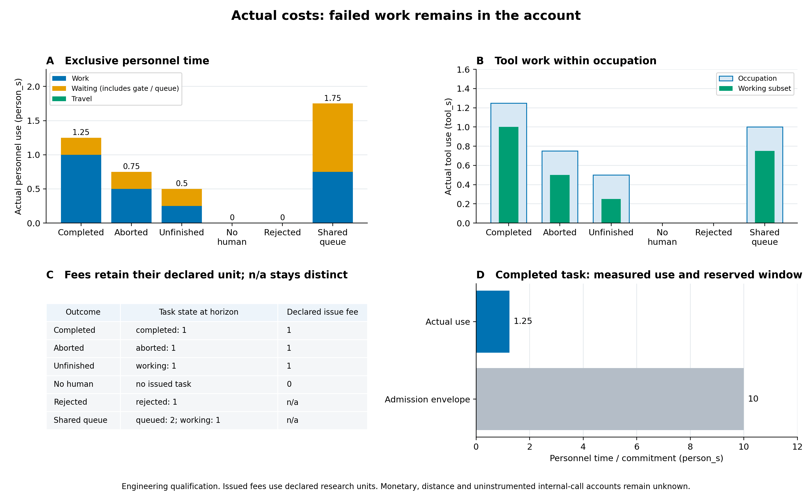

# 39c成本检查点：失败仍计成本，共享等待只算一次

2026年11月10日。继续落实[会后决策](../../docs/meetings/2026-11-03-research-reset.md)的业务价值评价：把人员、工具、等待、发出费用和计算开销接入完整设施运行接口，并按实际任务归属。**本页是有限工程资格，原180次研究和`〔验证关闭未入环；仅2个预设实例；无现场标定〕NO_PRACTICAL_GAIN`不变，39c尚未整体验收。**

## 实际发生了多少占用

|实际工况|作业人秒|等待人秒|人员互斥总量|工具占用秒|发出费用|任务结果|
|---|---:|---:|---:|---:|---:|---|
|正常完成|1|0.25|1.25|1.25|1|completed|
|现场保护中止|0.5|0.25|0.75|0.75|1|0.75秒aborted|
|观察窗内未完成|0.25|0.25|0.5|0.5|1|working|
|无人检查|0|0|0|0|0|没有发出任务|
|不合格人员被拒绝|0|0|0|0|不适用|rejected|
|共享工具队列|0.75|1|1.75|1|不适用|1项working、2项queued|

这些工况的实际移动时间均为0；未来计划走的路径没有计成已经发生的移动。人员总量只加移动＋作业＋等待。门禁、集合和排队是等待子项，不能再加一次；工具工作时间也是工具占用的子项。

费用1的单位是`declared_research_cost`，表示实际发出任务时声明的合成费用，不是工资或实际付款。直接工作程序没有这类费用账时保留“不适用／null”；无人工派工的已知费用0与此不同。米制路程、真实货币、计算能耗和未插桩内部调用继续保持未知。[原始绘图CSV](../../evidence/mainline/engineering/39c-development/figures-09/cost-checkpoint-48/actual-costs.csv)可逐项核对。

## 两个关键行为

**中止没有抹掉已经发生的成本。** 检查在0.25秒开始工作，0.75秒访问许可撤销，现场保护中止任务。前面0.5人秒作业、0.25人秒门禁等待及0.75工具秒占用仍归属该任务，发出费用1也没有退回。任务没有完成，不能把较少的占用解释为方法更优。[实际中止原件](../../evidence/mainline/engineering/39c-development/slice-44/green/result.json)

**同一个人的共享等待没有重复收费。** 工具被占用时，另一名人员先后排队两项工作。0.25至0.5秒的0.25人秒只归第一项；0.5至1秒的0.5人秒保留为两项任务的联合队列成本，计一次，不分别算成两份，也不凭空平均责任。人员总等待1＝门禁0.25＋队列0.75，按任务量＋共享池量与整体积分逐项一致。[五工况资格原件](../../evidence/mainline/engineering/39c-development/slice-45/qualification.json)

正常检查的实际人员用量1.25人秒，与准入账承诺的10人秒也分别保存。后者按完整任务窗作保守资源承诺，不能当作实际花费，二者差额也不是研究收益。

## 证据、计算与失败记录

成本只在设施运行结束后，从完整实际轨迹中的人员任务ID、工具预约者及活动状态积分，不回流派工。任务完成、中止、拒绝、窗口未完成和共享队列都保留。此前的[公开／私有评价架构](../../evidence/mainline/engineering/39c-development/figures-01/public-private-endpoint-architecture.png)继续适用。

已有计算审计分别保存公开选择、条件判定、数学模型和实例关闭评价；墙钟ns与物理秒分开，内部未测次数仍为null。独立审查发现并修复了两项遗漏：实例关闭评价计数现在按实际3次、覆盖3／3保留；无准入账的费用改为“不适用”。原红测2失败／1错误和修正绿测均保存。[原发现及关闭](../../evidence/mainline/engineering/39c-development/reviews-13/correction43.md)

时序剩余资格也已补齐：七项错误声明在积分前被拒绝；已有1.75秒确认、2秒仍未采到服务节点时，已观察lead仍为null，只给以后才出现节点的严格条件下界0.25秒。五项成本声明错误同样在积分前拒绝，不能由调用者自填“实际花费”或把合成来源改成现场实测。

本轮41–46共26次接口进入，12个实际完成窗口／15.25秒／22次返回，其中43红测虽断言失败，其两个实际窗口仍计入。累计39c为**70次进入、35个完成窗口、101.25秒、126次返回**；38次直接公开选择不变，内部嵌套调用未插桩。所有原失败保留，新增注册研究为0。[完整执行账](../../evidence/mainline/engineering/39c-development/cost-execution-ledger.json)

绘图48只读保存结果，PNG已实际查看；两次摘要下载中断后仅补拷同一压缩包并核对SHA，没有重跑完成项。完整输入、活动轨迹和明细仍留私有服务器，本地回传必要摘要、图和校验记录。

## 下一项实际缺口

诊断、时序、实例关闭和成本已经各自接入接口并通过有限资格，**尚未在同一个版本化业务程序中联合运行和完整重放**。下一步按[联合评价衔接记录](../../docs/mainline/39c-combined-endpoints-next.md)完成这条链，再进行39c整项独立复核、零跳过根回归与fresh交付。39d随后核查时间尺度；原39的AI比较及40–42保持前置依赖，总研究目标继续进行中。
