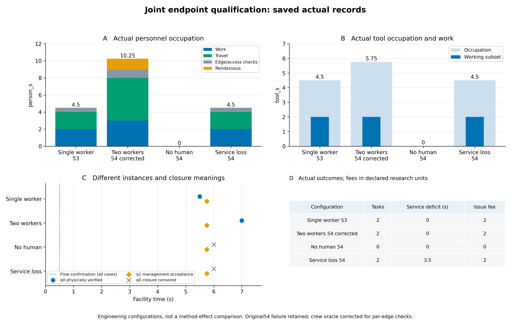
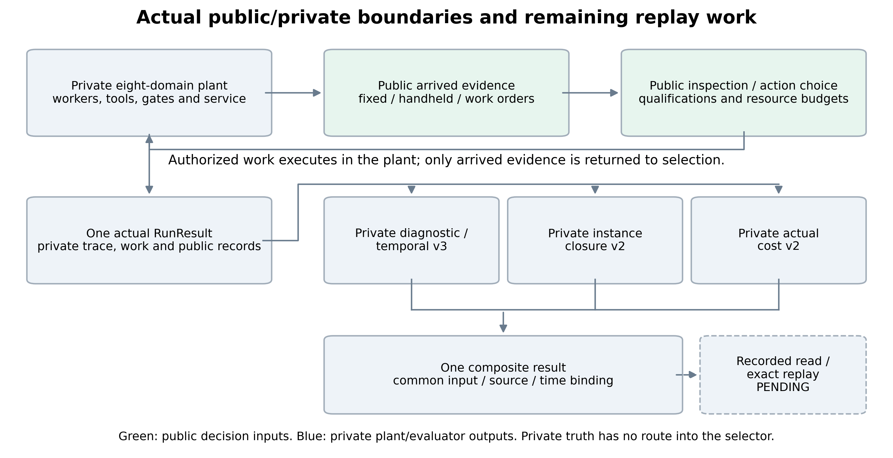

# 联合业务评价：实际数据与架构

> 本阅读版等待用户审查，不继承原文件的交付验收。以下数据与检查点保留原时点；当前研究扩展已暂停，39r风险基线与39t时间基础先交审查，第57项草稿未执行。

[离线HTML，含图表放大](../../docs/mainline/39c-joint-checkpoint-20261110.html) · [原始CSV](../../evidence/mainline/engineering/39c-development/slice-56/joint-actual-data.csv) · [完整联合数据](../../evidence/mainline/engineering/39c-development/slice-53/green/joint/business-result.json)

诊断、实例关闭与实际成本已接在同一次完整八域运行中。真实测点在0.5秒确认异常；单人自身链在5.5秒核验关闭，双人链经过逐边门禁后在7秒核验关闭。新问题在5.75秒的风险接受只关闭管理问题，物理风险不据此关闭。

|工程工况|旧问题物理关闭/秒|新问题管理接受/秒|实际人秒|工具占用秒|服务缺额秒|
|---|---:|---:|---:|---:|---:|
|单人|5.5|5.75|4.5|4.5|0|
|双人，逐边门禁|7|5.75|10.25|5.75|0|
|无人处置|未观察到|5.75|0|0|0|
|服务证据不合格|未观察到|5.75|4.5|4.5|3.5|

无人策略仍留在适用的确认机会分母；服务负例中冷却复检虽合格，服务判据失败，所以旧问题不关闭。费用仍为声明研究成本单位，未测的货币／米制距离／内部调用量保留null。以上是四个工程工作点，不是策略收益比较。

原54资格保持FAILED。双人预期遗漏控制人员第二条边的门禁，原3个窗口及2个已通过子项均保留；55按既有规则核对保存原件，不重跑物理。原测试逐字节归档，活动回归仅修相关预期。53的密度文字另有1000→实际998kg/m³勘误，未改变物理输入。

56只调整架构图连线并生成灰度预览；数据图、CSV和55资格逐字节保持。完整原件、轨迹和守恒文件留在私有服务器，必要数据与图表已回传。开发捕获累计100进入、45窗口164.25秒、207返回；保存验证／绘图／云端回归分别记账，原180研究及〔验证关闭未入环；仅2个预设实例；无现场标定〕NO_PRACTICAL_GAIN不变。

[53原件](../../evidence/mainline/engineering/39c-development/slice-53/README.md) · [54原失败](../../evidence/mainline/engineering/39c-development/slice-54/README.md) · [55保存资格](../../evidence/mainline/engineering/39c-development/slice-55/result.json) · [56原件与灰度](../../evidence/mainline/engineering/39c-development/slice-56/result.json)

下一步是[业务录制、读取与精确重放](../../docs/mainline/39c-combined-endpoints-next.md)，之后整39c独立复核、零跳过根与fresh，再进39d时间尺度／数值范围及AI研究。当前CI检查点另记，不等于整39c接受；AI/RSI效果未测，现场标定PENDING。

[新发布回归](../../docs/mainline/evidence/39c-joint-checkpoint-ci-20261110/README.md)实际650发现／648执行，零失败错误、2既有可选神经跳过，20历史原件核验通过；原54失败保持。
