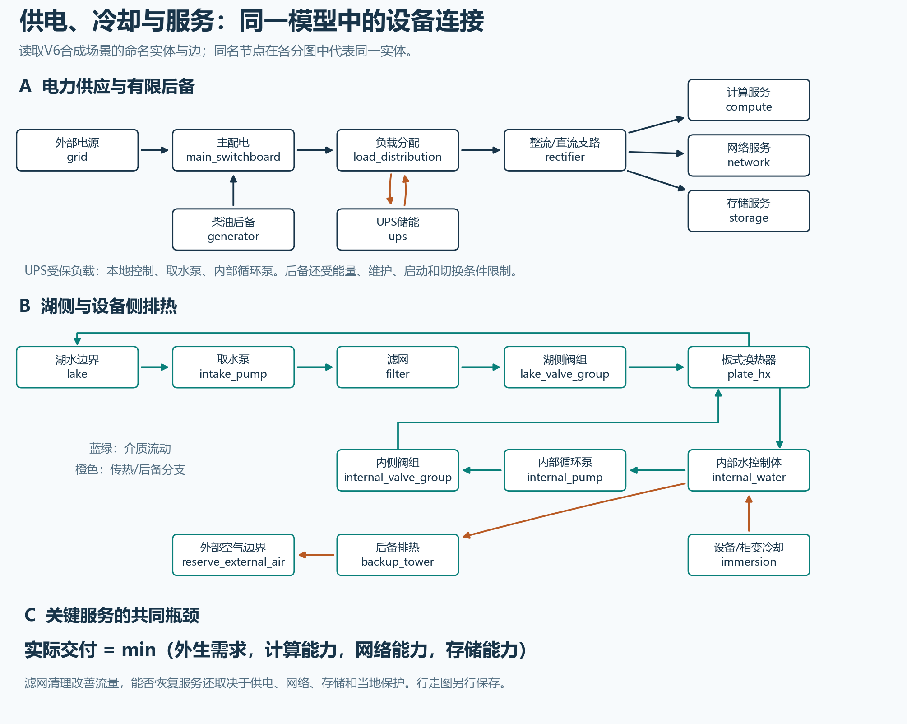
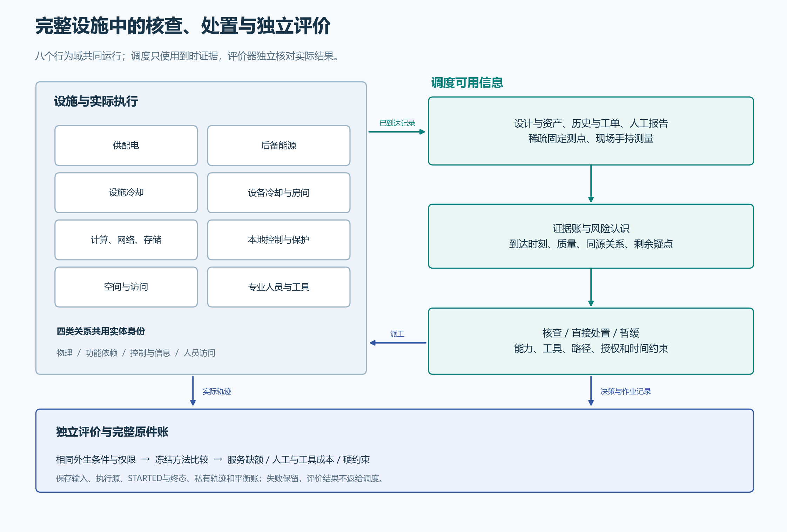
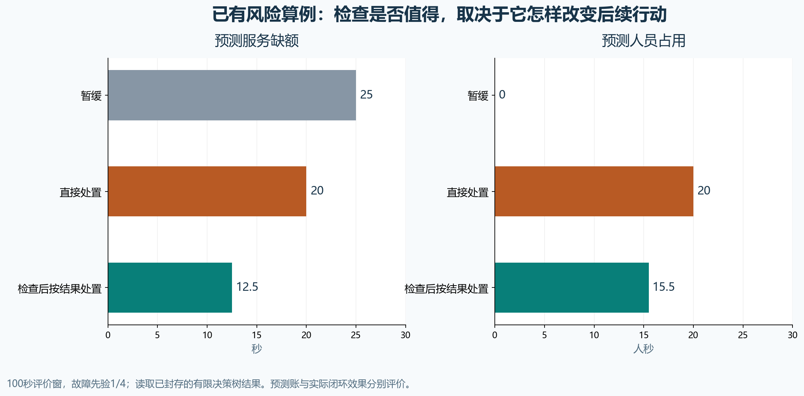
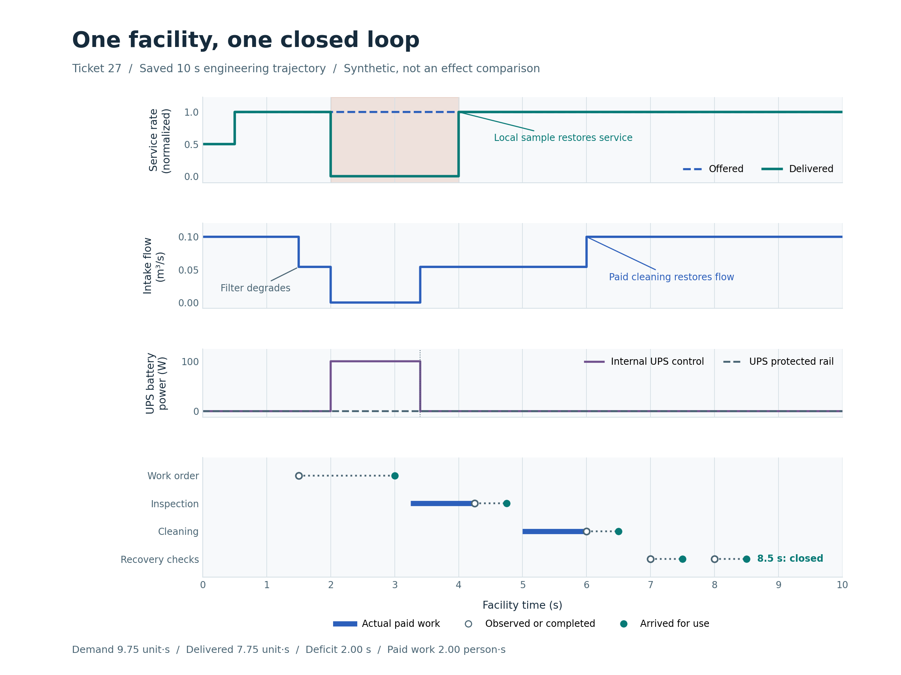
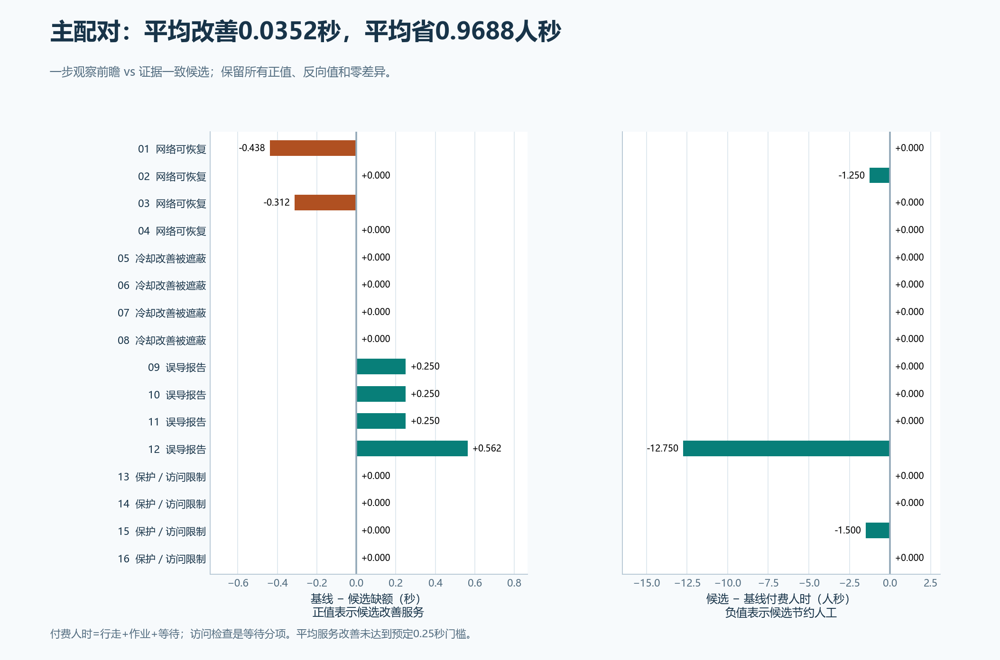
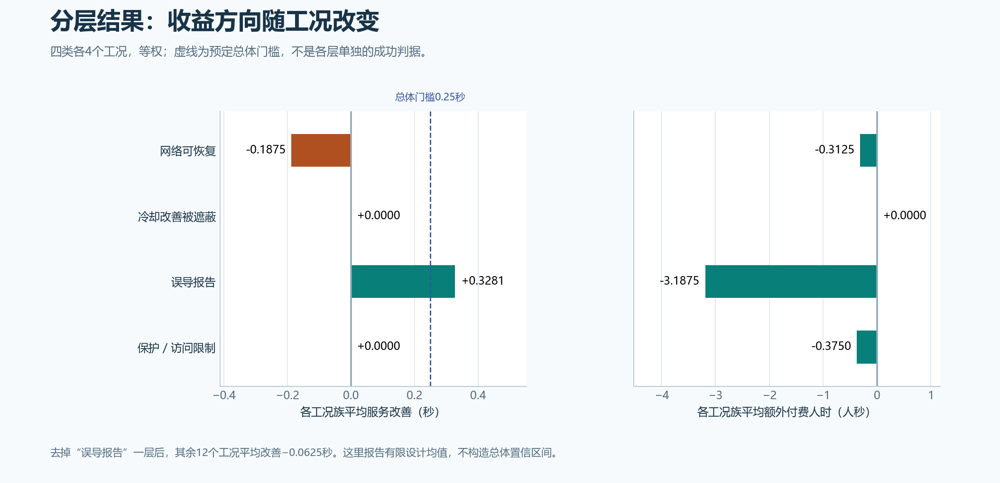
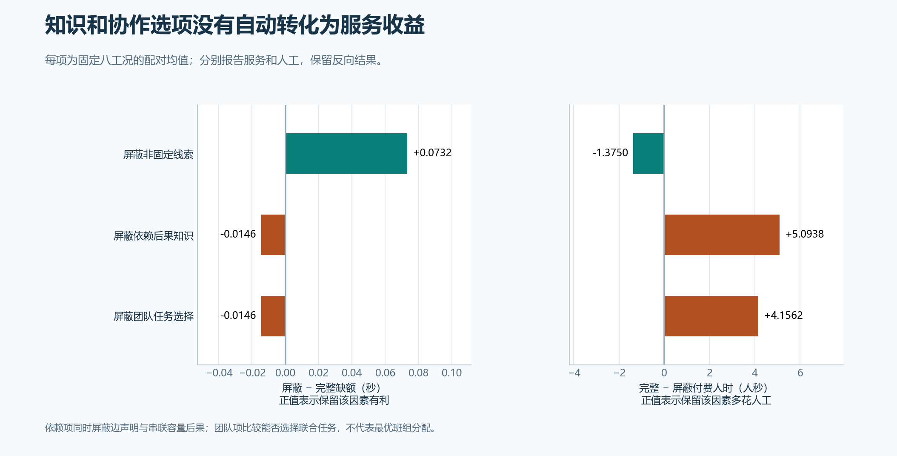
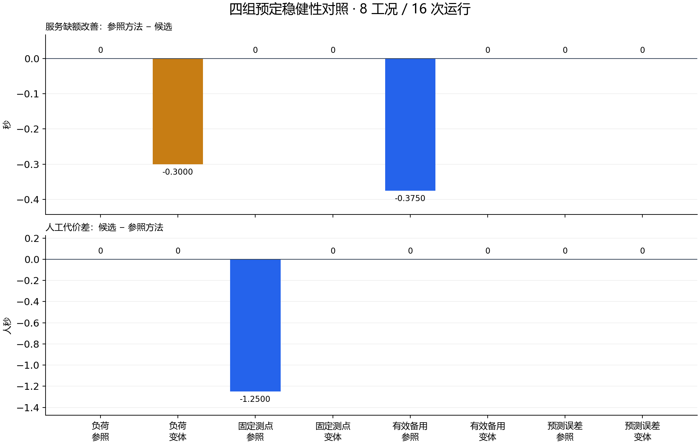

# 固定八域合成设施上的预设派工策略比较（180次）

> 主比较是两个预设策略，另有四个参照臂。验证关闭未入环、候选仅2个预设实例、无现场标定；不回答全场问题触发检查价值或全场风险基线是否成立。原180次运行及数值不改，未闭环收益下界未识别。

2026年11月8日 · 依据11月3日会后决策 · 基线研究与导师讨论版

**研究问题：固定测点稀疏、人员资质和工具有限时，应该去哪查、查后做什么，才能减少关键服务缺额？**

已建立一个八域耦合的合成设施，接通证据、风险、检查、处置和恢复核验。原定180次注册运行全部完成。候选方法在主要确认中的平均服务改善未达到预定门槛，效果随工况和预测模型改变；新增信息或团队选项也没有普遍带来收益。

180次注册运行 · 8个行为域 · 主要确认16个独立工况

## 1. 设施模型：把供电、排热和服务放在一起

研究设施以郑州核心节点／曙光8000的公开工程模块为参照。实际运行的是一套明确标注假设的合成模型；工程来源、模型设定与运行结果分别登记。

|对象|实际模型内容|
|---|---|
|供配电 / 后备能源|容量与功率分配、整流/直流支路、有限储能、发电与切换|
|设施冷却 / 设备冷却与环境|泵、滤阻、阀、换热、水与相变状态、房间/泄漏影响|
|计算网络存储 / 控制监测|外生需求、实际执行功率与发热、共同服务瓶颈、本地保护|
|空间保障 / 异质人员工具|独立访问图、访问与安全限制、资质、移动、占用、等待和协作|
|模型规模|8个行为域、45个实体、113项参数；四图共用身份|

图1　供电、有限后备、湖侧与设备侧排热，以及关键服务共同瓶颈。

同一服务的交付受计算、网络和存储共同限制，重叠失效不重复计算损失。后备能力同时受连接、能量、维护、启动和切换条件约束。MV/LV采用理想聚合接口；变压器细节、支路电压等不在当前模型精度内，现场参数尚未标定。

图2　完整设施与证据限定决策、专业执行和独立评价的关系；后台状态不直接提供给策略。

物理、功能、控制/信息和访问四图共用实体身份。后台真实状态留在设施与评价器中；调度端只能使用当时已到达的记录及声明的静态知识。完整设施是运行对象，本轮策略比较仍采用人工编制的两个任务选项，未验证全场任务自主发现或最佳团队分配。

## 2. 从风险问题到检查任务

先说明资产、失效路径、时间窗与服务后果，再判断检查能否改变后续可执行决策。FEMA提供危险源、资产、情景与影响梳理的过程参照；概率、似然和动作效果由本研究显式设定，尚无现场频率标定。

|信息来源|决策使用规则|
|---|---|
|资产/历史、报障/工单|保留来源、对象、获取时间和质量说明|
|稀疏固定测点、现场手持结果|按观测与到达时刻开放；未覆盖和未到达保持未知|
|复制/相关、过期/冲突记录|共享来源不重复乘证据；历史读数与当前授权分开|

风险按联合情景计算服务后果，避免把同一服务的多条故障原因反复相加。检查价值比较“不查、直接处置、检查后处置”的预期服务缺额，并单列人工和工具代价；未量化的问题保留未知，不填成零。

图3　100秒有限工程价值演算：预测后果与人工代价分开，不属于注册效果样本。

图中是100秒有限价值演算，说明信息只有改变后续行动时才可能减少损失。它使用设定概率和效果，不计入180次方法比较，也不代表现场故障概率或经济收益。

## 3. 实际执行：检查、处置与关闭分别记时

人员按专业资质、位置、工具、班次及访问条件执行任务。移动、等待、测量与处置按仿真时钟占用资源，期间设施继续运行；动作须在实际完成并满足授权后才能改变设施。

图4　实际工程闭环：服务4秒自动恢复、清滤6秒完成、8.5秒验证关闭。

工程闭环例中，服务在4秒自动恢复，清滤在6秒完成，证据到达后于8.5秒验证关闭。这三个时刻分别记账，4秒的自动恢复不归为人工巡检收益。该例证明执行接口可以闭环，方法是否带来收益另由独立比较回答。

## 4. 主要结果：成本有所减少，服务增益未达门槛

主要确认包含16个独立工况、六种方法，共96次运行。预先选定的主要参照是同接口的一步观测前瞻方法，候选增加前瞻报告与到时证据更新的一致解释；其他方法包括无人工、周期检查、FIFO和适配风险优先。

|指标及差值定义|16工况平均值|解释|
|---|---|---|
|服务缺额：参照−候选|0.03515625 秒|未达0.25秒门槛|
|人工：候选−参照|-0.96875 人秒|平均减少；不等同服务增益|
|行走 / 工具：候选−参照|-0.25 人秒 / -0.609375 工具秒|量纲分列，不混成总分|
|实际硬约束违反|0|针对本次已记录规则，不作现场安全保证|

图5　16个独立确认工况的服务差与实际代价；保留所有正、负和零差值。

主结论为 **〔验证关闭未入环；仅2个预设实例；无现场标定〕NO_PRACTICAL_GAIN**。它表示本次有限研究未达到预定实际收益门槛，不是总体显著性检验，也不说明检查在所有场景都无价值。确认中存在真实选择差异，但不同故障族的正反作用抵消；去掉虚假提示族后，平均服务改善为−0.0625秒。

图6　四个故障族的方向不同；单一平均值不能代替失效条件。

## 5. 消融与稳健性：优势没有稳定保持

消融保留实际设施和执行能力，只屏蔽规划者的信息或选项。8个工况、四个规划视图共32次运行；服务和成本分开解释。

|屏蔽项|缺额：屏蔽−完整（秒）|人工：完整−屏蔽（人秒）|
|---|---|---|
|屏蔽非固定线索|+0.073242|-1.37500|
|屏蔽依赖关系/后果|-0.014648|+5.09375|
|屏蔽联合团队选项|-0.014648|+4.15625|

图7　规划者信息/选项消融，实际设施和执行能力保持；服务与代价分列。

非固定线索在本组平均有帮助；依赖后果和联合团队选项也可能增加代价。依赖消融同时屏蔽关系与后果，团队消融测试多人选项是否可用，均不是纯图理论或最优分工的证明。

稳健性沿用原定四组条件，共8个工况、16次运行。每组参照/变体共享观测实现，独立设计单位为4个区组。

|条件变化|服务差：参照条件→变体（秒）|观察|
|---|---|---|
|需求0.75→1.25|0.000 → -0.300|高载候选较差0.30秒；人工相同|
|固定表计启用→停用|0.000 → 0.000|服务相同；1.25人秒节省消失|
|UPS在役→下线|-0.375 → 0.000|两法绝对缺额均增至7.375秒|
|预测容量0.75→1|0.000 → 0.000|两法共同改变选择，实际容量不变|

图8　四个配对区组。服务差=参照−候选，正值较好；人工差=候选−参照，负值表示减少。

8个工况的描述性平均服务改善为−0.084375秒，未替代原16工况主要结果。UPS下线后两法绝对损失都增加，差异消失不表示下线有益。预测更乐观时，两法都转向直接处置；实际处置容量仍为0.75，不能把共同变化算作候选独有收益，也不能据结果反推预测更准确。

## 6. 对会后要求的回答与下一步

|会后要求|本轮回答|状态|
|---|---|---|
|按问题触发|选择检查、处置或暂缓；固定周期只作对照|方向符合|
|稀疏多源信息|已有测点、历史/人工与现场结果统一记时和来源|有限接口已验证|
|完整设施|八域实际耦合；四图和共同瓶颈进入执行|合成范围完成|
|模型先于风险|守恒/容量/数值见证，情景/后果与检查价值演算|未现场标定|
|AI/RSI后置|注册策略没有LLM或训练调用|增量未测|
|业务价值|服务、人力、工具、硬约束分别评价|误报/漏报/预防/正式关闭未测|
|可追溯方法|冻结协议、版本、原件与失败；01–35修正及36新完整守卫|证据边界明确|

当前可交付的成果是：可复算的完整设施模型、证据与专业作业闭环，以及带原件、成本、消融和失效条件的有限比较结论。候选平均服务收益尚未成立，AI/RSI增量尚未试验。

下一步优先补三类资料：真实任务与人员/工具时间；报障真值、可检测机会和复检关闭准则；未参与开发或确认的新数据。取得这些资料后，再设计可独立检验的模型或智能体增量。

## 附录：数据、边界与复算

|阶段|实际运行|仿真秒|用途|
|---|---|---|---|
|开发|36|360|开发诊断；6工况×6方法|
|主要确认|96|960|主要确认；16独立工况×6方法|
|机制消融|32|320|信息/选项消融；8工况×4视图|
|稳健性|16|160|4配对区组×2条件×2方法|

比较采用10秒研究窗，人工任务设为1秒、路径为1/2秒；默认V6基线则为30秒工时、60/120秒路径。这里没有把全部物理时间常数同比缩放，不能将这些秒数换算为现场响应时间。现场参数、概率和作业性能均未标定。

来源绑定的历史阈值读数不等于故障诊断。主要确认中，候选有9条、主要参照有12条此类读数；终点时它们均已过期。正式方法比较的 `closure_program=None`，没有测量证据验证关闭；通用误报/漏报率与提前预防端点仍未定义或未测，不能填成零。

01–35的会后复核修正了历史复核时标与次要指标披露。原失败、错误审查断言、调用计数分类、图形排版修订及未测状态均保留。两件旧工程输入只完成事后Git身份补证，未冒称同期输入守卫。新增36采用完整输入与执行版本冻结；本报告只读取保存结果。

[主要确认原始分析JSON](../mainline-report-20261108/data/primary.json) · [消融原始分析JSON](../mainline-report-20261108/data/ablation.json) · [稳健性分析JSON](../mainline-report-20261108/data/robustness.json) · [稳健性配对CSV](../mainline-report-20261108/data/robustness-paired.csv) · [113项参数CSV](../mainline-report-20261108/data/model-parameters.csv) · [18项指标状态JSON](../mainline-report-20261108/data/metric-coverage.json)

[会后决策](../../docs/meetings/2026-11-03-research-reset.md) · [01–35复核与修正](../../docs/mainline/audits/20261108-pre36/audit-report.md) · [逐项初审矩阵](../../docs/mainline/audits/20261108-pre36/ticket-matrix.md) · [完整参数阅读版（35项时点）](../mentor-review-20261108/report.md) · [主要确认原件](../../evidence/mainline/research/33-confirmation/README.md) · [稳健性原件与复算](../../evidence/mainline/research/36-robustness/README.md)

180次指注册设施运行，工程检查、保存分析、作图及审查另记账。运行中的LLM和训练调用为0；人员是领域执行者。图表及全文内嵌于离线HTML，来源链接在完整仓库中可追溯。
