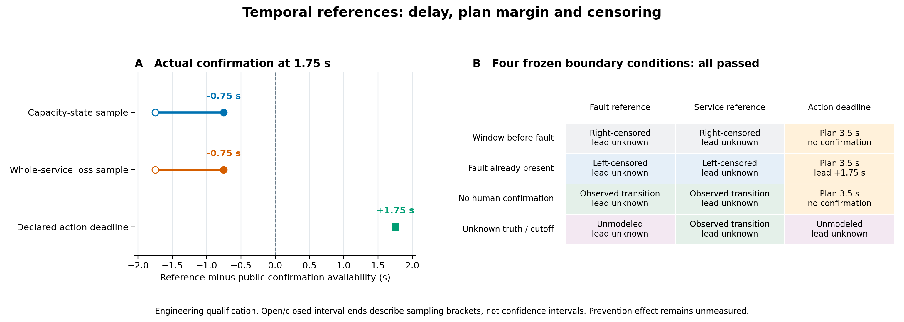

# 39c时序检查点：发现得晚，还是来得及处置？

2026年11月10日。继续按[会后决策](../../docs/meetings/2026-11-03-research-reset.md)补齐业务评价。新增私有时序端点，已通过一个完整设施行为及四个边界工况；**39c整项尚未验收，原180次研究和`〔验证关闭未入环；仅2个预设实例；无现场标定〕NO_PRACTICAL_GAIN`保持。**

## 实际结果

时间差统一为“参照时刻−首次有效确认可用时刻”。正值表示早于该参照，负值表示已经晚于它。确认依据1.25秒的专业测量，在1.75秒才可供决策，计算使用后者。

|独立参照|本例实际记录|相对确认的时间差|可以支持的解释|
|---|---|---:|---|
|容量状态异常|0秒样本正常，1秒样本异常|−0.75秒|到首个异常样本时已经发生；确认比这个样本晚0.75秒。|
|全设施服务缺额|0秒样本完整，1秒样本有缺额|−0.75秒|确认没有赶在本例首次采到的服务损失之前。|
|预先声明的处置截止|计划时刻3.5秒，独立于2秒确认截止|+1.75秒|只表示到计划截止的余量，不证明仍能挽救或已经防止损失。|

前两项的采样定位区间均为(−1.75,−0.75]秒；空心／实心端点表示开闭区间。它限定在声明的采样网格，不能据此排除未采到的短暂事件，亦不是统计置信区间。全场服务节点不自动归因于当前问题。预防效应仍为`NOT_IDENTIFIED_NO_PAIRED_COUNTERFACTUAL`。

## 删失与未知没有填成零

|实际资格工况|物理参照|确认和计划截止|
|---|---|---|
|窗口在故障前结束|0.5秒前的声明样本未出现异常或服务损失，按样本右删失|尚无确认；已声明的3.5秒计划截止仍保留。|
|打开时已异常|两个物理参照均左删失，起点和lead为null|1.75秒确认；窗外已知计划截止仍给出1.75秒余量。|
|无人检查|1秒实际采到异常及服务缺额|没有有效确认，lead为null，保留`NO_PUBLIC_CONFIRMATION`原因。|
|真值和截止未建模|故障参照保持未知；服务节点仍单独可观测|不因公开异常读数补造私有真值，也不把确认截止代替处置截止。|

四个工况在一次冻结资格中完成，4个实际窗口共6.5秒、11次返回决策，零失败／错误／跳过。它们是工程资格条件，不是四个独立效果样本。[逐条件原件](../../evidence/mainline/engineering/39c-development/slice-39/qualification.json)保留完整状态及null。

## 原失败与实际代价

首个37绿测保持FAILED。它实际完成3.5秒、6次返回；低需求0.1使模型报告的可交付能力也是0.1，原预期“初始容量样本1”错误。实现据实际样本给出初始已异常和左删失。原测试、输入、失败日志与完整轨迹均保留。

38另冻输入：需求保持1，删除3秒需求上升，网络仍在1秒从1降至0.25。实现、阈值和时间差定义均未修改，修正资格通过。接受实际负时间差，没有把原失败改成成功。[修订合同](../../docs/mainline/39c-temporal-input-correction-contract-38.md)记录输入解释和边界；“安装容量”和“负荷下可交付能力”的区别继续交39d复核。

|封存执行|设施接口进入|完成窗口|完成时长|返回决策|
|---|---:|---:|---:|---:|
|37红测：旧版本拒绝|1|0|0秒|0|
|37原绿测：断言失败，保留|1|1|3.5秒|6|
|38修正输入资格：通过|1|1|3.5秒|6|
|39四条件资格：通过|4|4|6.5秒|11|
|**新增合计**|**7**|**6**|**13.5秒**|**23**|

39c冻结开发累计为44次接口进入、23个完成窗口、86秒和104次返回决策；38次直接公开选择不变。内部嵌套选择未插桩，LLM及新增注册研究为0。绘图40只读保存结果，不增加设施运行。完整输入、轨迹和明细留在私有服务器，本地保存必要摘要、图和校验记录。[执行账](../../evidence/mainline/engineering/39c-development/temporal-execution-ledger.json)与[数据CSV](../../evidence/mainline/engineering/39c-development/temporal-references.csv)可直接核对。

独立Spec／Standards有限复核通过，原37失败未被排除；[复核记录](../../evidence/mainline/engineering/39c-development/reviews-11/followup.md)按源码与工况范围保存。

## 剩余门槛

有确认时的右删失条件下界、无效时序声明拒绝仍待资格验证。随后完成实际成本和联合版本化重放，再进行39c整项独立复核、零跳过根回归与fresh交付。39d、原39的AI比较及40–42继续保持前置依赖，总研究目标保持进行中。
